# Death Mask: Cambios hechos

En este punto, 10-10-525, para el mod de Minecraft Java (`quantumdeath`) incorporé este principal cambio: la trasnformación de los portales del Nether en el comienzo de un descenso por cinco círculos del Infierno. En esta rama añadí zombies distintos a los vanilla que forman hordas y hay de distintos tipos, así como jefes (temporales, tengo pensado cambiarlos luego), técnicas malditas como en Jujustu Kaisen, percepción de yokai (al estilo de las maldiciones de Jujutsu Kaisen) y pactos con shikigami.

<a href="docs/assets/mobs/hollow_0.png">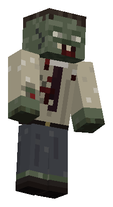</a>
<a href="docs/assets/mobs/swarm_eye_0.png">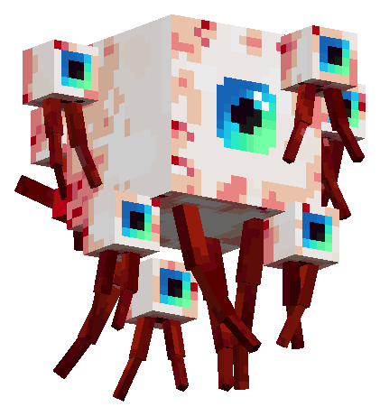</a>
<a href="docs/assets/mobs/toll_keeper_0.png">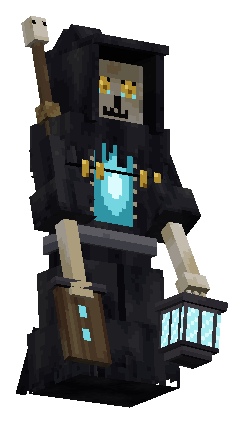</a>
<a href="docs/assets/equipment/leviathan.png">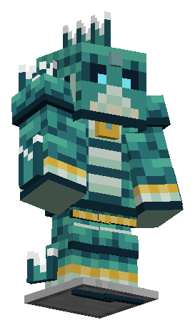</a>

*Zombi errante, Ojo de Enjambre, Guardián del Peaje y conjunto Leviatán. Clic en cada imagen para abrir el PNG completo.*

## Índice

- [Instalación](#instalación)
- [Dimensiones, biomas y estructuras](#dimensiones-biomas-y-estructuras)
- [Progresión, jefes y VIGIL](#progresión-jefes-y-vigil)
- [Limbo, hordas y plaga](#limbo-hordas-y-plaga)
- [Yokai, percepción y compañeros](#yokai-percepción-y-compañeros)
- [Habilidades generales](#habilidades-generales)
- [Técnicas malditas](#técnicas-malditas)
- [Catálogo de mobs y skins](#catálogo-de-mobs-y-skins)
- [Catálogo de objetos y bloques](#catálogo-de-objetos-y-bloques)
- [Recetas](#recetas)
- [Efectos, equipo y recursos](#efectos-equipo-y-recursos)
- [Comandos](#comandos)
- [Compatibilidad y cambios técnicos](#compatibilidad-y-cambios-técnicos)

## Instalación

| Requisito | Versión configurada en esta rama |
|---|---|
| Minecraft Java | 26.3 |
| Java | 25 |
| Fabric Loader | 0.19.5 |
| Fabric API | 0.161.0+26.3 |
| Fabric Loom | 1.17-SNAPSHOT en la configuración de Gradle |
| Gradle Wrapper | 9.5.1 |
| Versión del mod | 1.0.0 |

Compila con `./gradlew build` (Windows: `.\gradlew.bat build`), e instala el JAR de `build/libs/` junto con Fabric API en `mods/` de una instancia de Minecraft compatible. Las versiones provienen de [gradle.properties](gradle.properties), [build.gradle](build.gradle) y del [wrapper](gradle/wrapper/gradle-wrapper.properties).

Hay tres pestañas creativas: la original de Quantumdeath, **Death Mask: Descenso** (bloques, materiales, equipo, doce páginas del diario y poción) y **Bestiario** (huevos generadores, amuleto e hilo ritual). VIGIL no tiene huevo generador; sus apariciones se controlan con comandos y con su director.

## Dimensiones, biomas y estructuras

| Capa / identificador | Ambiente y riesgos | Jefe y acceso |
|---|---|---|
| I · Limbo · `quantumdeath:vestibule` | Cavernas volumétricas, terrazas, pilares y puentes de ceniza. Calor cerca de lava y magma, ceniza profunda y hueso inestable. Conserva fortalezas y bastiones para acceder a varas de blaze y netherita. | Guardián del Peaje: `toll_brazier` + `ferryman_toll`. |
| II · Garganta del Hambre · `quantumdeath:gorge` | Cañones de carne, huertos podridos, bilis y trampas de fauces. Hambre periódica y veneno en el agua. | Matriarca Hartada: `feast_altar` + `gluttons_offering`. |
| III · Pantano Estigio · `quantumdeath:mire` | Agua negra, barro, brea y almas petrificadas. El agua produce lentitud y fatiga sin el conjunto Leviatán. | Fauce Estigia: `drowned_bell` + `stygian_lure`. |
| IV · Ciudad de Hierro de Dite · `quantumdeath:dis` | Mesetas, lava, hierro fundido, tumbas y bosque de suicidas. Contiene el Osario de Dite. | Heresiarca; ruta de puzles del Osario y `confession_lectern` + `heretics_confession`. |
| V · Cenit · `quantumdeath:zenith` | Llanuras pálidas, hielo, estática roja, bloques falsos y susurros. | VIGIL: `last_vigil_altar` + `last_candle`. |

El **Vestíbulo Ceniciento** sigue siendo la zona de llegada del Limbo. No es una sexta dimensión. Las definiciones están en [dimension](src/main/resources/data/quantumdeath/dimension), y el terreno y las estructuras en [worldgen](src/main/resources/data/quantumdeath/worldgen).

Los 16 biomas y las 14 estructuras

| Bioma | ID | Capa | Recurso |
| --- | --- | --- | --- |
| Yermos Cenicientos | `quantumdeath:ashen_wastes` | I | [definición](src/main/resources/data/quantumdeath/worldgen/biome/ashen_wastes.json) |
| Bile shallows | `quantumdeath:bile_shallows` | II | [definición](src/main/resources/data/quantumdeath/worldgen/biome/bile_shallows.json) |
| Broken expanse | `quantumdeath:broken_expanse` | V | [definición](src/main/resources/data/quantumdeath/worldgen/biome/broken_expanse.json) |
| Burning fields | `quantumdeath:burning_fields` | IV | [definición](src/main/resources/data/quantumdeath/worldgen/biome/burning_fields.json) |
| Deltas de Ceniza | `quantumdeath:cinder_deltas` | I | [definición](src/main/resources/data/quantumdeath/worldgen/biome/cinder_deltas.json) |
| Cocytus | `quantumdeath:cocytus` | V | [definición](src/main/resources/data/quantumdeath/worldgen/biome/cocytus.json) |
| Forest of suicides | `quantumdeath:forest_of_suicides` | IV | [definición](src/main/resources/data/quantumdeath/worldgen/biome/forest_of_suicides.json) |
| Gullet canyons | `quantumdeath:gullet_canyons` | II | [definición](src/main/resources/data/quantumdeath/worldgen/biome/gullet_canyons.json) |
| Iron necropolis | `quantumdeath:iron_necropolis` | IV | [definición](src/main/resources/data/quantumdeath/worldgen/biome/iron_necropolis.json) |
| Red static fields | `quantumdeath:red_static_fields` | V | [definición](src/main/resources/data/quantumdeath/worldgen/biome/red_static_fields.json) |
| Jardines del Recuerdo | `quantumdeath:remembrance_gardens` | I | [definición](src/main/resources/data/quantumdeath/worldgen/biome/remembrance_gardens.json) |
| Rotting orchard | `quantumdeath:rotting_orchard` | II | [definición](src/main/resources/data/quantumdeath/worldgen/biome/rotting_orchard.json) |
| Styx shallows | `quantumdeath:styx_shallows` | III | [definición](src/main/resources/data/quantumdeath/worldgen/biome/styx_shallows.json) |
| Sullen depths | `quantumdeath:sullen_depths` | III | [definición](src/main/resources/data/quantumdeath/worldgen/biome/sullen_depths.json) |
| Campos Llorosos | `quantumdeath:weeping_fields` | I | [definición](src/main/resources/data/quantumdeath/worldgen/biome/weeping_fields.json) |
| Wrathful bluffs | `quantumdeath:wrathful_bluffs` | III | [definición](src/main/resources/data/quantumdeath/worldgen/biome/wrathful_bluffs.json) |

| Estructura | Función | Etiqueta de biomas | Recurso |
| --- | --- | --- | --- |
| `quantumdeath:butchers_hall` | Salón del carnicero de la Garganta. | #quantumdeath:in_gorge | [definición](src/main/resources/data/quantumdeath/worldgen/structure/butchers_hall.json) |
| `quantumdeath:dis_watchtower` | Torre de vigilancia de Dite. | #quantumdeath:in_dis | [definición](src/main/resources/data/quantumdeath/worldgen/structure/dis_watchtower.json) |
| `quantumdeath:drowned_choir` | Arena de Fauce Estigia. | #quantumdeath:in_mire | [definición](src/main/resources/data/quantumdeath/worldgen/structure/drowned_choir.json) |
| `quantumdeath:false_house` | Casa falsa del Cenit. | #quantumdeath:in_zenith | [definición](src/main/resources/data/quantumdeath/worldgen/structure/false_house.json) |
| `quantumdeath:feasting_pit` | Arena de la Matriarca. | #quantumdeath:in_gorge | [definición](src/main/resources/data/quantumdeath/worldgen/structure/feasting_pit.json) |
| `quantumdeath:ferry_landing` | Arena del Guardián del Peaje y puerta de descenso. | #quantumdeath:in_vestibule | [definición](src/main/resources/data/quantumdeath/worldgen/structure/ferry_landing.json) |
| `quantumdeath:funeral_village` | Aldea funeraria con tumbas y muertos. | #quantumdeath:limbo_villages | [definición](src/main/resources/data/quantumdeath/worldgen/structure/funeral_village.json) |
| `quantumdeath:last_vigil` | Arena de VIGIL y sus cuatro campanas. | #quantumdeath:in_zenith | [definición](src/main/resources/data/quantumdeath/worldgen/structure/last_vigil.json) |
| `quantumdeath:limbo_ossuary` | Osario del Limbo; distinto del dungeon de Dite. | #quantumdeath:limbo_ossuaries | [definición](src/main/resources/data/quantumdeath/worldgen/structure/limbo_ossuary.json) |
| `quantumdeath:mourner_shrine` | Santuario con linterna votiva. | #quantumdeath:in_shallow_hell | [definición](src/main/resources/data/quantumdeath/worldgen/structure/mourner_shrine.json) |
| `quantumdeath:ossuary` | Dungeon del Heresiarca: campanas, sarcófago, Inquisidor, llave y puerta sellada. | #quantumdeath:in_dis | [definición](src/main/resources/data/quantumdeath/worldgen/structure/ossuary.json) |
| `quantumdeath:pilgrim_camp` | Campamento y suministros de peregrinos. | #quantumdeath:in_vestibule | [definición](src/main/resources/data/quantumdeath/worldgen/structure/pilgrim_camp.json) |
| `quantumdeath:procession_pit` | Foso de procesiones. | #quantumdeath:in_vestibule | [definición](src/main/resources/data/quantumdeath/worldgen/structure/procession_pit.json) |
| `quantumdeath:sunken_chapel` | Capilla hundida del Pantano. | #quantumdeath:in_mire | [definición](src/main/resources/data/quantumdeath/worldgen/structure/sunken_chapel.json) |

## Progresión, jefes y VIGIL

La profundidad desbloqueada se guarda **por jugador**. Participar en el combate o estar dentro de la arena al morir el jefe permite avanzar; los jefes pueden volver a invocarse para que otros jugadores se incorporen. Las Puertas de Descenso comprueban el progreso y permiten acompañar a un jugador que ya puede pasar. Las Puertas de Ascenso suben una capa y los portales construidos en el Infierno llevan al Overworld.

Al llegar por primera vez al Limbo se recibe la Brújula del Peregrino y una página del diario. Usar la brújula en el Infierno busca la arena de la capa actual; fuera de él no fija un destino. El diario tiene doce páginas, con lectura y visitas persistentes; leerlas todas concede +4 de vida máxima una sola vez. La derrota de VIGIL registra que el jugador lo ha liberado.

| Jefe | Combate y recompensa principal |
|---|---|
| Guardián del Peaje | Arena del desembarcadero; barridos de remo, almas, fuego y procesiones de muertos. Su derrota permite descender y rompe el primer sello de la plaga. Botín de la tabla: Remo del Guardián o Linterna del Barquero. |
| Matriarca Hartada | Ataques de fauces, bilis y glotoncillos. Su botín incluye entradas para Cuchilla de las Fauces y Corazón de la Matriarca. |
| Fauce Estigia | Monstruo acuático de la arena de campanas; ataques de agua y arrastre. Arpón Estigio y escamas de Leviatán. |
| Heresiarca | Jefe de Dite con fuego, cadenas y secuencias de ataques. Marca del Hereje. |
| VIGIL, vigilia interminable | Tres fases: máscara, mirada que se corta con pilares y velo que se rompe con las cuatro campanas. Réquiem, Máscara Mortuoria, Corazón del Cenit y disco de la última vigilia. |

VIGIL acecha antes del combate final: sonidos, huellas de ceniza, restos de peregrinos, luces apagadas, avistamientos y persecuciones. Tiene **cinco formas** vinculadas al descenso y no puede dañarse durante el acecho. Una linterna votiva lo mantiene fuera de su santuario, incluso sin consagración. Cortar su línea de visión, agacharse y quedarse quieto ayuda a perderlo; la Campana de Duelo lo destierra y el Espejo del Leteo lo inmoviliza mientras se lo observa. El Gancho de Brasa permite escapar.

Los monstruos del Infierno admiten élites con afijos: **abrasador, veloz, vampírico, protegido y pavoroso**. Aumentan vida, daño y experiencia; añaden fuego, velocidad, curación al golpear, resistencia a ataques indirectos o oscuridad según el afijo. Son variantes de comportamiento y partículas, no skins nuevas. El **Inquisidor Insepulto** es un Hereje especial del sarcófago del Osario, con 180 de vida, mayor escala y ataques propios.

## Limbo, hordas y plaga

Los muertos recorren los estados **reposo → sospecha → reconocimiento → llamada → persecución → búsqueda → dispersión**. Ven en un cono, oyen movimientos y reaccionan al contacto o a quien los hiere. Una señal de ruido o luz es una pista; no concede conocimiento permanente de la posición del jugador. Las alertas comparten la última posición observada.

- Agacharse reduce el ruido, pero no vuelve invisible. Minar, romper o colocar bloques, abrir cofres o barriles y comer producen señales. Una pared reduce el alcance del oído; las luces visibles atraen atención, excepto las votivas.
- Los muertos con ruta pueden perseguir y golpear sin límite de atacantes por víctima. El director limita nuevas apariciones cuando ya hay muchos muertos cerca; no elimina a los presentes para alcanzar un cupo.
- El director organiza grupos, procesiones, flanqueos y rutas compartidas. Las tumbas selladas contienen un muerto y anuncian su apertura. El Osario ambulante transporta un contingente finito, conservado al guardar y cargar.
- El Pregonero llama a los cercanos y puede interrumpirse golpeándolo. El Capataz coordina flancos. Menudos y Reptantes aprovechan huecos de un bloque. El Putrescente deja un cadáver que estalla.
- Osario ambulante, Portador y Quebrantador pueden asediar las defensas de `#quantumdeath:siege_breakable`: puertas de madera, vallas, portones y barricadas funerarias. La preparación muestra grietas y se interrumpe con daño. Requiere `mobGriefing`.
- Los humanoides rompen vidrio, paneles y hojas después de prepararse. El Roedor de brechas abre corredores a través de construcciones marcadas como colocadas por jugadores; respeta terreno natural, contenedores, portales y bloques de progresión. También requiere `mobGriefing`.
- El Parásito posee animales, aldeanos o arañas; conserva al huésped y matarlo libera a la criatura. El Estrangulador usa una lengua que puede romperse con escudo, ataque o una pared. Escupidor y Descostillado lanzan bilis y costillas.
- Las hordas mejoradas: los muertos trepan unos sobre otros, comparten montículos bajo objetivos elevados y pueden desenterrar nuevos muertos en terreno blando. Los desenterrados no vuelven a excavar. El fuego se transmite al tocar otros muertos y acelera a los que arden.
- La ceniza profunda ralentiza y limita el salto; el hueso inestable se agrieta antes de caer. El calor cercano aplica Abrasamiento si no hay protección.

**Consagración.** Aplica Cera Funeraria o Cera Consagrada a una Linterna Votiva. Mientras hay combustible, su luz consagrada impide el paso y los ataques de los muertos, posesiones, lenguas, proyectiles de bilis y costillas, adhesiones y montículos. No destruye a los muertos: los obliga a salir. El agotamiento se anuncia con sonido. La protección contra VIGIL funciona también sin combustible.

**Plaga de los Huecos.** Cruzar al Limbo habilita filtraciones menores en el Overworld; derrotar al Guardián del Peaje habilita las mayores. Un foco avisa con ceniza, huellas, velas y campanas antes de emitir oleadas desde su Ancla de Brecha. Para purgarla, úsala y permanece cerca mirando durante cinco segundos. El foco se suspende cuando no hay jugadores cerca; purgarlo no borra los muertos que ya salieron. Su estado y presupuestos se guardan en el mundo.

Los parámetros de sentidos, movimiento, hordas, asedio, consagración y plaga están en [LimboTuning](src/main/java/ryuna/qdeath/limbo/LimboTuning.java). Las proporciones de velocidad allí son parámetros del código, no mediciones nuevas de esta entrega.

## Yokai, percepción y compañeros

El primer portal de obsidiana formado en el Overworld despierta a los yokai del mundo. El responsable recibe el avance **¿Qué has hecho?**; si lo enciende lava o un dispensador, la atribución espera al primer jugador que cruce. Cruzar un portal de un mundo anterior también puede iniciar el despertar. Suenan señales para los conectados y aparece una nota en el libro.

El periodo inicial de gracia permite señales y encuentros inofensivos. Después actúa un director por grupos de jugadores: elige apariciones fuera de la vista, respeta camas ocupadas y reapariciones recientes y utiliza solo zonas cargadas. Los cuatro mobs originales dejan de depender del spawn natural de biomas del Overworld; dentro del Infierno conservan su peligro y visibilidad.

| Percepción | Qué ve y puede hacer el jugador |
|---|---|
| Sin percepción | Oye sonidos con subtítulos y observa indicios: huellas, luces y obstáculos. |
| Presagio (`perception_i`) | Percibe sombras y partículas; algunos hostiles pueden iniciar una persecución. |
| Vista Maldita (`perception_ii`) | Ve el modelo completo, puede combatir y realizar pactos. |
| Lectura de intención (`perception_iii`) | Añade una señal discreta a los ataques que se están preparando. |

Antes de Vista Maldita, los ataques del jugador, proyectiles, técnicas, explosiones y compañeros no dañan a los yokai. Los casos peligrosos tienen reglas propias: el Apagador sigue luces sostenidas, el Kappa retiene a quien lo provoca en el agua y el Falso Creeper puede estallar mientras deriva. El bestiario registra indicios presenciados, luego sombras y finalmente la identificación con el modelo real.

Hábitat, ataques, respuesta y ritual de los 13 yokai

| Yokai | Hábitat | Comportamiento y respuesta | Pacto |
| --- | --- | --- | --- |
| Falso Creeper | Terreno abierto de noche. Se disipa al amanecer. | Atraviesa paredes y se hincha con un siseo de tres segundos antes de estallar (3 bloques, máximo 6 de daño, menos con la distancia). Sin percepción nunca persigue: estalla donde flota. Nunca rompe bloques ni enciende fuego. Al oír el siseo, aléjate o pon una pared sólida en medio: el estallido no atraviesa paredes. | Sin pacto. |
| Bifauce | Bosques oscuros y bordes de caminos. | Una boca imita sonidos cotidianos; la otra respira al revés. Sin percepción solo engaña y desvía. Vista, abre ambas bocas durante un segundo y medio y embiste en línea recta (5 de daño, cada 4 s). La embestida no corrige: apártate o mantén un obstáculo en medio. | Sin pacto. |
| Apagador | Cuevas. | Imita pasos, minería y bloques colocados. Quien lleve una luz en cualquiera de las manos es su presa, la vea o no: un crujido de dos segundos y luego golpes de 5 de daño cada 2 s. También apaga una antorcha alcanzable cada diez segundos. Guarda la luz: abandona tras cinco segundos, salvo que la hayas atacado. Las luces guardadas en el inventario no cuentan. | Sin pacto. |
| Ojo de Enjambre | Bosques, cavernas amplias y ruinas. | Un ojo flotante que arrastra sus nervios, rodeado por un enjambre de ojos pequeños; nunca se posa y vaga a uno o dos bloques del suelo. Tras observar a alguien tres segundos chilla e indica a los yōkai cercanos dónde estaba (cada uno conserva sus propias reglas). Si lo hieres, te lanza sus ojos pequeños (3 de daño cada 2,5 s, 20 bloques). Rompe su línea de visión antes del chillido. Nunca inicia una pelea. | Sostén su mirada cinco segundos y ofrece un ojo de araña. Vinculado, puede rastrear físicamente a un jugador. |
| Kappa | Ríos y lagos naturales. | Atacarlo, o arrancar vegetación acuática a menos de 6 bloques, lo provoca: burbujas y chapoteos durante tres segundos. Una víctima provocada que entre en su agua queda retenida a menos de 8 bloques de su lugar y recibe mordidas (3 de daño cada 2 s). Nunca arrastra al fondo. Derrótalo o arrójale tres pepinos de mar: cualquiera puede hacerlo, incluso sin verlo. Los pepinos de mar regalados ganan su confianza. | Tres visitas con un pepino de mar, separadas al menos un minuto. |
| Oni | Montañas y ruinas. | Sus pasos pesados delatan su terreno. Alza la maza dos segundos antes del golpe (8 de daño, cada 4 s). No sigue a nadie fuera de su territorio salvo a quien lo haya herido. Sal del alcance de la maza alzada, o de su territorio. | Sin pacto. |
| Cofre tsukumogami | Cofres naturales intactos de estructuras. | Golpes internos y una tapa que se levanta sola. Despierto, lleva su contenido y se aleja dando saltos de quien se acerca. Si lo atacan, muerde (3 de daño, anunciado durante un segundo). Nunca roba ni borra objetos: vuelve a su lugar con todo dentro. Déjalo en paz y vuelve a dormirse en su sitio. | Repáralo con cuatro tablones y ofrece un lingote de hierro. Vinculado, es un cofre ambulante de 27 espacios. |
| Tanuki | Bosques y aldeas. | Toca su panza como tambor y deja señuelos brillantes que se desvanecen al investigarlos. Nunca sustituye ni roba objetos reales. Inofensivo. Investiga los señuelos para ver a través de ellos. | Descubre tres de sus señuelos y ofrece una manzana. Vinculado, distrae a enemigos ordinarios 3 s (nunca a un jefe). |
| Tengu | Montañas y arboledas altas. | El viento y las plumas negras lo anuncian. Solo pelea con quien lo ataca: alza el abanico 1,5 s y lanza una ráfaga (4 de daño y un fuerte empuje). No lo ataques. Si lo haces, sal del arco del abanico. | Recorre en orden y en menos de un minuto la ruta de tres puntos altos que te marca; luego ofrece una pluma. Vinculado, te apoya con ráfagas (no concede vuelo). |
| Kodama | Arboledas naturales. | Un traqueteo de madera y pequeñas luces marcan el refugio que señala al pie de un árbol crecido. Con un brote, el refugio hace que los yōkai hostiles detecten a la gente un 25 % más tarde durante cinco minutos (8 bloques). No termina una persecución ya iniciada. Inofensivo. | No es transportable: pertenece a su bosque. |
| Nurikabe | Senderos y entradas de cuevas. | Un muro que no está: cierra un paso durante un rato sin colocar ni romper bloques, y nunca aparece en el espacio que ocupas. Golpea su base: se aparta durante diez segundos, aunque no puedas verlo. No sufre daño por ello. | Sin pacto. |
| Ittan-momen | Llanuras de noche. | Una tira de algodón que flota. Un roce y un siseo durante dos segundos y luego te envuelve (3 de daño y lentitud 2 s, cada 5 s). Aléjate mientras roza. La nieve lo inmoviliza en el suelo. | Inmovilízalo con una bola de nieve y átale un hilo ritual en cinco segundos. Vinculado, se puede montar: planea, nunca asciende, desciende al menos 0,5 bloques/s y nunca supera 6 bloques/s. |
| Campana tsukumogami | Campanas naturales de aldeas. | Vibra y suena suavemente cerca de presencias, y toca un aviso cuando hay algo hostil a menos de 24 bloques (como máximo cada 10 s). El toque no dice qué ni dónde. La campana original se conserva: vuelve a su lugar, nunca se duplica. Inofensiva. Conviene atender sus avisos. | Atiende tres avisos distintos (acércate en los diez segundos posteriores al toque) y ofrece un lingote de cobre. |

**Shikigami.** Vista Maldita y Pactos permiten sellar los rituales en un Amuleto Shikigami. Usa el amuleto en tu compañero para guardarlo, y en un sitio libre para invocarlo. Requiere cercanía y que no esté combatiendo, montado, reteniendo a alguien o rastreando. Guarda salud, inventario y efectos; un registro del servidor y tokens evitan duplicados. La muerte es permanente; un amuleto copiado queda inválido y destruir uno que contiene al compañero lo pierde. No hay límite de compañeros.

Interactúa con la mano vacía para dar órdenes. Pactos habilita seguir y quedarse; Órdenes añade defender, pasivo y acciones especiales. El Tanuki distrae, el Tengu ofrece ráfagas y el Ojo rastrea físicamente: comunica solo lo observado, busca en la última posición y pierde el rastro si no puede continuarlo. Desconexiones y cambios de dimensión no le dan información nueva. El Ittan-momen sirve de montura planeadora: no asciende libremente. Resonancia muestra los compañeros y avisa cuando su salud es baja.

Balance del servidor: `config/quantumdeath-yokai.json`, creado por [YokaiBalance](src/main/java/ryuna/qdeath/yokai/YokaiBalance.java). Las recetas de amuleto e hilo aparecen más abajo.

## Habilidades generales

Sabiduría del Vacío abre un libro con **Técnicas Malditas**, **Habilidades Generales** y **Bestiario**. Los puntos generales provienen de subir niveles vanilla; son independientes de los puntos de técnica. El servidor verifica costes y requisitos.

| Habilidad | ID estable | Efecto | Coste predeterminado | Requisito |
| --- | --- | --- | --- | --- |
| Vida I | `health_i` | +2 de vida máxima | 1 | — |
| Vida II | `health_ii` | +4 de vida máxima | 1 | `health_i` |
| Vida III | `health_iii` | +6 de vida máxima | 1 | `health_ii` |
| Velocidad I | `speed_i` | +5 % de velocidad de movimiento | 1 | — |
| Velocidad II | `speed_ii` | +10 % de velocidad de movimiento | 1 | `speed_i` |
| Velocidad III | `speed_iii` | +15 % de velocidad de movimiento | 1 | `speed_ii` |
| Fuerza I | `strength_i` | +1 de daño de ataque | 1 | — |
| Fuerza II | `strength_ii` | +2 de daño de ataque | 1 | `strength_i` |
| Fuerza III | `strength_iii` | +3 de daño de ataque | 1 | `strength_ii` |
| Presagio | `perception_i` | Percepción parcial: los yōkai aparecen como sombras y motas oscuras, nunca su forma, nombre ni vida. | 1 | — |
| Visión maldita | `perception_ii` | Percepción completa: ves a los yōkai como son, puedes combatirlos, interactuar y pactar. | 2 | `perception_i` |
| Lectura de intención | `perception_iii` | Una marca roja discreta aparece sobre un yōkai visible mientras prepara un ataque. | 3 | `perception_ii` |
| Pactos | `bond_i` | Habilita los rituales de cada especie que vinculan un yōkai a un amuleto de shikigami. Requiere también Visión maldita. Órdenes básicas: seguir y permanecer. | 1 | `perception_ii` |
| Órdenes | `bond_ii` | Control avanzado: defender, pasivo, acciones especiales y el rastreo del Ojo de Enjambre. | 2 | `bond_i` |
| Resonancia | `bond_iii` | Panel de estado de tus compañeros y aviso cuando uno baja del 25 % de vida. | 3 | `bond_ii` |
| Interpretación | `spirit_i` | El libro explica las señales que ya presenciaste. | 1 | — |
| Ofrendas preparadas | `spirit_ii` | El libro muestra recetas y ofrendas, y con un clic lleva una ofrenda de tu inventario a tu mano. | 2 | `spirit_i` |
| Retirada | `spirit_iii` | +10 % de velocidad durante 4 segundos tras recibir daño de un yōkai (recarga de 20 s). | 3 | `spirit_ii` |

Las ramas son secuenciales. Pactos también exige Vista Maldita. Los modificadores de vida, velocidad y fuerza de cada nodo se acumulan con los anteriores; los costes proceden de la configuración de yokai. El reinicio administrativo de habilidades generales borra sus puntos y desbloqueos, a diferencia del reinicio de técnicas que devuelve TP.

## Técnicas malditas

Elige **Choso, Uraume, Jogo, Naoya o Aoi Todo** desde el libro. Cada clase conserva su propio progreso al cambiar; cambiar sella temporalmente las técnicas. Daño, bajas y acciones de habilidad conceden XP de clase contra oponentes válidos. Por defecto hay un límite de 600 XP por minuto, nivel máximo 30, dos TP por nivel y bonos en los hitos 5, 10, 15 y 20. Los desbloqueos requieren nivel, TP y prerrequisitos.

| Clase | Mecánica principal |
|---|---|
| Choso | Manipulación de sangre: reserva propia, convergencia, disparos y refuerzos corporales. Si falta sangre se paga con salud sin permitir un gasto letal. La anemia debilita. |
| Uraume | Formación de hielo: acumulación de congelación, inmovilización, proyectiles, muros y área. El hielo maldito ocupa aire y se derrite; después de inmovilizar hay resistencia temporal. |
| Jogo | Llamas del desastre: fuego, insectos, volcanes y meteorito máximo con aviso. El cráter requiere `mobGriefing`; la técnica máxima gasta la reserva y tiene recarga larga. |
| Naoya | Hechicería de proyección: trayectorias de 24 fotogramas, cadenas rítmicas, velocidad y congelación. Colisiones, activar fuera de ritmo o giros excesivos pueden congelar al usuario. |
| Aoi Todo | Boogie Woogie: palmadas e intercambios de posiciones, objetos malditos y proyectiles. Comprueba destinos cargados, colisiones, borde y objetivos inmunes antes de intercambiar. |

| Control predeterminado | Acción |
|---|---|
| `R` | Técnica seleccionada; mantener para cargar o canalizar. |
| `V` | Acción secundaria. |
| `Z` / `Alt+Z` | Técnica siguiente / anterior. |
| `J` | Árbol de técnicas; exige el libro hasta elegir una clase. |
| Clic izquierdo / derecho en el árbol | Aprender / seleccionar técnica. |

Son reasignables. El HUD muestra técnicas, recargas, energía, recurso de clase e indicadores; la carga aparece bajo la mira. Clase, desbloqueos, niveles y recargas se guardan con identificadores estables, sobreviven a muerte y reconexión, y al reaparecer las reservas se recuperan parcialmente. Balance: `config/quantumdeath-jjk.json`, creado por [JjkBalance](src/main/java/ryuna/qdeath/jjk/JjkBalance.java).

Choso · habilidades y requisitos

| Habilidad | ID | Función | Nivel | TP | Requisitos | Tipo |
| --- | --- | --- | --- | --- | --- | --- |
| Manipulación de Sangre | `choso:blood_manipulation` | Tu sangre es tu arma: una reserva que se rellena lento con la comida (te da más hambre). Bajo 35% sufres anemia (debilidad); bajo 15% la pérdida de sangre te incapacita. Gastar sangre que no tienes cuesta salud. Uso: extrae sangre de tu propio cuerpo para rellenar la reserva. Inmune al veneno. | 1 | 0 | — | Activa |
| Exorcismo Cortante | `choso:slicing_exorcism` | Lanza una corriente giratoria de sangre que atraviesa a un enemigo y sigue al siguiente. Con sangre comprimida guardada (Convergencia) es mucho más fuerte y perfora más. | 1 | 1 | `choso:blood_manipulation` | Activa |
| Control de Sangre | `choso:blood_control` | Control más fino de cada gota: las técnicas de sangre cuestan 25% menos, la sangre se recupera 40% más rápido y se comprime más rápido. | 1 | 1 | `choso:blood_manipulation` | Pasiva |
| Convergencia | `choso:convergence` | Mantén para comprimir sangre entre tus palmas (cuesta sangre mientras carga). Suelta para guardar la carga unos segundos. La sangre guardada potencia Sangre Perforante, Supernova y un Exorcismo Cortante más fuerte. Secundaria: soltarla. | 5 | 2 | `choso:slicing_exorcism` | Activa · mantener |
| Escama Roja Fluida | `choso:flowing_red_scale` | Alternar: sangre impulsada por tu cuerpo. Más velocidad de movimiento y de ataque, golpes más fuertes, saltos más altos. Consume sangre cada segundo; termina sola cuando se acaba la sangre. | 5 | 2 | `choso:blood_control` | Activa |
| Sangre Perforante | `choso:piercing_blood` | Sangre comprimida al límite, disparada como una línea instantánea: rapidísima, muy larga, estrecha y perforante. Se dispara al instante con Convergencia guardada (mínimo 50%); si no, mantén para comprimir y suelta para disparar. | 10 | 3 | `choso:convergence` | Activa · mantener |
| Supernova | `choso:supernova` | La sangre comprimida forma orbes que te rodean y luego salen disparados en todas direcciones y detonan. Hecha para grupos a corta y media distancia. Cada objetivo recibe como mucho dos orbes. | 15 | 4 | `choso:convergence` | Activa · mantener |
| Escama Roja Fluida: Pila | `choso:flowing_red_scale_stack` | Alternar: el cuerpo llevado mucho más allá de su límite. Mucho más rápido y fuerte, firme y capaz de subir bordes al paso. Consume mucha sangre y, al terminar, el cuerpo colapsa (lentitud, debilidad, fatiga). | 15 | 4 | `choso:flowing_red_scale` | Activa |
| Maestría de Choso | `choso:choso_mastery` | Todo el kit fluye: la compresión es mucho más rápida y dura más, y usarla deja un residuo para que la siguiente técnica salga al instante. Sangre Perforante pide menos carga y perfora más; Supernova crea más orbes que buscan enemigos; la Escama Roja cuesta menos y reduce a la mitad el Exorcismo Cortante; recuperas sangre con cada golpe. | 20 | 6 | `choso:piercing_blood`, `choso:supernova`, `choso:flowing_red_scale_stack` | Pasiva |

Uraume · habilidades y requisitos

| Habilidad | ID | Función | Nivel | TP | Requisitos | Tipo |
| --- | --- | --- | --- | --- | --- | --- |
| Formación de Hielo | `uraume:ice_formation` | El hielo maldito te obedece: nunca te congelas. Uso: un grupo de picos de hielo maldito brota donde apuntas, congelando y levantando a quien esté ahí. El hielo maldito siempre se derrite. | 1 | 0 | — | Activa |
| Proyectil de Hielo | `uraume:ice_projectile` | Un fragmento rápido de hielo maldito: daño y un poco de congelación. | 1 | 1 | `uraume:ice_formation` | Activa |
| Toque Congelante | `uraume:freeze_touch` | Toca a un enemigo a tu alcance: congelación fuerte al instante. Sobre un objetivo en Congelación III lo inmoviliza. | 1 | 1 | `uraume:ice_formation` | Activa |
| Caída de Hielo | `uraume:icefall` | Una masa de hielo maldito se forma sobre la zona (un anillo la marca) y se desploma: daño en área y congelación fuerte. | 5 | 2 | `uraume:ice_projectile` | Activa |
| Muro de Hielo | `uraume:ice_wall` | Alza un muro de hielo maldito a lo ancho de tu vista: bloquea pasos, separa enemigos, da cobertura. Solo ocupa aire y se derrite con el tiempo. Secundaria: estalla tus muros en fragmentos congelantes. | 5 | 2 | `uraume:freeze_touch` | Activa |
| Caída de Hielo Mejorada | `uraume:enhanced_icefall` | La Caída de Hielo crece: área mayor, tres masas en vez de una, mucha más congelación y un anillo de picos de hielo en el impacto. | 10 | 3 | `uraume:icefall` | Pasiva |
| Calma Helada | `uraume:frost_calm` | Mantén: una nube helada brota en un cono amplio frente a ti. Lo que quede atrapado se congela en segundos y puede quedar inmovilizado. El agua se cubre de hielo y el fuego se apaga a su paso. | 15 | 4 | `uraume:ice_wall` | Activa · mantener |
| Maestría del Hielo | `uraume:ice_mastery` | Control a escala de campo: 30% más congelación de todo, el hielo maldito dura mucho más, muros mayores, Caída de Hielo más rápida y Calma Helada más amplia y larga. Los fragmentos se dividen en objetivos congelados; los inmovilizados estallan bajo la Caída de Hielo; la inmovilización dura más. | 20 | 6 | `uraume:enhanced_icefall`, `uraume:frost_calm` | Pasiva |

Jogo · habilidades y requisitos

| Habilidad | ID | Función | Nivel | TP | Requisitos | Tipo |
| --- | --- | --- | --- | --- | --- | --- |
| Llamas del Desastre | `jogo:disaster_flames` | Eres una maldición de fuego: inmune a las llamas y a quemarte. Uso (mantener): vierte un cono corto de fuego maldito desde tu palma. | 1 | 0 | — | Activa · mantener |
| Explosión de Fuego | `jogo:fire_blast` | Un proyectil rápido y fiable de fuego maldito que incendia al objetivo y salpica alrededor. | 1 | 1 | `jogo:disaster_flames` | Activa |
| Mini Volcán | `jogo:mini_volcano` | Alza un pequeño volcán maldito que lanza magma a los enemigos cercanos y quema a quien esté al pie. Temporal; puede ser destruido. Solo uno a la vez. | 1 | 1 | `jogo:disaster_flames` | Activa |
| Estallido de Fuego | `jogo:fire_burst` | El aire en el punto apuntado detona: gran daño en área, retroceso y fuego. | 5 | 2 | `jogo:fire_blast` | Activa |
| Insectos de Brasa | `jogo:ember_insects` | Libera insectos malditos de brasa. Zumban a tu alrededor, cazan al enemigo de tu mira (o al más cercano) y explotan al contacto. | 10 | 3 | `jogo:fire_blast` | Activa |
| Control Volcánico | `jogo:volcano_control` | Hasta tres volcanes a la vez, con más alcance. Disparan a lo que apuntas (o a lo último que golpeaste). Secundaria (con una técnica volcánica): cada volcán dispara una salva a tu mira. | 5 | 2 | `jogo:mini_volcano` | Pasiva |
| Erupción Volcánica | `jogo:volcanic_eruption` | Apunta a uno de tus volcanes para que haga erupción (una columna de fuego, una lluvia de magma, y se agota). Apunta al suelo para que el propio suelo haga erupción tras un aviso. | 10 | 3 | `jogo:volcano_control` | Activa |
| Máximo: Meteoro | `jogo:maximum_meteor` | Una Técnica Máxima. Requiere al menos 90% de energía maldita y la gasta toda. Todos cerca reciben el aviso, un anillo marca el suelo y un meteoro ardiente cae sobre la zona: un impacto enorme de fuego y una onda expansiva. Rompe el suelo solo con mobGriefing activo. | 18 | máxima: 5 (configurable) | `jogo:fire_burst`, `jogo:ember_insects`, `jogo:volcanic_eruption` | Activa |
| Maestría de Jogo | `jogo:jogo_mastery` | El fuego y la tierra se responden: tu fuego cerca de uno de tus volcanes lo hace disparar al instante; los volcanes sueltan insectos de brasa solos y duran más. Los volcanes se alzan el doble de seguido, el Estallido cuesta menos y los insectos vuelan más rápido y salen más. | 20 | 6 | `jogo:maximum_meteor` | Pasiva |

Naoya · habilidades y requisitos

| Habilidad | ID | Función | Nivel | TP | Requisitos | Tipo |
| --- | --- | --- | --- | --- | --- | --- |
| Hechicería de Proyección | `naoya:projection_sorcery` | Uso: planea 24 fotogramas de movimiento hacia donde miras y síguelos (marcas blancas muestran el plan; rojo indica que chocaría). La regla de 24 FPS: chocar con el terreno o volver a pulsar antes de que acaben los fotogramas te congela un segundo. | 1 | 0 | — | Activa |
| Movimiento a 24 FPS | `naoya:fps_movement` | Vuelve a pulsar dentro de la breve ventana de ritmo tras una proyección para encadenar la siguiente (las pulsaciones en sus últimos fotogramas se guardan). Un giro encadenado más cerrado que el ángulo permitido rompe la regla. Secundaria: detenerse limpio. | 1 | 1 | `naoya:projection_sorcery` | Pasiva |
| Aumento de Velocidad | `naoya:speed_increase` | Cada proyección recorre 35% más distancia y más rápido. | 5 | 2 | `naoya:fps_movement` | Pasiva |
| Toque de Fotograma | `naoya:frame_touch` | Tus golpes imponen la regla de 24 FPS al objetivo durante 24 fotogramas: debe mantener su movimiento (o quedarse quieto). Los marcados reciben más daño tuyo. | 5 | 2 | `naoya:fps_movement` | Pasiva |
| Ataque de Impulso | `naoya:momentum_attack` | Los golpes cuerpo a cuerpo mientras proyectas o te mueves rápido hacen más daño según tu impulso y tu velocidad real, y empujan al objetivo en tu línea. Quieto no ganas nada. | 10 | 3 | `naoya:speed_increase` | Pasiva |
| Acumulación de Velocidad | `naoya:speed_stacking` | Cada proyección encadenada sube el impulso: x1.25, x1.5, x2, x2.5. Los choques o romper la regla lo reinician; perder el ritmo termina la secuencia. | 10 | 3 | `naoya:speed_increase` | Pasiva |
| Congelación de Fotograma | `naoya:frame_freeze` | Un objetivo que rompe la regla impuesta (gira, acelera, frena, salta) queda congelado en un fotograma un momento. Tu siguiente golpe rompe el fotograma con gran daño. | 10 | 3 | `naoya:frame_touch` | Pasiva |
| Congelación Extendida | `naoya:extended_freeze` | Ventana de evaluación más larga y congelaciones más largas. Los rendimientos decrecientes siguen: una segunda congelación seguida dura la mitad y el congelado es inmune un rato a nuevos fotogramas. | 15 | 4 | `naoya:frame_freeze` | Pasiva |
| Movimiento Mach | `naoya:mach_movement` | Tras cuatro proyecciones encadenadas entras en Mach: el impulso sube a x3 y x3.5 y cada proyección suelta un estampido sónico. La regla de giro es más estricta en Mach. | 18 | máxima: 5 (configurable) | `naoya:momentum_attack`, `naoya:speed_stacking`, `naoya:extended_freeze` | Pasiva |
| Maestría de Naoya | `naoya:naoya_mastery` | Control a velocidad extrema: giros más amplios permitidos, ventana de ritmo y búfer más largos, los planes suben bordes más altos, perder el ritmo solo resta un nivel, las proyecciones cuestan menos. Los golpes durante o justo tras una proyección aplican Toque de Fotograma gratis. | 20 | 6 | `naoya:mach_movement` | Pasiva |

Todo · habilidades y requisitos

| Habilidad | ID | Función | Nivel | TP | Requisitos | Tipo |
| --- | --- | --- | --- | --- | --- | --- |
| Boogie Woogie | `todo:boogie_woogie` | Una palmada intercambia la posición de dos objetivos con energía maldita. Las criaturas intercambiadas pierden el equilibrio un momento y tus golpes justo después de un intercambio son más fuertes. Los jefes no se pueden mover. | 1 | 0 | — | Pasiva |
| Intercambio Propio | `todo:self_swap` | Palmada: intercambia tu lugar con el objetivo de tu mira (asistencia de puntería generosa, requiere línea de visión). Nunca deja a nadie dentro de bloques. | 1 | 0 | `todo:boogie_woogie` | Activa |
| Intercambio de Entidades | `todo:entity_swap` | Agacharse + usar: marca un primer objetivo. Luego da una palmada a un segundo objetivo para intercambiarlos entre sí, sin que tú te muevas. | 1 | 1 | `todo:self_swap` | Activa |
| Intercambio de Objetos Malditos | `todo:cursed_object_swap` | Los objetos con energía maldita se vuelven objetivos: reliquias del Vacío y del Infierno tiradas, y los cuerpos conjurados por técnicas (volcanes, hielo). | 5 | 2 | `todo:self_swap` | Pasiva |
| Doble Intercambio | `todo:double_swap` | Tras un intercambio, el siguiente dentro de una ventana corta ignora el enfriamiento. | 5 | 2 | `todo:entity_swap` | Pasiva |
| Intercambio de Proyectiles | `todo:projectile_swap` | Los proyectiles en vuelo se vuelven objetivos: pon a un enemigo donde está una flecha o métete en la trayectoria de tu propio lanzamiento. Mantienen su velocidad y dueño. | 10 | 3 | `todo:cursed_object_swap` | Pasiva |
| Palmada Falsa | `todo:fake_clap` | Palmada sin intercambio. Sonido y gesto idénticos a los reales, hasta que nada se mueve. También en la tecla secundaria con cualquier técnica de Boogie Woogie. | 10 | 3 | `todo:double_swap`, `todo:projectile_swap` | Activa |
| Intercambios Rápidos | `todo:rapid_swaps` | El retraso entre palmada e intercambio se reduce a la mitad y el enfriamiento baja mucho; la ventana del doble intercambio crece. Siempre hay un límite de intercambios por cada dos segundos. | 15 | 4 | `todo:fake_clap` | Pasiva |
| Maestría de Todo | `todo:todo_mastery` | Boogie Woogie sin límites: más alcance y asistencia de puntería más amplia, intercambio casi instantáneo, un intercambio gratis extra tras cada uno. Con una marca puesta, cualquier palmada intercambia la marca (sin cambiar de técnica); agacharse + usar marca desde cualquiera. | 20 | 6 | `todo:rapid_swaps` | Pasiva |

Expansiones de dominio, Técnica Maldita Inversa, Destello Negro y barreras no están implementados en esta etapa. La API interna utiliza `TechniqueClass`, `SkillDef`, `Ability` y `ClassHooks`; el registro de clases alimenta pantalla, HUD, comandos y sincronización.

## Catálogo de mobs y skins

Cada imagen enlaza a su PNG de documentación. Los enlaces **textura** abren los atlas originales; los renders usan los modelos reales, no un cuerpo genérico. Los números de variante coinciden con los índices de las skins en el código. Los huevos generadores permiten obtener las criaturas en creativo, salvo VIGIL.

### Muertos del Limbo

| Render | Nombre / ID | Dónde | Función | Vistas / fuente |
| --- | --- | --- | --- | --- |
| <a href="docs/assets/mobs/bile_spitter_0.png">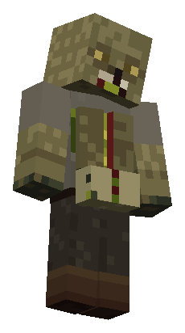</a> | Escupidor `quantumdeath:bile_spitter` | Limbo y plaga | Lanza bilis en arco que ralentiza y deja un charco. | 3 · [textura](src/main/resources/assets/quantumdeath/textures/entity/limbo/bile_spitter_0.png) |
| <a href="docs/assets/mobs/bloater_0.png">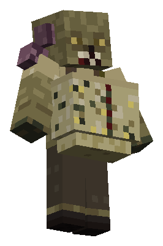</a> | Putrescente `quantumdeath:bloater` | Limbo y plaga | Se hincha y deja un cadáver explosivo; golpear el cadáver adelanta la explosión. | 3 · [textura](src/main/resources/assets/quantumdeath/textures/entity/limbo/bloater_0.png) |
| <a href="docs/assets/mobs/breach_ticker_0.png">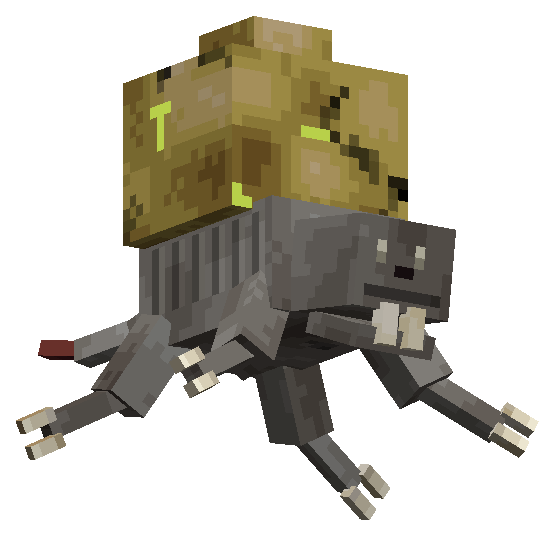</a> | Roedor de brechas `quantumdeath:breach_ticker` | Limbo y plaga | Abre brechas en construcciones de jugadores o se adhiere a su presa; un golpe lo desprende. | 1 · [textura](src/main/resources/assets/quantumdeath/textures/entity/breach_ticker.png) |
| <a href="docs/assets/mobs/breaker_0.png">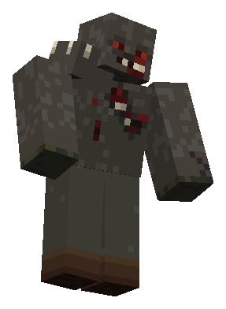</a> | Quebrantador `quantumdeath:breaker` | Limbo y plaga | Golpe pesado que rompe escudos y asedio de defensas. | 3 · [textura](src/main/resources/assets/quantumdeath/textures/entity/limbo/breaker_0.png) |
| <a href="docs/assets/mobs/crawler_0.png">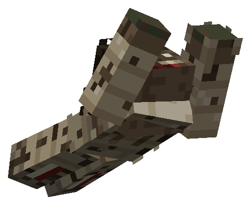</a> | Reptante `quantumdeath:crawler` | Limbo y plaga | Se desplaza bajo y aprovecha accesos de un bloque. | 3 · [textura](src/main/resources/assets/quantumdeath/textures/entity/limbo/crawler_0.png) |
| <a href="docs/assets/mobs/crier_0.png">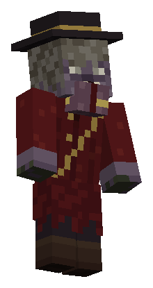</a> | Pregonero del último aliento `quantumdeath:crier` | Limbo y plaga | Su tumor de garganta se hincha antes de llamar a los muertos; un golpe interrumpe la llamada. | 3 · [textura](src/main/resources/assets/quantumdeath/textures/entity/limbo/crier_0.png) |
| <a href="docs/assets/mobs/foreman_0.png">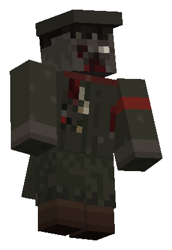</a> | Capataz del duelo `quantumdeath:foreman` | Limbo y plaga | Coordina rutas y flancos; matar al capataz deshace sus órdenes. | 3 · [textura](src/main/resources/assets/quantumdeath/textures/entity/limbo/foreman_0.png) |
|  | Zombi errante `quantumdeath:hollow` | Limbo y plaga | Muerto común de las hordas; persigue sin detener su golpe; 17 skins. | 17 · [textura](src/main/resources/assets/quantumdeath/textures/entity/limbo/hollow_0.png) |
| <a href="docs/assets/mobs/lanky_0.png">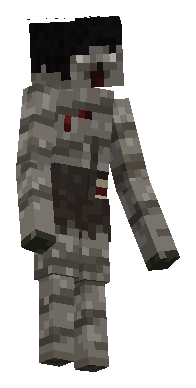</a> | Larguirucho `quantumdeath:lanky` | Limbo y plaga | Brazo largo para golpear sobre la primera fila, respetando paredes. | 3 · [textura](src/main/resources/assets/quantumdeath/textures/entity/limbo/lanky_0.png) |
| <a href="docs/assets/mobs/mourning_hound_0.png">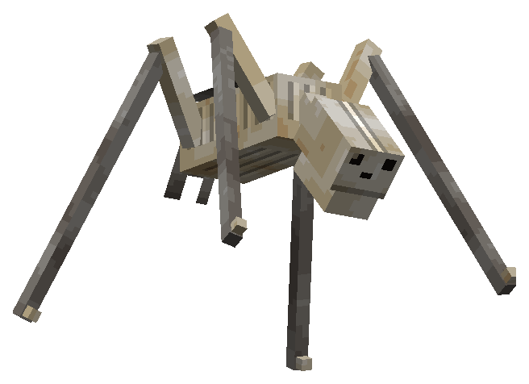</a> | Sabueso de duelo `quantumdeath:mourning_hound` | Limbo | Rastrea aliento; un señuelo de aliento lo desvía. | 1 · [textura](src/main/resources/assets/quantumdeath/textures/entity/mourning_hound.png) |
| <a href="docs/assets/mobs/mourning_parasite_0.png">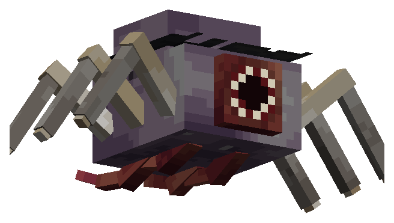</a> | Parásito del duelo `quantumdeath:mourning_parasite` | Limbo y plaga | Salta a un huésped y lo incorpora a la horda; matarlo libera al huésped. | 1 · [textura](src/main/resources/assets/quantumdeath/textures/entity/mourning_parasite.png) |
| <a href="docs/assets/mobs/rib_thrower_0.png">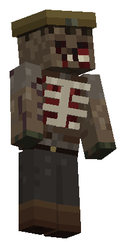</a> | Descostillado `quantumdeath:rib_thrower` | Limbo y plaga | Arranca una costilla y la lanza; el gesto de extracción anuncia el disparo. | 3 · [textura](src/main/resources/assets/quantumdeath/textures/entity/limbo/rib_thrower_0.png) |
| <a href="docs/assets/mobs/runaway_0.png">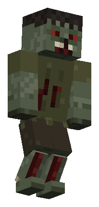</a> | Desbocado `quantumdeath:runaway` | Limbo y plaga | Acelera en ráfagas y descansa después. | 3 · [textura](src/main/resources/assets/quantumdeath/textures/entity/limbo/runaway_0.png) |
| <a href="docs/assets/mobs/runt_0.png">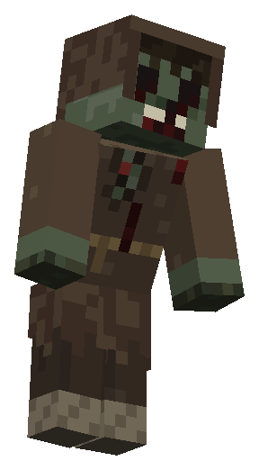</a> | Menudo `quantumdeath:runt` | Limbo y plaga | Pequeño, frágil y rápido; pasa por huecos de un bloque. | 3 · [textura](src/main/resources/assets/quantumdeath/textures/entity/limbo/runt_0.png) |
| <a href="docs/assets/mobs/stalker_0.png">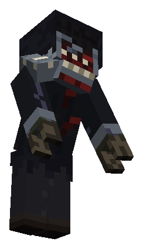</a> | Acechador `quantumdeath:stalker` | Limbo y plaga | Flanquea por la espalda; hombro encorvado y garras anuncian el ataque. | 3 · [textura](src/main/resources/assets/quantumdeath/textures/entity/limbo/stalker_0.png) |
| <a href="docs/assets/mobs/strangler_0.png">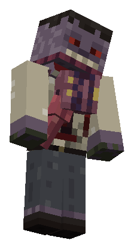</a> | Estrangulador `quantumdeath:strangler` | Limbo y plaga | Lengua de alcance largo para arrastrar; escudos, golpes y obstáculos la cortan. | 3 · [textura](src/main/resources/assets/quantumdeath/textures/entity/limbo/strangler_0.png) |
| <a href="docs/assets/mobs/sundered_0.png">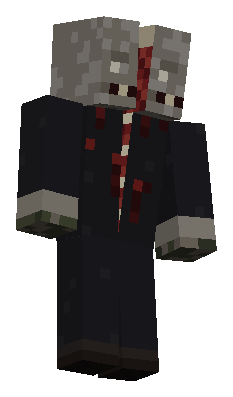</a> | Desdoblado `quantumdeath:sundered` | Limbo y plaga | Abre ambas mitades del cuerpo antes de su barrido. | 3 · [textura](src/main/resources/assets/quantumdeath/textures/entity/limbo/sundered_0.png) |
| <a href="docs/assets/mobs/wake_bearer_0.png">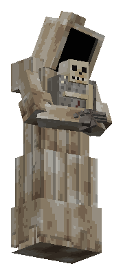</a> | Portador de la vigilia `quantumdeath:wake_bearer` | Limbo | Élite pesada de restos; asedia y deja cera consagrada. | 1 · [textura](src/main/resources/assets/quantumdeath/textures/entity/wake_bearer.png) |
| <a href="docs/assets/mobs/walking_ossuary_0.png">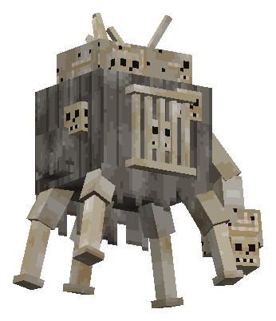</a> | Osario ambulante `quantumdeath:walking_ossuary` | Limbo | Bloquea pasos, asedia y lleva una reserva finita de muertos. | 1 · [textura](src/main/resources/assets/quantumdeath/textures/entity/walking_ossuary.png) |

Escupidor · todas las variantes

| Render | Variante | Skin de origen |
| --- | --- | --- |
|  | Skin 0 | [atlas original](src/main/resources/assets/quantumdeath/textures/entity/limbo/bile_spitter_0.png) |
| <a href="docs/assets/mobs/bile_spitter_1.png">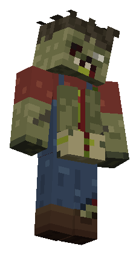</a> | Skin 1 | [atlas original](src/main/resources/assets/quantumdeath/textures/entity/limbo/bile_spitter_1.png) |
| <a href="docs/assets/mobs/bile_spitter_2.png">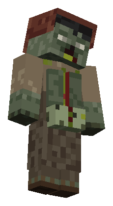</a> | Skin 2 | [atlas original](src/main/resources/assets/quantumdeath/textures/entity/limbo/bile_spitter_2.png) |

Putrescente · todas las variantes

| Render | Variante | Skin de origen |
| --- | --- | --- |
|  | Skin 0 | [atlas original](src/main/resources/assets/quantumdeath/textures/entity/limbo/bloater_0.png) |
| <a href="docs/assets/mobs/bloater_1.png">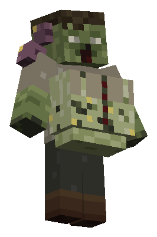</a> | Skin 1 | [atlas original](src/main/resources/assets/quantumdeath/textures/entity/limbo/bloater_1.png) |
| <a href="docs/assets/mobs/bloater_2.png">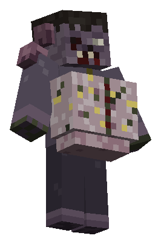</a> | Skin 2 | [atlas original](src/main/resources/assets/quantumdeath/textures/entity/limbo/bloater_2.png) |

Quebrantador · todas las variantes

| Render | Variante | Skin de origen |
| --- | --- | --- |
|  | Skin 0 | [atlas original](src/main/resources/assets/quantumdeath/textures/entity/limbo/breaker_0.png) |
| <a href="docs/assets/mobs/breaker_1.png">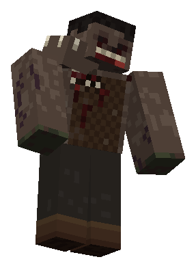</a> | Skin 1 | [atlas original](src/main/resources/assets/quantumdeath/textures/entity/limbo/breaker_1.png) |
| <a href="docs/assets/mobs/breaker_2.png">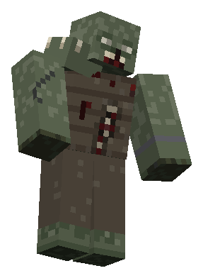</a> | Skin 2 | [atlas original](src/main/resources/assets/quantumdeath/textures/entity/limbo/breaker_2.png) |

Reptante · todas las variantes

| Render | Variante | Skin de origen |
| --- | --- | --- |
|  | Skin 0 | [atlas original](src/main/resources/assets/quantumdeath/textures/entity/limbo/crawler_0.png) |
| <a href="docs/assets/mobs/crawler_1.png">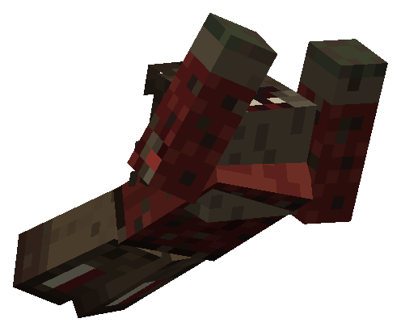</a> | Skin 1 | [atlas original](src/main/resources/assets/quantumdeath/textures/entity/limbo/crawler_1.png) |
| <a href="docs/assets/mobs/crawler_2.png">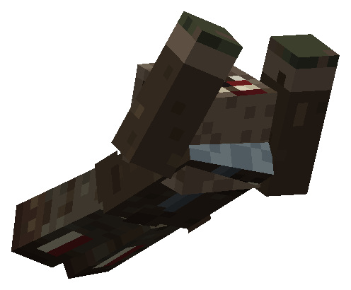</a> | Skin 2 | [atlas original](src/main/resources/assets/quantumdeath/textures/entity/limbo/crawler_2.png) |

Pregonero del último aliento · todas las variantes

| Render | Variante | Skin de origen |
| --- | --- | --- |
|  | Skin 0 | [atlas original](src/main/resources/assets/quantumdeath/textures/entity/limbo/crier_0.png) |
| <a href="docs/assets/mobs/crier_1.png">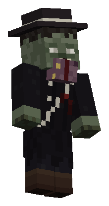</a> | Skin 1 | [atlas original](src/main/resources/assets/quantumdeath/textures/entity/limbo/crier_1.png) |
| <a href="docs/assets/mobs/crier_2.png">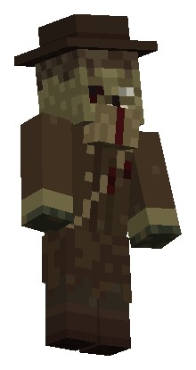</a> | Skin 2 | [atlas original](src/main/resources/assets/quantumdeath/textures/entity/limbo/crier_2.png) |

Capataz del duelo · todas las variantes

| Render | Variante | Skin de origen |
| --- | --- | --- |
|  | Skin 0 | [atlas original](src/main/resources/assets/quantumdeath/textures/entity/limbo/foreman_0.png) |
| <a href="docs/assets/mobs/foreman_1.png">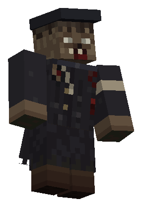</a> | Skin 1 | [atlas original](src/main/resources/assets/quantumdeath/textures/entity/limbo/foreman_1.png) |
| <a href="docs/assets/mobs/foreman_2.png">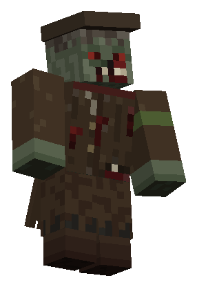</a> | Skin 2 | [atlas original](src/main/resources/assets/quantumdeath/textures/entity/limbo/foreman_2.png) |

Zombi errante · todas las variantes

| Render | Variante | Skin de origen |
| --- | --- | --- |
|  | Skin 0 | [atlas original](src/main/resources/assets/quantumdeath/textures/entity/limbo/hollow_0.png) |
| <a href="docs/assets/mobs/hollow_1.png">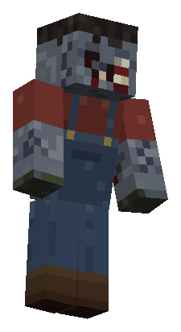</a> | Skin 1 | [atlas original](src/main/resources/assets/quantumdeath/textures/entity/limbo/hollow_1.png) |
| <a href="docs/assets/mobs/hollow_2.png">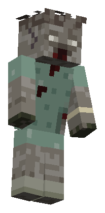</a> | Skin 2 · brazos delgados | [atlas original](src/main/resources/assets/quantumdeath/textures/entity/limbo/hollow_2.png) |
| <a href="docs/assets/mobs/hollow_3.png">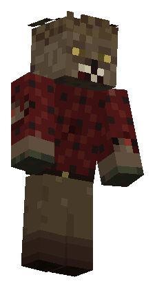</a> | Skin 3 | [atlas original](src/main/resources/assets/quantumdeath/textures/entity/limbo/hollow_3.png) |
| <a href="docs/assets/mobs/hollow_4.png">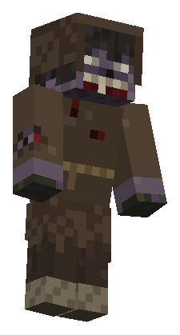</a> | Skin 4 | [atlas original](src/main/resources/assets/quantumdeath/textures/entity/limbo/hollow_4.png) |
| <a href="docs/assets/mobs/hollow_5.png">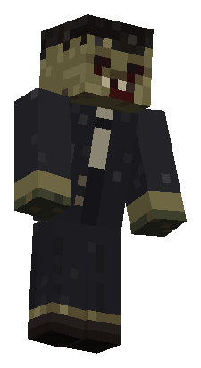</a> | Skin 5 | [atlas original](src/main/resources/assets/quantumdeath/textures/entity/limbo/hollow_5.png) |
| <a href="docs/assets/mobs/hollow_6.png">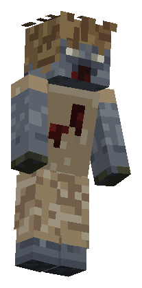</a> | Skin 6 · brazos delgados | [atlas original](src/main/resources/assets/quantumdeath/textures/entity/limbo/hollow_6.png) |
| <a href="docs/assets/mobs/hollow_7.png">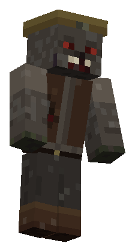</a> | Skin 7 | [atlas original](src/main/resources/assets/quantumdeath/textures/entity/limbo/hollow_7.png) |
| <a href="docs/assets/mobs/hollow_8.png">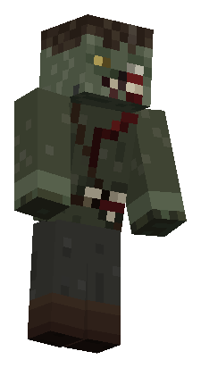</a> | Skin 8 | [atlas original](src/main/resources/assets/quantumdeath/textures/entity/limbo/hollow_8.png) |
| <a href="docs/assets/mobs/hollow_9.png">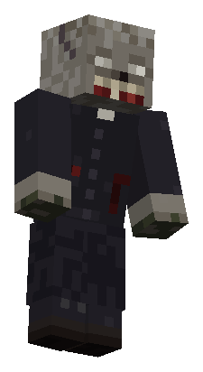</a> | Skin 9 | [atlas original](src/main/resources/assets/quantumdeath/textures/entity/limbo/hollow_9.png) |
| <a href="docs/assets/mobs/hollow_10.png">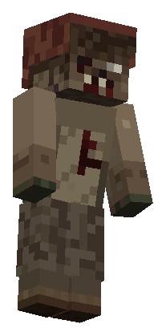</a> | Skin 10 · brazos delgados | [atlas original](src/main/resources/assets/quantumdeath/textures/entity/limbo/hollow_10.png) |
| <a href="docs/assets/mobs/hollow_11.png">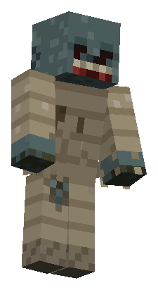</a> | Skin 11 | [atlas original](src/main/resources/assets/quantumdeath/textures/entity/limbo/hollow_11.png) |
| <a href="docs/assets/mobs/hollow_12.png">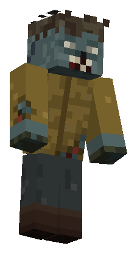</a> | Skin 12 | [atlas original](src/main/resources/assets/quantumdeath/textures/entity/limbo/hollow_12.png) |
| <a href="docs/assets/mobs/hollow_13.png">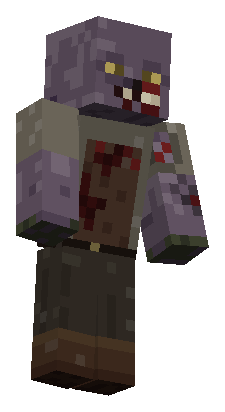</a> | Skin 13 | [atlas original](src/main/resources/assets/quantumdeath/textures/entity/limbo/hollow_13.png) |
| <a href="docs/assets/mobs/hollow_14.png">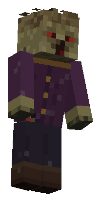</a> | Skin 14 · brazos delgados | [atlas original](src/main/resources/assets/quantumdeath/textures/entity/limbo/hollow_14.png) |
| <a href="docs/assets/mobs/hollow_15.png">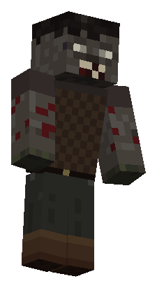</a> | Skin 15 | [atlas original](src/main/resources/assets/quantumdeath/textures/entity/limbo/hollow_15.png) |
| <a href="docs/assets/mobs/hollow_16.png">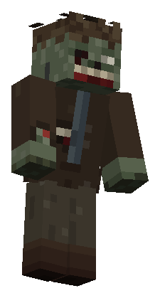</a> | Skin 16 | [atlas original](src/main/resources/assets/quantumdeath/textures/entity/limbo/hollow_16.png) |

Larguirucho · todas las variantes

| Render | Variante | Skin de origen |
| --- | --- | --- |
|  | Skin 0 | [atlas original](src/main/resources/assets/quantumdeath/textures/entity/limbo/lanky_0.png) |
|  | Skin 1 | [atlas original](src/main/resources/assets/quantumdeath/textures/entity/limbo/lanky_1.png) |
|  | Skin 2 | [atlas original](src/main/resources/assets/quantumdeath/textures/entity/limbo/lanky_2.png) |

Descostillado · todas las variantes

| Render | Variante | Skin de origen |
| --- | --- | --- |
|  | Skin 0 | [atlas original](src/main/resources/assets/quantumdeath/textures/entity/limbo/rib_thrower_0.png) |
|  | Skin 1 | [atlas original](src/main/resources/assets/quantumdeath/textures/entity/limbo/rib_thrower_1.png) |
|  | Skin 2 | [atlas original](src/main/resources/assets/quantumdeath/textures/entity/limbo/rib_thrower_2.png) |

Desbocado · todas las variantes

| Render | Variante | Skin de origen |
| --- | --- | --- |
|  | Skin 0 | [atlas original](src/main/resources/assets/quantumdeath/textures/entity/limbo/runaway_0.png) |
|  | Skin 1 | [atlas original](src/main/resources/assets/quantumdeath/textures/entity/limbo/runaway_1.png) |
|  | Skin 2 | [atlas original](src/main/resources/assets/quantumdeath/textures/entity/limbo/runaway_2.png) |

Menudo · todas las variantes

| Render | Variante | Skin de origen |
| --- | --- | --- |
|  | Skin 0 | [atlas original](src/main/resources/assets/quantumdeath/textures/entity/limbo/runt_0.png) |
|  | Skin 1 | [atlas original](src/main/resources/assets/quantumdeath/textures/entity/limbo/runt_1.png) |
|  | Skin 2 | [atlas original](src/main/resources/assets/quantumdeath/textures/entity/limbo/runt_2.png) |

Acechador · todas las variantes

| Render | Variante | Skin de origen |
| --- | --- | --- |
|  | Skin 0 | [atlas original](src/main/resources/assets/quantumdeath/textures/entity/limbo/stalker_0.png) |
|  | Skin 1 | [atlas original](src/main/resources/assets/quantumdeath/textures/entity/limbo/stalker_1.png) |
|  | Skin 2 | [atlas original](src/main/resources/assets/quantumdeath/textures/entity/limbo/stalker_2.png) |

Estrangulador · todas las variantes

| Render | Variante | Skin de origen |
| --- | --- | --- |
|  | Skin 0 | [atlas original](src/main/resources/assets/quantumdeath/textures/entity/limbo/strangler_0.png) |
|  | Skin 1 | [atlas original](src/main/resources/assets/quantumdeath/textures/entity/limbo/strangler_1.png) |
|  | Skin 2 | [atlas original](src/main/resources/assets/quantumdeath/textures/entity/limbo/strangler_2.png) |

Desdoblado · todas las variantes

| Render | Variante | Skin de origen |
| --- | --- | --- |
|  | Skin 0 | [atlas original](src/main/resources/assets/quantumdeath/textures/entity/limbo/sundered_0.png) |
|  | Skin 1 | [atlas original](src/main/resources/assets/quantumdeath/textures/entity/limbo/sundered_1.png) |
|  | Skin 2 | [atlas original](src/main/resources/assets/quantumdeath/textures/entity/limbo/sundered_2.png) |

### Criaturas de los otros círculos

| Render | Nombre / ID | Dónde | Función | Vistas / fuente |
| --- | --- | --- | --- | --- |
|  | Caballero de Brasa `quantumdeath:cinder_knight` | Deltas de Brasa y desembarcadero | Guardián raro con ataques de espada anunciados. | 1 · [textura](src/main/resources/assets/quantumdeath/textures/entity/cinder_knight.png) |
|  | Eco `quantumdeath:echo` | Cenit | Aparición del Vacío y de los ataques de VIGIL. | 1 · [textura](src/main/resources/assets/quantumdeath/textures/entity/echo.png) |
|  | Glotoncillo `quantumdeath:gluttling` | Garganta del Hambre | Pequeño atacante que salta; también acompaña a la Matriarca. | 1 · [textura](src/main/resources/assets/quantumdeath/textures/entity/gluttling.png) |
|  | Glotón `quantumdeath:glutton` | Garganta del Hambre | Monstruo de hambre con mordidas y bilis. | 1 · [textura](src/main/resources/assets/quantumdeath/textures/entity/glutton.png) |
|  | Hereje `quantumdeath:heretic` | Dite | Ataca a distancia y prepara piras bajo su objetivo; variante Inquisidor en el Osario. | 2 · [textura](src/main/resources/assets/quantumdeath/textures/entity/heretic.png) |
|  | Furia de Hierro `quantumdeath:iron_fury` | Dite | Criatura voladora de hierro con ataques de cadenas. | 1 · [textura](src/main/resources/assets/quantumdeath/textures/entity/iron_fury.png) |
|  | Penitente `quantumdeath:penitent` | Cenit | Su comportamiento depende de ser observado. | 1 · [textura](src/main/resources/assets/quantumdeath/textures/entity/penitent.png) |
|  | Hosco `quantumdeath:sullen` | Pantano Estigio | Muerto acuático que amenaza desde el agua. | 1 · [textura](src/main/resources/assets/quantumdeath/textures/entity/sullen.png) |
|  | Hijo de la Ira `quantumdeath:wrathborn` | Pantano Estigio | Acumula ira y arremete con ataques físicos. | 1 · [textura](src/main/resources/assets/quantumdeath/textures/entity/wrathborn.png) |

Hereje · todas las variantes

| Render | Variante | Skin de origen |
| --- | --- | --- |
|  | Hereje | [atlas original](src/main/resources/assets/quantumdeath/textures/entity/heretic.png) |
|  | Inquisidor Insepulto | [atlas original](src/main/resources/assets/quantumdeath/textures/entity/heretic.png) |

### Yokai

| Render | Nombre / ID | Dónde | Función | Vistas / fuente |
| --- | --- | --- | --- | --- |
|  | Falso Creeper `quantumdeath:fake_creeper` | Terreno abierto de noche. Se disipa al amanecer. | Atraviesa paredes y se hincha con un siseo de tres segundos antes de estallar (3 bloques, máximo 6 de daño, menos con la distancia). Sin percepción nunca persigue: estalla donde flota. Nunca rompe bloques ni enciende fuego. | 1 · [textura](src/main/resources/assets/quantumdeath/textures/entity/fake_creeper.png) |
|  | Bifauce `quantumdeath:bifauce` | Bosques oscuros y bordes de caminos. | Una boca imita sonidos cotidianos; la otra respira al revés. Sin percepción solo engaña y desvía. Vista, abre ambas bocas durante un segundo y medio y embiste en línea recta (5 de daño, cada 4 s). | 1 · [textura](src/main/resources/assets/quantumdeath/textures/entity/bifauce.png) |
|  | Apagador `quantumdeath:damper` | Cuevas. | Imita pasos, minería y bloques colocados. Quien lleve una luz en cualquiera de las manos es su presa, la vea o no: un crujido de dos segundos y luego golpes de 5 de daño cada 2 s. También apaga una antorcha alcanzable cada diez segundos. | 1 · [textura](src/main/resources/assets/quantumdeath/textures/entity/damper_hell.png) |
|  | Ojo de Enjambre `quantumdeath:swarm_eye` | Bosques, cavernas amplias y ruinas. | Un ojo flotante que arrastra sus nervios, rodeado por un enjambre de ojos pequeños; nunca se posa y vaga a uno o dos bloques del suelo. Tras observar a alguien tres segundos chilla e indica a los yōkai cercanos dónde estaba (cada uno conserva sus propias reglas). Si lo hieres, te lanza sus ojos pequeños (3 de daño cada 2,5 s, 20 bloques). | 1 · [textura](src/main/resources/assets/quantumdeath/textures/entity/swarm_eye.png) |
|  | Kappa `quantumdeath:kappa` | Ríos y lagos naturales. | Atacarlo, o arrancar vegetación acuática a menos de 6 bloques, lo provoca: burbujas y chapoteos durante tres segundos. Una víctima provocada que entre en su agua queda retenida a menos de 8 bloques de su lugar y recibe mordidas (3 de daño cada 2 s). Nunca arrastra al fondo. | 1 · [textura](src/main/resources/assets/quantumdeath/textures/entity/kappa.png) |
|  | Oni `quantumdeath:oni` | Montañas y ruinas. | Sus pasos pesados delatan su terreno. Alza la maza dos segundos antes del golpe (8 de daño, cada 4 s). No sigue a nadie fuera de su territorio salvo a quien lo haya herido. | 1 · [textura](src/main/resources/assets/quantumdeath/textures/entity/oni.png) |
|  | Cofre tsukumogami `quantumdeath:chest_tsukumogami` | Cofres naturales intactos de estructuras. | Golpes internos y una tapa que se levanta sola. Despierto, lleva su contenido y se aleja dando saltos de quien se acerca. Si lo atacan, muerde (3 de daño, anunciado durante un segundo). Nunca roba ni borra objetos: vuelve a su lugar con todo dentro. | 1 · [textura](src/main/resources/assets/quantumdeath/textures/entity/chest_tsukumogami.png) |
|  | Tanuki `quantumdeath:tanuki` | Bosques y aldeas. | Toca su panza como tambor y deja señuelos brillantes que se desvanecen al investigarlos. Nunca sustituye ni roba objetos reales. | 1 · [textura](src/main/resources/assets/quantumdeath/textures/entity/tanuki.png) |
|  | Tengu `quantumdeath:tengu` | Montañas y arboledas altas. | El viento y las plumas negras lo anuncian. Solo pelea con quien lo ataca: alza el abanico 1,5 s y lanza una ráfaga (4 de daño y un fuerte empuje). | 1 · [textura](src/main/resources/assets/quantumdeath/textures/entity/tengu.png) |
|  | Kodama `quantumdeath:kodama` | Arboledas naturales. | Un traqueteo de madera y pequeñas luces marcan el refugio que señala al pie de un árbol crecido. Con un brote, el refugio hace que los yōkai hostiles detecten a la gente un 25 % más tarde durante cinco minutos (8 bloques). No termina una persecución ya iniciada. | 1 · [textura](src/main/resources/assets/quantumdeath/textures/entity/kodama.png) |
|  | Nurikabe `quantumdeath:nurikabe` | Senderos y entradas de cuevas. | Un muro que no está: cierra un paso durante un rato sin colocar ni romper bloques, y nunca aparece en el espacio que ocupas. | 1 · [textura](src/main/resources/assets/quantumdeath/textures/entity/nurikabe.png) |
|  | Ittan-momen `quantumdeath:ittan_momen` | Llanuras de noche. | Una tira de algodón que flota. Un roce y un siseo durante dos segundos y luego te envuelve (3 de daño y lentitud 2 s, cada 5 s). | 1 · [textura](src/main/resources/assets/quantumdeath/textures/entity/ittan_momen.png) |
|  | Campana tsukumogami `quantumdeath:bell_tsukumogami` | Campanas naturales de aldeas. | Vibra y suena suavemente cerca de presencias, y toca un aviso cuando hay algo hostil a menos de 24 bloques (como máximo cada 10 s). El toque no dice qué ni dónde. La campana original se conserva: vuelve a su lugar, nunca se duplica. | 1 · [textura](src/main/resources/assets/quantumdeath/textures/entity/bell_tsukumogami.png) |

### Jefes y acechador

| Render | Nombre / ID | Dónde | Función | Vistas / fuente |
| --- | --- | --- | --- | --- |
|  | La Matriarca Hartada `quantumdeath:gorged_matriarch` | Foso del Festín | Jefa de la capa II; mordidas, bilis y glotoncillos. | 1 · [textura](src/main/resources/assets/quantumdeath/textures/entity/gorged_matriarch.png) |
|  | El Heresiarca `quantumdeath:heresiarch` | Osario de Dite | Jefe de la capa IV; fuego y cadenas. | 1 · [textura](src/main/resources/assets/quantumdeath/textures/entity/heresiarch.png) |
|  | Fauce Estigia `quantumdeath:styxmaw` | Coro Ahogado | Jefe acuático de la capa III. | 1 · [textura](src/main/resources/assets/quantumdeath/textures/entity/styxmaw.png) |
|  | El Guardián del Peaje `quantumdeath:toll_keeper` | Desembarcadero del Barquero | Jefe de la capa I; peajes, remo, almas, fuego y procesiones de reserva limitada. | 1 · [textura](src/main/resources/assets/quantumdeath/textures/entity/toll_keeper.png) |
|  | VIGIL `quantumdeath:vigil` | Todas las capas | Acechador invulnerable; cinco formas visuales. Sin huevo generador. | 5 · [textura](src/main/resources/assets/quantumdeath/textures/entity/vigil_1.png) |
|  | VIGIL `quantumdeath:vigil_wake` | Última Vigilia, Cenit | Jefe final con máscara, mirada y velo. | 3 · [textura](src/main/resources/assets/quantumdeath/textures/entity/vigil_5.png) |

VIGIL · todas las variantes

| Render | Variante | Skin de origen |
| --- | --- | --- |
|  | Forma 1 | [atlas original](src/main/resources/assets/quantumdeath/textures/entity/vigil_1.png) |
|  | Forma 2 | [atlas original](src/main/resources/assets/quantumdeath/textures/entity/vigil_2.png) |
|  | Forma 3 | [atlas original](src/main/resources/assets/quantumdeath/textures/entity/vigil_3.png) |
|  | Forma 4 | [atlas original](src/main/resources/assets/quantumdeath/textures/entity/vigil_4.png) |
|  | Forma 5 | [atlas original](src/main/resources/assets/quantumdeath/textures/entity/vigil_5.png) |

VIGIL · todas las variantes

| Render | Variante | Skin de origen |
| --- | --- | --- |
|  | Máscara intacta | [atlas original](src/main/resources/assets/quantumdeath/textures/entity/vigil_5.png) |
|  | Máscara rota | [atlas original](src/main/resources/assets/quantumdeath/textures/entity/vigil_5.png) |
|  | Velo | [atlas original](src/main/resources/assets/quantumdeath/textures/entity/vigil_5.png) |

Entidades auxiliares: proyectiles, cadáveres, charcos y señuelos

| ID | Uso |
| --- | --- |
| `quantumdeath:swarm_arm` | Ojo pequeño lanzado por Ojo de Enjambre; modelo propio. |
| `quantumdeath:hell_bolt` | Proyectil multifunción de alma, bilis, brea, fuego, cadenas y gancho; sprites según tipo. |
| `quantumdeath:bloater_corpse` | Cadáver explosivo del Putrescente; modelo y skin del cadáver. |
| `quantumdeath:tongue_segment` | Segmento lógico de lengua; render propio desactivado, la lengua se dibuja desde el Estrangulador. |
| `quantumdeath:bile_bolus` | Bolo de bilis con geometría de proyectil. |
| `quantumdeath:rib_shard` | Costilla con geometría y capa luminosa. |
| `quantumdeath:bile_residue` | Charco de bilis persistente por tiempo limitado. |
| `quantumdeath:technique_projectile` | Proyectiles malditos: disco de sangre, hielo, fuego, magma e insectos. |
| `quantumdeath:technique_body` | Constructos: volcán, meteorito y masa de hielo. |
| `quantumdeath:tanuki_decoy` | Señuelo brillante del Tanuki; representación de objeto. |

## Catálogo de objetos y bloques

Todos los identificadores de esta sección pertenecen a `quantumdeath:`. **Nuevo** significa ausente de la principal; **existente · sprite cambiado** identifica contenido previo con arte modificado. Se indican recetas y botín cuando existe una fuente en los datos o en el código. La presencia en creativo no implica una receta de supervivencia.

Los sprites se ampliaron por vecino más cercano, conservando bordes nítidos. Las vistas de bloques y objetos con geometría usan el modelo de inventario real del cliente. Los atlas de entidad y armadura se enlazan como fuente, sin confundirlos con sprites de inventario.

Materiales originales, alimentos y libro · 14 entradas

| Vista | Nombre / ID / cambio | Función y usos | Obtención | Recursos |
| --- | --- | --- | --- | --- |
|  | Apple Of Discord `apple_of_discord` existente · sprite cambiado | Al consumir: +2 de vida máxima una vez por tipo y regeneración. | [receta apple_of_discord](src/main/resources/data/quantumdeath/recipe/apple_of_discord.json) | [modelo](src/main/resources/assets/quantumdeath/models/item/apple_of_discord.json) [textura](src/main/resources/assets/quantumdeath/textures/item/apple_of_discord.png) |
|  | Apple Of The Void `apple_of_the_void` existente · sprite cambiado | Al consumir: +8 de vida máxima una vez por tipo y regeneración. | [receta apple_of_the_void](src/main/resources/data/quantumdeath/recipe/apple_of_the_void.json) | [modelo](src/main/resources/assets/quantumdeath/models/item/apple_of_the_void.json) [textura](src/main/resources/assets/quantumdeath/textures/item/apple_of_the_void.png) |
|  | Fragment Of The Void `fragment_of_the_void` existente · sprite cambiado | Material original para la Manzana del Vacío y Sabiduría del Vacío. Se usa para fabricar: `apple_of_the_void`. | [receta fragment_of_the_void](src/main/resources/data/quantumdeath/recipe/fragment_of_the_void.json); [botín heresiarch](src/main/resources/data/quantumdeath/loot_table/entities/heresiarch.json) | [modelo](src/main/resources/assets/quantumdeath/models/item/fragment_of_the_void.json) [textura](src/main/resources/assets/quantumdeath/textures/item/fragment_of_the_void.png) |
|  | Life Fruit `life_fruit` existente · sprite cambiado | Alimento original: 6 de nutrición, saturación 1.2. | [receta life_fruit](src/main/resources/data/quantumdeath/recipe/life_fruit.json) | [modelo](src/main/resources/assets/quantumdeath/models/item/life_fruit.json) [textura](src/main/resources/assets/quantumdeath/textures/item/life_fruit.png) |
|  | Purified Sculk Apple `purified_sculk_apple` existente · sprite cambiado | Al consumir: +4 de vida máxima una vez por tipo y regeneración. | [receta purified_sculk_apple](src/main/resources/data/quantumdeath/recipe/purified_sculk_apple.json) | [modelo](src/main/resources/assets/quantumdeath/models/item/purified_sculk_apple.json) [textura](src/main/resources/assets/quantumdeath/textures/item/purified_sculk_apple.png) |
|  | Purified Sculk Fragment `purified_sculk_fragment` existente · sprite cambiado | Material original de la cadena de purificación sculk. Se usa para fabricar: `purified_sculk_apple`. | [receta purified_sculk_fragment](src/main/resources/data/quantumdeath/recipe/purified_sculk_fragment.json) | [modelo](src/main/resources/assets/quantumdeath/models/item/purified_sculk_fragment.json) [textura](src/main/resources/assets/quantumdeath/textures/item/purified_sculk_fragment.png) |
|  | Purified Soul Apple `purified_soul_apple` existente · sprite cambiado | Al consumir: +6 de vida máxima una vez por tipo y regeneración. | [receta purified_soul_apple](src/main/resources/data/quantumdeath/recipe/purified_soul_apple.json) | [modelo](src/main/resources/assets/quantumdeath/models/item/purified_soul_apple.json) [textura](src/main/resources/assets/quantumdeath/textures/item/purified_soul_apple.png) |
|  | Purified Soul Fragment `purified_soul_fragment` existente · sprite cambiado | Material original de la cadena de purificación de almas. Se usa para fabricar: `purified_soul_apple`. | [receta purified_soul_fragment](src/main/resources/data/quantumdeath/recipe/purified_soul_fragment.json); [botín ossuary_vault](src/main/resources/data/quantumdeath/loot_table/chests/ossuary_vault.json) | [modelo](src/main/resources/assets/quantumdeath/models/item/purified_soul_fragment.json) [textura](src/main/resources/assets/quantumdeath/textures/item/purified_soul_fragment.png) |
|  | Reinforced Shulker Shell `reinforced_shulker_shell` existente · sprite cambiado | Material original de la receta de Sabiduría del Vacío. Se usa para fabricar: `apple_of_the_void`. | [receta reinforced_shulker_shell](src/main/resources/data/quantumdeath/recipe/reinforced_shulker_shell.json) | [modelo](src/main/resources/assets/quantumdeath/models/item/reinforced_shulker_shell.json) [textura](src/main/resources/assets/quantumdeath/textures/item/reinforced_shulker_shell.png) |
|  | Remnant Of The Void `remnant_of_the_void` existente · sprite cambiado | Material original de progresión del Vacío. Se usa para fabricar: `fragment_of_the_void`. | [receta remnant_of_the_void_from_zenith](src/main/resources/data/quantumdeath/recipe/remnant_of_the_void_from_zenith.json); [botín false_house](src/main/resources/data/quantumdeath/loot_table/chests/false_house.json); [botín styxmaw](src/main/resources/data/quantumdeath/loot_table/entities/styxmaw.json); [botín vigil_wake](src/main/resources/data/quantumdeath/loot_table/entities/vigil_wake.json) | [modelo](src/main/resources/assets/quantumdeath/models/item/remnant_of_the_void.json) [textura](src/main/resources/assets/quantumdeath/textures/item/remnant_of_the_void.png) |
|  | Shard Of Discord `shard_of_discord` existente · sprite cambiado | Material original para fabricar la Manzana de Discordia y fragmentos purificados. Se usa para fabricar: `apple_of_discord`, `life_fruit`, `purified_sculk_fragment`. | [receta shard_of_discord](src/main/resources/data/quantumdeath/recipe/shard_of_discord.json); [botín gorged_matriarch](src/main/resources/data/quantumdeath/loot_table/entities/gorged_matriarch.json) | [modelo](src/main/resources/assets/quantumdeath/models/item/shard_of_discord.json) [textura](src/main/resources/assets/quantumdeath/textures/item/shard_of_discord.png) |
|  | Soul Vessel `soul_vessel` existente · sprite cambiado | Recipiente de almas; material de la cadena de purificación y botín de élites. Se usa para fabricar: `purified_soul_fragment`. | [receta soul_vessel_from_hell](src/main/resources/data/quantumdeath/recipe/soul_vessel_from_hell.json); [botín ossuary_vault](src/main/resources/data/quantumdeath/loot_table/chests/ossuary_vault.json); [botín toll_keeper](src/main/resources/data/quantumdeath/loot_table/entities/toll_keeper.json); También como botín adicional de élites. | [modelo](src/main/resources/assets/quantumdeath/models/item/soul_vessel.json) [textura](src/main/resources/assets/quantumdeath/textures/item/soul_vessel.png) |
|  | Suspicious Substance II `suspicious_substance` existente · sprite cambiado | Material original; ingrediente de purificación y progresión. | [receta suspicious_substance](src/main/resources/data/quantumdeath/recipe/suspicious_substance.json) | [modelo](src/main/resources/assets/quantumdeath/models/item/suspicious_substance.json) [textura](src/main/resources/assets/quantumdeath/textures/item/suspicious_substance.png) |
|  | Sabiduría del Vacío `wisdom_of_the_void` nuevo | Abre Técnicas Malditas, Habilidades Generales y Bestiario. | [receta wisdom_of_the_void](src/main/resources/data/quantumdeath/recipe/wisdom_of_the_void.json) | [modelo](src/main/resources/assets/quantumdeath/models/item/wisdom_of_the_void.json) [textura](src/main/resources/assets/quantumdeath/textures/item/wisdom_of_the_void1.png) |

Bloques, altares, puertas y señales · 58 entradas

| Vista | Nombre / ID / cambio | Función y usos | Obtención | Recursos |
| --- | --- | --- | --- | --- |
|  | Puerta de ascenso `ascent_gate` nuevo | Puerta para ascender una capa. | Sin receta ni botín JSON localizado; disponible en creativo o con /give. | [modelo](src/main/resources/assets/quantumdeath/models/item/ascent_gate.json) [textura](src/main/resources/assets/quantumdeath/textures/block/ascent_gate.png) |
|  | Ceniza `ash` nuevo | Ceniza con gravedad. | [romper ash](src/main/resources/data/quantumdeath/loot_table/blocks/ash.json) | [modelo](src/main/resources/assets/quantumdeath/models/block/ash.json) [textura](src/main/resources/assets/quantumdeath/textures/block/ash.png) |
|  | Huella de ceniza `ash_print` nuevo | Huella temporal de ceniza; no deja botín. | Sin receta ni botín JSON localizado; disponible en creativo o con /give. | [modelo](src/main/resources/assets/quantumdeath/models/item/ash_print.json) [textura](src/main/resources/assets/quantumdeath/textures/block/ash_print.png) |
|  | Ladrillos cenicientos `ashen_bricks` nuevo | Bloque de construcción del Limbo. Se usa para fabricar: `chiseled_ashen_bricks`. | [receta ashen_bricks](src/main/resources/data/quantumdeath/recipe/ashen_bricks.json); [romper ashen_bricks](src/main/resources/data/quantumdeath/loot_table/blocks/ashen_bricks.json) | [modelo](src/main/resources/assets/quantumdeath/models/block/ashen_bricks.json) [textura](src/main/resources/assets/quantumdeath/textures/block/ashen_bricks.png) |
|  | Piedra cenicienta `ashen_stone` nuevo | Piedra del Limbo. Se usa para fabricar: `ashen_bricks`. | [romper ashen_stone](src/main/resources/data/quantumdeath/loot_table/blocks/ashen_stone.json) | [modelo](src/main/resources/assets/quantumdeath/models/block/ashen_stone.json) [textura](src/main/resources/assets/quantumdeath/textures/block/ashen_stone.png) |
|  | Bile `bile` nuevo | Bilis pegajosa: ralentiza y reduce el salto. | [romper bile](src/main/resources/data/quantumdeath/loot_table/blocks/bile.json) | [modelo](src/main/resources/assets/quantumdeath/models/block/bile.json) [textura](src/main/resources/assets/quantumdeath/textures/block/bile.png) |
|  | Bleeding Log `bleeding_log` nuevo | Tronco que sangra al interactuar con él. | [romper bleeding_log](src/main/resources/data/quantumdeath/loot_table/blocks/bleeding_log.json) | [modelo](src/main/resources/assets/quantumdeath/models/block/bleeding_log.json) [textura 1](src/main/resources/assets/quantumdeath/textures/block/bleeding_log_top.png) [textura 2](src/main/resources/assets/quantumdeath/textures/block/bleeding_log_side.png) |
|  | Ancla de brecha `breach_anchor` nuevo | Origen de oleadas de plaga; se purga mediante interacción y mirada cercana. | Sin receta ni botín JSON localizado; disponible en creativo o con /give. | [modelo](src/main/resources/assets/quantumdeath/models/block/breach_anchor.json) [textura 1](src/main/resources/assets/quantumdeath/textures/block/breach_anchor_top.png) [textura 2](src/main/resources/assets/quantumdeath/textures/block/ashen_stone.png) [textura 3](src/main/resources/assets/quantumdeath/textures/block/breach_anchor_side.png) |
|  | Burning Tomb `burning_tomb` nuevo | Tumba ardiente de herejes. | Sin receta ni botín JSON localizado; disponible en creativo o con /give. | [modelo](src/main/resources/assets/quantumdeath/models/block/burning_tomb.json) [textura 1](src/main/resources/assets/quantumdeath/textures/block/burning_tomb_side.png) [textura 2](src/main/resources/assets/quantumdeath/textures/block/burning_tomb_top.png) |
|  | Tronco carbonizado `charred_log` nuevo | Tronco carbonizado con orientación. Se usa para fabricar: `charred_planks`. | [romper charred_log](src/main/resources/data/quantumdeath/loot_table/blocks/charred_log.json) | [modelo](src/main/resources/assets/quantumdeath/models/block/charred_log.json) [textura 1](src/main/resources/assets/quantumdeath/textures/block/charred_log_top.png) [textura 2](src/main/resources/assets/quantumdeath/textures/block/charred_log_side.png) |
|  | Tablones carbonizados `charred_planks` nuevo | Tablones carbonizados. Se usa para fabricar: `funeral_barricade`. | [receta charred_planks](src/main/resources/data/quantumdeath/recipe/charred_planks.json); [romper charred_planks](src/main/resources/data/quantumdeath/loot_table/blocks/charred_planks.json) | [modelo](src/main/resources/assets/quantumdeath/models/block/charred_planks.json) [textura](src/main/resources/assets/quantumdeath/textures/block/charred_planks.png) |
|  | Ladrillos cenicientos cincelados `chiseled_ashen_bricks` nuevo | Variante decorativa de ladrillos cenicientos. | [receta chiseled_ashen_bricks](src/main/resources/data/quantumdeath/recipe/chiseled_ashen_bricks.json); [romper chiseled_ashen_bricks](src/main/resources/data/quantumdeath/loot_table/blocks/chiseled_ashen_bricks.json) | [modelo](src/main/resources/assets/quantumdeath/models/block/chiseled_ashen_bricks.json) [textura](src/main/resources/assets/quantumdeath/textures/block/chiseled_ashen_bricks.png) |
|  | Choir Bell `choir_bell` nuevo | Campana del puzle del Osario. | Sin receta ni botín JSON localizado; disponible en creativo o con /give. | [modelo](src/main/resources/assets/quantumdeath/models/block/choir_bell.json) [textura 1](src/main/resources/assets/quantumdeath/textures/block/choir_bell.png) [textura 2](src/main/resources/assets/quantumdeath/textures/block/dis_bricks.png) |
|  | Suelo de brasa `cinder_soil` nuevo | Suelo del Limbo. | [romper cinder_soil](src/main/resources/data/quantumdeath/loot_table/blocks/cinder_soil.json); [romper limbo_grave](src/main/resources/data/quantumdeath/loot_table/blocks/limbo_grave.json) | [modelo](src/main/resources/assets/quantumdeath/models/block/cinder_soil.json) [textura](src/main/resources/assets/quantumdeath/textures/block/cinder_soil.png) |
|  | Lectern of Confession `confession_lectern` nuevo | Altar del Heresiarca. | Sin receta ni botín JSON localizado; disponible en creativo o con /give. | [modelo](src/main/resources/assets/quantumdeath/models/block/confession_lectern.json) [textura 1](src/main/resources/assets/quantumdeath/textures/block/confession_lectern_side.png) [textura 2](src/main/resources/assets/quantumdeath/textures/block/confession_lectern_top.png) |
|  | Cracked Dis Bricks `cracked_dis_bricks` nuevo | Variante agrietada. | [romper cracked_dis_bricks](src/main/resources/data/quantumdeath/loot_table/blocks/cracked_dis_bricks.json) | [modelo](src/main/resources/assets/quantumdeath/models/block/cracked_dis_bricks.json) [textura](src/main/resources/assets/quantumdeath/textures/block/cracked_dis_bricks.png) |
|  | Crumbling Bone `crumbling_bone` nuevo | Hueso quebradizo que colapsa. | Sin receta ni botín JSON localizado; disponible en creativo o con /give. | [modelo](src/main/resources/assets/quantumdeath/models/block/crumbling_bone.json) [textura](src/main/resources/assets/quantumdeath/textures/block/crumbling_bone.png) |
|  | Ceniza profunda `deep_ash` nuevo | Ralentiza el movimiento y reduce el salto. | [romper deep_ash](src/main/resources/data/quantumdeath/loot_table/blocks/deep_ash.json) | [modelo](src/main/resources/assets/quantumdeath/models/block/deep_ash.json) [textura](src/main/resources/assets/quantumdeath/textures/block/deep_ash.png) |
|  | Puerta de descenso `descent_gate` nuevo | Puerta que comprueba progreso y permite descender a la siguiente capa. | Sin receta ni botín JSON localizado; disponible en creativo o con /give. | [modelo](src/main/resources/assets/quantumdeath/models/item/descent_gate.json) [textura](src/main/resources/assets/quantumdeath/textures/block/descent_gate.png) |
|  | Dis Bricks `dis_bricks` nuevo | Ladrillos de construcción de Dite. | [receta dis_bricks](src/main/resources/data/quantumdeath/recipe/dis_bricks.json); [romper burning_tomb](src/main/resources/data/quantumdeath/loot_table/blocks/burning_tomb.json); [romper dis_bricks](src/main/resources/data/quantumdeath/loot_table/blocks/dis_bricks.json); [romper hollow_wall](src/main/resources/data/quantumdeath/loot_table/blocks/hollow_wall.json) | [modelo](src/main/resources/assets/quantumdeath/models/block/dis_bricks.json) [textura](src/main/resources/assets/quantumdeath/textures/block/dis_bricks.png) |
|  | Block of Dis Iron `dis_iron_block` nuevo | Bloque de hierro de Dite. Se usa para fabricar: `dis_iron_ingot`. | [receta dis_iron_block](src/main/resources/data/quantumdeath/recipe/dis_iron_block.json); [romper dis_iron_block](src/main/resources/data/quantumdeath/loot_table/blocks/dis_iron_block.json) | [modelo](src/main/resources/assets/quantumdeath/models/block/dis_iron_block.json) [textura](src/main/resources/assets/quantumdeath/textures/block/dis_iron_block.png) |
|  | Dis Iron Ore `dis_iron_ore` nuevo | Mineral de hierro de Dite. | [romper dis_iron_ore](src/main/resources/data/quantumdeath/loot_table/blocks/dis_iron_ore.json) | [modelo](src/main/resources/assets/quantumdeath/models/block/dis_iron_ore.json) [textura](src/main/resources/assets/quantumdeath/textures/block/dis_iron_ore.png) |
|  | Drowned Bell `drowned_bell` nuevo | Altar de Fauce Estigia. | Sin receta ni botín JSON localizado; disponible en creativo o con /give. | [modelo](src/main/resources/assets/quantumdeath/models/block/drowned_bell.json) [textura 1](src/main/resources/assets/quantumdeath/textures/block/drowned_bell_side.png) [textura 2](src/main/resources/assets/quantumdeath/textures/block/drowned_bell_top.png) |
|  | Drowned Log `drowned_log` nuevo | Tronco ahogado con orientación. | [romper drowned_log](src/main/resources/data/quantumdeath/loot_table/blocks/drowned_log.json) | [modelo](src/main/resources/assets/quantumdeath/models/block/drowned_log.json) [textura 1](src/main/resources/assets/quantumdeath/textures/block/drowned_log_top.png) [textura 2](src/main/resources/assets/quantumdeath/textures/block/drowned_log_side.png) |
|  | Ember Ore `ember_ore` nuevo | Mineral luminoso de brasa. Se usa para fabricar: `cinder_shard`. | [romper ember_ore](src/main/resources/data/quantumdeath/loot_table/blocks/ember_ore.json) | [modelo](src/main/resources/assets/quantumdeath/models/block/ember_ore.json) [textura](src/main/resources/assets/quantumdeath/textures/block/ember_ore.png) |
|  | Zenith Stone? `false_block` nuevo | Suelo ilusorio que desaparece al activarse. | Sin receta ni botín JSON localizado; disponible en creativo o con /give. | [modelo](src/main/resources/assets/quantumdeath/models/block/false_block.json) [textura](src/main/resources/assets/quantumdeath/textures/block/false_block.png) |
|  | Fang `fang_spike` nuevo | Púa que daña al contacto. | Sin receta ni botín JSON localizado; disponible en creativo o con /give. | [modelo](src/main/resources/assets/quantumdeath/models/item/fang_spike.json) [textura](src/main/resources/assets/quantumdeath/textures/block/fang_spike.png) |
|  | Feast Altar `feast_altar` nuevo | Altar de la Matriarca. | Sin receta ni botín JSON localizado; disponible en creativo o con /give. | [modelo](src/main/resources/assets/quantumdeath/models/block/feast_altar.json) [textura 1](src/main/resources/assets/quantumdeath/textures/block/feast_altar_side.png) [textura 2](src/main/resources/assets/quantumdeath/textures/block/feast_altar_top.png) |
|  | Flesh `flesh` nuevo | Terreno de carne. | [romper flesh](src/main/resources/data/quantumdeath/loot_table/blocks/flesh.json); [romper maw_trap](src/main/resources/data/quantumdeath/loot_table/blocks/maw_trap.json) | [modelo](src/main/resources/assets/quantumdeath/models/block/flesh.json) [textura](src/main/resources/assets/quantumdeath/textures/block/flesh.png) |
|  | Frozen Tear Ore `frozen_tear_ore` nuevo | Mineral luminoso de lágrima helada. | [romper frozen_tear_ore](src/main/resources/data/quantumdeath/loot_table/blocks/frozen_tear_ore.json) | [modelo](src/main/resources/assets/quantumdeath/models/block/frozen_tear_ore.json) [textura](src/main/resources/assets/quantumdeath/textures/block/frozen_tear_ore.png) |
|  | Barricada funeraria `funeral_barricade` nuevo | Defensa de madera que las criaturas de asedio pueden destruir. | [receta funeral_barricade](src/main/resources/data/quantumdeath/recipe/funeral_barricade.json); [romper funeral_barricade](src/main/resources/data/quantumdeath/loot_table/blocks/funeral_barricade.json); [botín funeral_village](src/main/resources/data/quantumdeath/loot_table/chests/funeral_village.json); [botín pilgrim_camp](src/main/resources/data/quantumdeath/loot_table/chests/pilgrim_camp.json) | [modelo](src/main/resources/assets/quantumdeath/models/block/funeral_barricade.json) [textura](src/main/resources/assets/quantumdeath/textures/block/funeral_barricade.png) |
|  | Gristle `gristle` nuevo | Bloque de cartílago. Se usa para fabricar: `gristle_bricks`. | [romper gristle](src/main/resources/data/quantumdeath/loot_table/blocks/gristle.json) | [modelo](src/main/resources/assets/quantumdeath/models/block/gristle.json) [textura](src/main/resources/assets/quantumdeath/textures/block/gristle.png) |
|  | Gristle Bricks `gristle_bricks` nuevo | Cartílago trabajado para construcción. | [receta gristle_bricks](src/main/resources/data/quantumdeath/recipe/gristle_bricks.json); [romper gristle_bricks](src/main/resources/data/quantumdeath/loot_table/blocks/gristle_bricks.json) | [modelo](src/main/resources/assets/quantumdeath/models/block/gristle_bricks.json) [textura](src/main/resources/assets/quantumdeath/textures/block/gristle_bricks.png) |
|  | Dis Bricks? `hollow_wall` nuevo | Parece una pared de Dite, pero permite atravesarla. | Sin receta ni botín JSON localizado; disponible en creativo o con /give. | [modelo](src/main/resources/assets/quantumdeath/models/block/hollow_wall.json) [textura](src/main/resources/assets/quantumdeath/textures/block/hollow_wall.png) |
|  | Altar of the Last Vigil `last_vigil_altar` nuevo | Altar de VIGIL en el Cenit. | Sin receta ni botín JSON localizado; disponible en creativo o con /give. | [modelo](src/main/resources/assets/quantumdeath/models/block/last_vigil_altar.json) [textura 1](src/main/resources/assets/quantumdeath/textures/block/last_vigil_altar_side.png) [textura 2](src/main/resources/assets/quantumdeath/textures/block/last_vigil_altar_top.png) |
|  | Sepultura del Limbo `limbo_grave` nuevo | Tumba sellada que contiene un muerto y anuncia su salida. | Sin receta ni botín JSON localizado; disponible en creativo o con /give. | [modelo](src/main/resources/assets/quantumdeath/models/block/limbo_grave_sealed.json) [textura 1](src/main/resources/assets/quantumdeath/textures/block/limbo_grave_side.png) [textura 2](src/main/resources/assets/quantumdeath/textures/block/limbo_grave_top_sealed.png) [textura 3](src/main/resources/assets/quantumdeath/textures/block/limbo_grave_stone.png) |
|  | Maw `maw_trap` nuevo | Trampa de mordida al pisarla. | Sin receta ni botín JSON localizado; disponible en creativo o con /give. | [modelo](src/main/resources/assets/quantumdeath/models/block/maw_trap.json) [textura 1](src/main/resources/assets/quantumdeath/textures/block/maw_trap_top.png) [textura 2](src/main/resources/assets/quantumdeath/textures/block/maw_trap_side.png) [textura 3](src/main/resources/assets/quantumdeath/textures/block/flesh.png) |
|  | Molten Dis Iron `molten_dis_iron` nuevo | Hierro fundido; bloque tipo magma y fuente de calor. | [romper molten_dis_iron](src/main/resources/data/quantumdeath/loot_table/blocks/molten_dis_iron.json) | [modelo](src/main/resources/assets/quantumdeath/models/block/molten_dis_iron.json) [textura](src/main/resources/assets/quantumdeath/textures/block/molten_dis_iron.png) |
|  | Velas de duelo `mourning_candle` nuevo | Vela temporal de las señales de VIGIL y plaga. | Sin receta ni botín JSON localizado; disponible en creativo o con /give. | [modelo](src/main/resources/assets/quantumdeath/models/item/mourning_candle.json) [textura](src/main/resources/assets/quantumdeath/textures/item/mourning_candle.png) |
|  | Pale Ice `pale_ice` nuevo | Hielo pálido resbaladizo. | [romper pale_ice](src/main/resources/data/quantumdeath/loot_table/blocks/pale_ice.json) | [modelo](src/main/resources/assets/quantumdeath/models/block/pale_ice.json) [textura](src/main/resources/assets/quantumdeath/textures/block/pale_ice.png) |
|  | Petrified Soul `petrified_soul` nuevo | Alma petrificada con orientación. | [romper petrified_soul](src/main/resources/data/quantumdeath/loot_table/blocks/petrified_soul.json) | [modelo](src/main/resources/assets/quantumdeath/models/block/petrified_soul.json) [textura 1](src/main/resources/assets/quantumdeath/textures/block/petrified_soul_top.png) [textura 2](src/main/resources/assets/quantumdeath/textures/block/petrified_soul_side.png) |
|  | Restos de peregrino `pilgrim_remains` nuevo | Pieza del conjunto Peregrino; el conjunto completo protege del calor. | Sin receta ni botín JSON localizado; disponible en creativo o con /give. | [modelo](src/main/resources/assets/quantumdeath/models/block/pilgrim_remains.json) [textura 1](src/main/resources/assets/quantumdeath/textures/block/pilgrim_remains_side.png) [textura 2](src/main/resources/assets/quantumdeath/textures/block/pilgrim_remains_top.png) |
|  | Red Static `red_static` nuevo | Estática roja luminosa con efecto de contacto. | [romper red_static](src/main/resources/data/quantumdeath/loot_table/blocks/red_static.json) | [modelo](src/main/resources/assets/quantumdeath/models/block/red_static.json) [textura](src/main/resources/assets/quantumdeath/textures/block/red_static.png) |
|  | Rotting Stalk `rotting_stalk` nuevo | Tallo podrido con orientación. | [romper rotting_stalk](src/main/resources/data/quantumdeath/loot_table/blocks/rotting_stalk.json) | [modelo](src/main/resources/assets/quantumdeath/models/block/rotting_stalk.json) [textura 1](src/main/resources/assets/quantumdeath/textures/block/rotting_stalk_top.png) [textura 2](src/main/resources/assets/quantumdeath/textures/block/rotting_stalk_side.png) |
|  | Sealed Door `sealed_door` nuevo | Puerta sellada de progresión; no se mina. | Sin receta ni botín JSON localizado; disponible en creativo o con /give. | [modelo](src/main/resources/assets/quantumdeath/models/block/sealed_door.json) [textura](src/main/resources/assets/quantumdeath/textures/block/sealed_door.png) |
|  | Sealed Sarcophagus `sealed_sarcophagus` nuevo | Sarcófago del Inquisidor del Osario. | Sin receta ni botín JSON localizado; disponible en creativo o con /give. | [modelo](src/main/resources/assets/quantumdeath/models/block/sealed_sarcophagus.json) [textura 1](src/main/resources/assets/quantumdeath/textures/block/sealed_sarcophagus_side.png) [textura 2](src/main/resources/assets/quantumdeath/textures/block/sealed_sarcophagus_top.png) |
|  | Sinew Cap `sinew_cap` nuevo | Vegetación de tendón. | Sin receta ni botín JSON localizado; disponible en creativo o con /give. | [modelo](src/main/resources/assets/quantumdeath/models/block/sinew_cap.json) [textura](src/main/resources/assets/quantumdeath/textures/block/sinew_cap.png) |
|  | Stygian Bricks `stygian_bricks` nuevo | Ladrillos estigios. | [receta stygian_bricks](src/main/resources/data/quantumdeath/recipe/stygian_bricks.json); [romper stygian_bricks](src/main/resources/data/quantumdeath/loot_table/blocks/stygian_bricks.json) | [modelo](src/main/resources/assets/quantumdeath/models/block/stygian_bricks.json) [textura](src/main/resources/assets/quantumdeath/textures/block/stygian_bricks.png) |
|  | Stygian Mud `stygian_mud` nuevo | Barro del Pantano que ralentiza. | [romper stygian_mud](src/main/resources/data/quantumdeath/loot_table/blocks/stygian_mud.json) | [modelo](src/main/resources/assets/quantumdeath/models/block/stygian_mud.json) [textura](src/main/resources/assets/quantumdeath/textures/block/stygian_mud.png) |
|  | Stygian Stone `stygian_stone` nuevo | Piedra del Pantano. Se usa para fabricar: `stygian_bricks`. | [romper stygian_stone](src/main/resources/data/quantumdeath/loot_table/blocks/stygian_stone.json) | [modelo](src/main/resources/assets/quantumdeath/models/block/stygian_stone.json) [textura](src/main/resources/assets/quantumdeath/textures/block/stygian_stone.png) |
|  | Tar `tar` nuevo | Brea pegajosa; ralentiza y reduce el salto. Se usa para fabricar: `stygian_lure`. | [romper tar](src/main/resources/data/quantumdeath/loot_table/blocks/tar.json); [botín sunken_chapel](src/main/resources/data/quantumdeath/loot_table/chests/sunken_chapel.json) | [modelo](src/main/resources/assets/quantumdeath/models/block/tar.json) [textura](src/main/resources/assets/quantumdeath/textures/block/tar.png) |
|  | Brasero del Peaje `toll_brazier` nuevo | Altar del Guardián del Peaje. | Sin receta ni botín JSON localizado; disponible en creativo o con /give. | [modelo](src/main/resources/assets/quantumdeath/models/block/toll_brazier.json) [textura 1](src/main/resources/assets/quantumdeath/textures/block/toll_brazier_side.png) [textura 2](src/main/resources/assets/quantumdeath/textures/block/toll_brazier_top.png) |
|  | Hueso inestable `unstable_bone` nuevo | Se agrieta en etapas y colapsa. | Sin receta ni botín JSON localizado; disponible en creativo o con /give. | [modelo](src/main/resources/assets/quantumdeath/models/item/unstable_bone.json) [textura](src/main/resources/assets/quantumdeath/textures/block/unstable_bone_0.png) |
|  | Bell of the Last Vigil `vigil_bell` nuevo | Una de las campanas que rompen el velo del jefe final. | Sin receta ni botín JSON localizado; disponible en creativo o con /give. | [modelo](src/main/resources/assets/quantumdeath/models/block/vigil_bell.json) [textura 1](src/main/resources/assets/quantumdeath/textures/block/vigil_bell.png) [textura 2](src/main/resources/assets/quantumdeath/textures/block/zenith_bricks.png) |
|  | Void Glass `void_glass` nuevo | Vidrio del Vacío. | [romper void_glass](src/main/resources/data/quantumdeath/loot_table/blocks/void_glass.json) | [modelo](src/main/resources/assets/quantumdeath/models/block/void_glass.json) [textura](src/main/resources/assets/quantumdeath/textures/block/void_glass.png) |
|  | Linterna votiva `votive_lantern` nuevo | Santuario contra VIGIL; puede consagrarse con combustible contra los muertos. | [receta votive_lantern](src/main/resources/data/quantumdeath/recipe/votive_lantern.json); [romper votive_lantern](src/main/resources/data/quantumdeath/loot_table/blocks/votive_lantern.json); [botín ferry_landing](src/main/resources/data/quantumdeath/loot_table/chests/ferry_landing.json); [botín funeral_village](src/main/resources/data/quantumdeath/loot_table/chests/funeral_village.json); [botín pilgrim_camp](src/main/resources/data/quantumdeath/loot_table/chests/pilgrim_camp.json) | [modelo](src/main/resources/assets/quantumdeath/models/item/votive_lantern.json) [textura](src/main/resources/assets/quantumdeath/textures/item/votive_lantern.png) |
|  | Zenith Bricks `zenith_bricks` nuevo | Ladrillos del Cenit. | [receta zenith_bricks](src/main/resources/data/quantumdeath/recipe/zenith_bricks.json); [romper zenith_bricks](src/main/resources/data/quantumdeath/loot_table/blocks/zenith_bricks.json) | [modelo](src/main/resources/assets/quantumdeath/models/block/zenith_bricks.json) [textura](src/main/resources/assets/quantumdeath/textures/block/zenith_bricks.png) |
|  | Zenith Stone `zenith_stone` nuevo | Piedra pálida del Cenit. Se usa para fabricar: `zenith_bricks`. | [romper false_block](src/main/resources/data/quantumdeath/loot_table/blocks/false_block.json); [romper zenith_stone](src/main/resources/data/quantumdeath/loot_table/blocks/zenith_stone.json) | [modelo](src/main/resources/assets/quantumdeath/models/block/zenith_stone.json) [textura](src/main/resources/assets/quantumdeath/textures/block/zenith_stone.png) |

Materiales, reliquias, armas, armaduras y pactos · 53 entradas

| Vista | Nombre / ID / cambio | Función y usos | Obtención | Recursos |
| --- | --- | --- | --- | --- |
|  | Óbolo ceniciento `ashen_obol` nuevo | Moneda de ceniza; componente del peaje y de otras recetas. Se usa para fabricar: `breath_lure`, `ferryman_toll`, `pilgrims_compass`. | [romper pilgrim_remains](src/main/resources/data/quantumdeath/loot_table/blocks/pilgrim_remains.json); [botín drowned_choir](src/main/resources/data/quantumdeath/loot_table/chests/drowned_choir.json); [botín ferry_landing](src/main/resources/data/quantumdeath/loot_table/chests/ferry_landing.json); [botín funeral_village](src/main/resources/data/quantumdeath/loot_table/chests/funeral_village.json); [botín limbo_ossuary](src/main/resources/data/quantumdeath/loot_table/chests/limbo_ossuary.json); [botín mourner_shrine](src/main/resources/data/quantumdeath/loot_table/chests/mourner_shrine.json); [botín ossuary_common](src/main/resources/data/quantumdeath/loot_table/chests/ossuary_common.json); [botín pilgrim_camp](src/main/resources/data/quantumdeath/loot_table/chests/pilgrim_camp.json); [botín procession_pit](src/main/resources/data/quantumdeath/loot_table/chests/procession_pit.json); [botín bile_spitter](src/main/resources/data/quantumdeath/loot_table/entities/bile_spitter.json); [botín breaker](src/main/resources/data/quantumdeath/loot_table/entities/breaker.json); [botín cinder_knight](src/main/resources/data/quantumdeath/loot_table/entities/cinder_knight.json); [botín foreman](src/main/resources/data/quantumdeath/loot_table/entities/foreman.json); [botín hollow](src/main/resources/data/quantumdeath/loot_table/entities/hollow.json); [botín rib_thrower](src/main/resources/data/quantumdeath/loot_table/entities/rib_thrower.json); [botín stalker](src/main/resources/data/quantumdeath/loot_table/entities/stalker.json); [botín strangler](src/main/resources/data/quantumdeath/loot_table/entities/strangler.json); [botín sundered](src/main/resources/data/quantumdeath/loot_table/entities/sundered.json); [botín toll_keeper](src/main/resources/data/quantumdeath/loot_table/entities/toll_keeper.json); [botín wake_bearer](src/main/resources/data/quantumdeath/loot_table/entities/wake_bearer.json); [botín walking_ossuary](src/main/resources/data/quantumdeath/loot_table/entities/walking_ossuary.json); [botín wrathborn](src/main/resources/data/quantumdeath/loot_table/entities/wrathborn.json); [botín breach_purge](src/main/resources/data/quantumdeath/loot_table/gameplay/breach_purge.json) | [modelo](src/main/resources/assets/quantumdeath/models/item/ashen_obol.json) [textura](src/main/resources/assets/quantumdeath/textures/item/ashen_obol.png) |
|  | Bile Sac `bile_sac` nuevo | Material de bilis de la Garganta. Se usa para fabricar: `gluttons_offering`. | [botín butchers_hall](src/main/resources/data/quantumdeath/loot_table/chests/butchers_hall.json); [botín feasting_pit](src/main/resources/data/quantumdeath/loot_table/chests/feasting_pit.json); [botín bile_spitter](src/main/resources/data/quantumdeath/loot_table/entities/bile_spitter.json); [botín breach_ticker](src/main/resources/data/quantumdeath/loot_table/entities/breach_ticker.json); [botín glutton](src/main/resources/data/quantumdeath/loot_table/entities/glutton.json) | [modelo](src/main/resources/assets/quantumdeath/models/item/bile_sac.json) [textura](src/main/resources/assets/quantumdeath/textures/item/bile_sac.png) |
|  | Señuelo de aliento `breath_lure` nuevo | Se lanza; atrae sabuesos y muertos que buscan al olor de vida. | [receta breath_lure](src/main/resources/data/quantumdeath/recipe/breath_lure.json); [botín funeral_village](src/main/resources/data/quantumdeath/loot_table/chests/funeral_village.json); [botín limbo_ossuary](src/main/resources/data/quantumdeath/loot_table/chests/limbo_ossuary.json); [botín mourner_shrine](src/main/resources/data/quantumdeath/loot_table/chests/mourner_shrine.json); [botín pilgrim_camp](src/main/resources/data/quantumdeath/loot_table/chests/pilgrim_camp.json); [botín procession_pit](src/main/resources/data/quantumdeath/loot_table/chests/procession_pit.json); [botín crier](src/main/resources/data/quantumdeath/loot_table/entities/crier.json); [botín mourning_hound](src/main/resources/data/quantumdeath/loot_table/entities/mourning_hound.json); [botín stalker](src/main/resources/data/quantumdeath/loot_table/entities/stalker.json); [botín breach_purge](src/main/resources/data/quantumdeath/loot_table/gameplay/breach_purge.json) | [modelo](src/main/resources/assets/quantumdeath/models/item/breath_lure.json) [textura](src/main/resources/assets/quantumdeath/textures/item/breath_lure.png) |
|  | Cinder Hook `cinder_hook` nuevo | Dispara un gancho que arrastra al portador cuando se fija; durabilidad 256. | [receta cinder_hook](src/main/resources/data/quantumdeath/recipe/cinder_hook.json); [botín dis_watchtower](src/main/resources/data/quantumdeath/loot_table/chests/dis_watchtower.json); [botín pilgrim_camp](src/main/resources/data/quantumdeath/loot_table/chests/pilgrim_camp.json); [botín cinder_knight](src/main/resources/data/quantumdeath/loot_table/entities/cinder_knight.json) | [modelo](src/main/resources/assets/quantumdeath/models/item/cinder_hook.json) [textura](src/main/resources/assets/quantumdeath/textures/item/cinder_hook.png) |
|  | Cinder Shard `cinder_shard` nuevo | Material de brasa del Limbo; fabricación de herramientas y ofrendas. Se usa para fabricar: `cinder_hook`, `pilgrim_boots`, `pilgrim_hood`, `pilgrim_leggings`, `pilgrim_robe`. | [receta cinder_shard_blasting](src/main/resources/data/quantumdeath/recipe/cinder_shard_blasting.json); [receta cinder_shard_smelting](src/main/resources/data/quantumdeath/recipe/cinder_shard_smelting.json); [romper ember_ore](src/main/resources/data/quantumdeath/loot_table/blocks/ember_ore.json); [botín ferry_landing](src/main/resources/data/quantumdeath/loot_table/chests/ferry_landing.json); [botín cinder_knight](src/main/resources/data/quantumdeath/loot_table/entities/cinder_knight.json); [botín toll_keeper](src/main/resources/data/quantumdeath/loot_table/entities/toll_keeper.json) | [modelo](src/main/resources/assets/quantumdeath/models/item/cinder_shard.json) [textura](src/main/resources/assets/quantumdeath/textures/item/cinder_shard.png) |
|  | Cera funeraria consagrada `consecrated_wax` nuevo | Combustible de consagración con el doble de unidades de la cera común. | [botín wake_bearer](src/main/resources/data/quantumdeath/loot_table/entities/wake_bearer.json); También al morir un Portador de la vigilia. | [modelo](src/main/resources/assets/quantumdeath/models/item/consecrated_wax.json) [textura](src/main/resources/assets/quantumdeath/textures/item/consecrated_wax.png) |
|  | Dis Iron Boots `dis_iron_boots` nuevo | Pieza de Hierro de Dite; conjunto completo con resistencia al fuego. | [receta dis_iron_boots](src/main/resources/data/quantumdeath/recipe/dis_iron_boots.json) | [modelo](src/main/resources/assets/quantumdeath/models/item/dis_iron_boots.json) [textura](src/main/resources/assets/quantumdeath/textures/item/dis_iron_boots.png) |
|  | Dis Iron Chestplate `dis_iron_chestplate` nuevo | Pieza de Hierro de Dite; conjunto completo con resistencia al fuego. | [receta dis_iron_chestplate](src/main/resources/data/quantumdeath/recipe/dis_iron_chestplate.json) | [modelo](src/main/resources/assets/quantumdeath/models/item/dis_iron_chestplate.json) [textura](src/main/resources/assets/quantumdeath/textures/item/dis_iron_chestplate.png) |
|  | Dis Iron Helmet `dis_iron_helmet` nuevo | Pieza de Hierro de Dite; conjunto completo con resistencia al fuego. | [receta dis_iron_helmet](src/main/resources/data/quantumdeath/recipe/dis_iron_helmet.json) | [modelo](src/main/resources/assets/quantumdeath/models/item/dis_iron_helmet.json) [textura](src/main/resources/assets/quantumdeath/textures/item/dis_iron_helmet.png) |
|  | Dis Iron Ingot `dis_iron_ingot` nuevo | Material del conjunto de Dite y bloques de hierro. Se usa para fabricar: `dis_iron_block`, `dis_iron_boots`, `dis_iron_chestplate`, `dis_iron_helmet`, `dis_iron_leggings`, `heretics_confession`. | [receta dis_iron_ingot_blasting](src/main/resources/data/quantumdeath/recipe/dis_iron_ingot_blasting.json); [receta dis_iron_ingot_from_block](src/main/resources/data/quantumdeath/recipe/dis_iron_ingot_from_block.json); [receta dis_iron_ingot_smelting](src/main/resources/data/quantumdeath/recipe/dis_iron_ingot_smelting.json); [botín dis_watchtower](src/main/resources/data/quantumdeath/loot_table/chests/dis_watchtower.json); [botín ossuary_common](src/main/resources/data/quantumdeath/loot_table/chests/ossuary_common.json); [botín ossuary_vault](src/main/resources/data/quantumdeath/loot_table/chests/ossuary_vault.json); [botín heresiarch](src/main/resources/data/quantumdeath/loot_table/entities/heresiarch.json) | [modelo](src/main/resources/assets/quantumdeath/models/item/dis_iron_ingot.json) [textura](src/main/resources/assets/quantumdeath/textures/item/dis_iron_ingot.png) |
|  | Dis Iron Leggings `dis_iron_leggings` nuevo | Pieza de Hierro de Dite; conjunto completo con resistencia al fuego. | [receta dis_iron_leggings](src/main/resources/data/quantumdeath/recipe/dis_iron_leggings.json) | [modelo](src/main/resources/assets/quantumdeath/models/item/dis_iron_leggings.json) [textura](src/main/resources/assets/quantumdeath/textures/item/dis_iron_leggings.png) |
|  | Ferryman's Lantern `ferryman_lantern` nuevo | Sostenida en cualquiera de las manos, elimina oscuridad y ceguera y resalta a VIGIL cercano. | [botín toll_keeper](src/main/resources/data/quantumdeath/loot_table/entities/toll_keeper.json) | [modelo](src/main/resources/assets/quantumdeath/models/item/ferryman_lantern.json) [textura](src/main/resources/assets/quantumdeath/textures/item/ferryman_lantern.png) |
|  | Peaje del Barquero `ferryman_toll` nuevo | Ofrenda en el Brasero del Peaje para invocar al Guardián. | [receta ferryman_toll](src/main/resources/data/quantumdeath/recipe/ferryman_toll.json) | [modelo](src/main/resources/assets/quantumdeath/models/item/ferryman_toll.json) [textura](src/main/resources/assets/quantumdeath/textures/item/ferryman_toll.png) |
|  | Frozen Tear `frozen_tear` nuevo | Material mineral del Cenit. Se usa para fabricar: `last_candle`. | [romper frozen_tear_ore](src/main/resources/data/quantumdeath/loot_table/blocks/frozen_tear_ore.json); [botín last_vigil](src/main/resources/data/quantumdeath/loot_table/chests/last_vigil.json); [botín penitent](src/main/resources/data/quantumdeath/loot_table/entities/penitent.json) | [modelo](src/main/resources/assets/quantumdeath/models/item/frozen_tear.json) [textura](src/main/resources/assets/quantumdeath/textures/item/frozen_tear.png) |
|  | Cera funeraria `funeral_wax` nuevo | Consagra y alimenta una Linterna Votiva. | [receta funeral_wax](src/main/resources/data/quantumdeath/recipe/funeral_wax.json); [botín ferry_landing](src/main/resources/data/quantumdeath/loot_table/chests/ferry_landing.json); [botín funeral_village](src/main/resources/data/quantumdeath/loot_table/chests/funeral_village.json); [botín limbo_ossuary](src/main/resources/data/quantumdeath/loot_table/chests/limbo_ossuary.json); [botín mourner_shrine](src/main/resources/data/quantumdeath/loot_table/chests/mourner_shrine.json); [botín pilgrim_camp](src/main/resources/data/quantumdeath/loot_table/chests/pilgrim_camp.json); [botín procession_pit](src/main/resources/data/quantumdeath/loot_table/chests/procession_pit.json); [botín breaker](src/main/resources/data/quantumdeath/loot_table/entities/breaker.json); [botín foreman](src/main/resources/data/quantumdeath/loot_table/entities/foreman.json); [botín hollow](src/main/resources/data/quantumdeath/loot_table/entities/hollow.json); [botín lanky](src/main/resources/data/quantumdeath/loot_table/entities/lanky.json); [botín strangler](src/main/resources/data/quantumdeath/loot_table/entities/strangler.json); [botín sundered](src/main/resources/data/quantumdeath/loot_table/entities/sundered.json); [botín walking_ossuary](src/main/resources/data/quantumdeath/loot_table/entities/walking_ossuary.json); [botín breach_purge](src/main/resources/data/quantumdeath/loot_table/gameplay/breach_purge.json) | [modelo](src/main/resources/assets/quantumdeath/models/item/funeral_wax.json) [textura](src/main/resources/assets/quantumdeath/textures/item/funeral_wax.png) |
|  | Glutton's Offering `gluttons_offering` nuevo | Ofrenda en el Altar del Festín para invocar a la Matriarca. | [receta gluttons_offering](src/main/resources/data/quantumdeath/recipe/gluttons_offering.json); [botín butchers_hall](src/main/resources/data/quantumdeath/loot_table/chests/butchers_hall.json); [botín feasting_pit](src/main/resources/data/quantumdeath/loot_table/chests/feasting_pit.json) | [modelo](src/main/resources/assets/quantumdeath/models/item/gluttons_offering.json) [textura](src/main/resources/assets/quantumdeath/textures/item/gluttons_offering.png) |
|  | Heretic's Ember `heretic_ember` nuevo | Brasa de hereje; ingrediente de equipo y ofrendas. Se usa para fabricar: `dis_iron_boots`, `dis_iron_chestplate`, `dis_iron_helmet`, `dis_iron_leggings`, `heretics_confession`. | [botín dis_watchtower](src/main/resources/data/quantumdeath/loot_table/chests/dis_watchtower.json); [botín ossuary_common](src/main/resources/data/quantumdeath/loot_table/chests/ossuary_common.json); [botín heresiarch](src/main/resources/data/quantumdeath/loot_table/entities/heresiarch.json); [botín heretic](src/main/resources/data/quantumdeath/loot_table/entities/heretic.json) | [modelo](src/main/resources/assets/quantumdeath/models/item/heretic_ember.json) [textura](src/main/resources/assets/quantumdeath/textures/item/heretic_ember.png) |
|   | Heretic's Brand `heretics_brand` nuevo | Golpear: fuego 6 s; golpe en caída produce una columna de fuego. | [botín heresiarch](src/main/resources/data/quantumdeath/loot_table/entities/heresiarch.json) | [modelo](src/main/resources/assets/quantumdeath/models/item/heretics_brand.json) [modelo 3D](src/main/resources/assets/quantumdeath/models/item/heretics_brand_hand.json) [textura 1](src/main/resources/assets/quantumdeath/textures/item/heretics_brand.png) [textura 2](src/main/resources/assets/quantumdeath/textures/item/heretics_brand_hand.png) |
|  | Heretic's Confession `heretics_confession` nuevo | Ofrenda del atril para el Heresiarca. | [receta heretics_confession](src/main/resources/data/quantumdeath/recipe/heretics_confession.json); [botín ossuary_vault](src/main/resources/data/quantumdeath/loot_table/chests/ossuary_vault.json) | [modelo](src/main/resources/assets/quantumdeath/models/item/heretics_confession.json) [textura](src/main/resources/assets/quantumdeath/textures/item/heretics_confession.png) |
|  | Hunger Fang `hunger_fang` nuevo | Material de los monstruos de hambre. Se usa para fabricar: `gluttons_offering`. | [botín butchers_hall](src/main/resources/data/quantumdeath/loot_table/chests/butchers_hall.json); [botín feasting_pit](src/main/resources/data/quantumdeath/loot_table/chests/feasting_pit.json); [botín bifauce](src/main/resources/data/quantumdeath/loot_table/entities/bifauce.json); [botín gorged_matriarch](src/main/resources/data/quantumdeath/loot_table/entities/gorged_matriarch.json) | [modelo](src/main/resources/assets/quantumdeath/models/item/hunger_fang.json) [textura](src/main/resources/assets/quantumdeath/textures/item/hunger_fang.png) |
|  | Pilgrim's Journal Page `journal_page` nuevo | Una de doce páginas, seleccionada mediante el componente quantumdeath:page; usar para leer y registrar la página. | [romper pilgrim_remains](src/main/resources/data/quantumdeath/loot_table/blocks/pilgrim_remains.json); [botín butchers_hall](src/main/resources/data/quantumdeath/loot_table/chests/butchers_hall.json); [botín drowned_choir](src/main/resources/data/quantumdeath/loot_table/chests/drowned_choir.json); [botín false_house](src/main/resources/data/quantumdeath/loot_table/chests/false_house.json); [botín feasting_pit](src/main/resources/data/quantumdeath/loot_table/chests/feasting_pit.json); [botín ferry_landing](src/main/resources/data/quantumdeath/loot_table/chests/ferry_landing.json); [botín funeral_village](src/main/resources/data/quantumdeath/loot_table/chests/funeral_village.json); [botín last_vigil](src/main/resources/data/quantumdeath/loot_table/chests/last_vigil.json); [botín limbo_ossuary](src/main/resources/data/quantumdeath/loot_table/chests/limbo_ossuary.json); [botín ossuary_library](src/main/resources/data/quantumdeath/loot_table/chests/ossuary_library.json); [botín ossuary_secret](src/main/resources/data/quantumdeath/loot_table/chests/ossuary_secret.json); [botín pilgrim_camp](src/main/resources/data/quantumdeath/loot_table/chests/pilgrim_camp.json); [botín sunken_chapel](src/main/resources/data/quantumdeath/loot_table/chests/sunken_chapel.json); [botín foreman](src/main/resources/data/quantumdeath/loot_table/entities/foreman.json); [botín gorged_matriarch](src/main/resources/data/quantumdeath/loot_table/entities/gorged_matriarch.json); [botín heresiarch](src/main/resources/data/quantumdeath/loot_table/entities/heresiarch.json); [botín styxmaw](src/main/resources/data/quantumdeath/loot_table/entities/styxmaw.json); [botín toll_keeper](src/main/resources/data/quantumdeath/loot_table/entities/toll_keeper.json); [botín vigil_wake](src/main/resources/data/quantumdeath/loot_table/entities/vigil_wake.json); [botín wake_bearer](src/main/resources/data/quantumdeath/loot_table/entities/wake_bearer.json); También en la llegada al Limbo y mediante /deathmask journal. | [modelo](src/main/resources/assets/quantumdeath/models/item/journal_page.json) [textura](src/main/resources/assets/quantumdeath/textures/item/journal_page.png) |
|  | The Last Candle `last_candle` nuevo | Ofrenda de la Última Vigilia para VIGIL. | [receta last_candle](src/main/resources/data/quantumdeath/recipe/last_candle.json); [botín last_vigil](src/main/resources/data/quantumdeath/loot_table/chests/last_vigil.json) | [modelo](src/main/resources/assets/quantumdeath/models/item/last_candle.json) [textura](src/main/resources/assets/quantumdeath/textures/item/last_candle.png) |
|  | Leviathan Boots `leviathan_boots` nuevo | Pieza del conjunto Leviatán; bonificaciones acuáticas con el conjunto completo. | [receta leviathan_boots](src/main/resources/data/quantumdeath/recipe/leviathan_boots.json) | [modelo](src/main/resources/assets/quantumdeath/models/item/leviathan_boots.json) [textura](src/main/resources/assets/quantumdeath/textures/item/leviathan_boots.png) |
|  | Leviathan Cuirass `leviathan_cuirass` nuevo | Pieza del conjunto Leviatán; bonificaciones acuáticas con el conjunto completo. | [receta leviathan_cuirass](src/main/resources/data/quantumdeath/recipe/leviathan_cuirass.json) | [modelo](src/main/resources/assets/quantumdeath/models/item/leviathan_cuirass.json) [textura](src/main/resources/assets/quantumdeath/textures/item/leviathan_cuirass.png) |
|  | Leviathan Greaves `leviathan_greaves` nuevo | Pieza del conjunto Leviatán; bonificaciones acuáticas con el conjunto completo. | [receta leviathan_greaves](src/main/resources/data/quantumdeath/recipe/leviathan_greaves.json) | [modelo](src/main/resources/assets/quantumdeath/models/item/leviathan_greaves.json) [textura](src/main/resources/assets/quantumdeath/textures/item/leviathan_greaves.png) |
|  | Leviathan Helm `leviathan_helm` nuevo | Pieza del conjunto Leviatán; bonificaciones acuáticas con el conjunto completo. | [receta leviathan_helm](src/main/resources/data/quantumdeath/recipe/leviathan_helm.json) | [modelo](src/main/resources/assets/quantumdeath/models/item/leviathan_helm.json) [textura](src/main/resources/assets/quantumdeath/textures/item/leviathan_helm.png) |
|  | Leviathan Scale `leviathan_scale` nuevo | Material para el conjunto Leviatán. Se usa para fabricar: `leviathan_boots`, `leviathan_cuirass`, `leviathan_greaves`, `leviathan_helm`. | [botín styxmaw](src/main/resources/data/quantumdeath/loot_table/entities/styxmaw.json) | [modelo](src/main/resources/assets/quantumdeath/models/item/leviathan_scale.json) [textura](src/main/resources/assets/quantumdeath/textures/item/leviathan_scale.png) |
|  | Mask Fragment `mask_fragment` nuevo | Fragmento de máscara; material de la última etapa. Se usa para fabricar: `last_candle`, `mirror_of_lethe`, `mourning_bell`, `remnant_of_the_void`. | [botín last_vigil](src/main/resources/data/quantumdeath/loot_table/chests/last_vigil.json); [botín ossuary_secret](src/main/resources/data/quantumdeath/loot_table/chests/ossuary_secret.json); [botín ossuary_vault](src/main/resources/data/quantumdeath/loot_table/chests/ossuary_vault.json); [botín echo](src/main/resources/data/quantumdeath/loot_table/entities/echo.json) | [modelo](src/main/resources/assets/quantumdeath/models/item/mask_fragment.json) [textura](src/main/resources/assets/quantumdeath/textures/item/mask_fragment.png) |
|  | Matriarch's Heart `matriarchs_heart` nuevo | Al consumir: +4 de vida máxima una vez por modificador y regeneración. | [botín gorged_matriarch](src/main/resources/data/quantumdeath/loot_table/entities/gorged_matriarch.json) | [modelo](src/main/resources/assets/quantumdeath/models/item/matriarchs_heart.json) [textura](src/main/resources/assets/quantumdeath/textures/item/matriarchs_heart.png) |
|   | Maw Cleaver `maw_cleaver` nuevo | Golpear: cura 2 de vida al atacante y provoca hambre. | [botín gorged_matriarch](src/main/resources/data/quantumdeath/loot_table/entities/gorged_matriarch.json) | [modelo](src/main/resources/assets/quantumdeath/models/item/maw_cleaver.json) [modelo 3D](src/main/resources/assets/quantumdeath/models/item/maw_cleaver_hand.json) [textura 1](src/main/resources/assets/quantumdeath/textures/item/maw_cleaver.png) [textura 2](src/main/resources/assets/quantumdeath/textures/item/maw_cleaver_hand.png) |
|  | Mirror of Lethe `mirror_of_lethe` nuevo | Mantener para observar e inmovilizar a VIGIL en línea de visión; durabilidad 240. | [receta mirror_of_lethe](src/main/resources/data/quantumdeath/recipe/mirror_of_lethe.json); [botín ossuary_secret](src/main/resources/data/quantumdeath/loot_table/chests/ossuary_secret.json) | [modelo](src/main/resources/assets/quantumdeath/models/item/mirror_of_lethe.json) [textura](src/main/resources/assets/quantumdeath/textures/item/mirror_of_lethe.png) |
|  | Campana de Duelo `mourning_bell` nuevo | Destierra VIGIL cercano y debilita/ralentiza monstruos; 16 usos, recarga de 45 s. | [receta mourning_bell](src/main/resources/data/quantumdeath/recipe/mourning_bell.json); [botín drowned_choir](src/main/resources/data/quantumdeath/loot_table/chests/drowned_choir.json); [botín procession_pit](src/main/resources/data/quantumdeath/loot_table/chests/procession_pit.json); [botín sunken_chapel](src/main/resources/data/quantumdeath/loot_table/chests/sunken_chapel.json) | [modelo](src/main/resources/assets/quantumdeath/models/item/mourning_bell.json) [textura](src/main/resources/assets/quantumdeath/textures/item/mourning_bell.png) |
|  | Music Disc `music_disc_last_vigil` nuevo | Disco reproducible en tocadiscos con la música de la última vigilia. | [botín vigil_wake](src/main/resources/data/quantumdeath/loot_table/entities/vigil_wake.json) | [modelo](src/main/resources/assets/quantumdeath/models/item/music_disc_last_vigil.json) [textura](src/main/resources/assets/quantumdeath/textures/item/music_disc_last_vigil.png) |
|  | Ossuary Key `ossuary_key` nuevo | Llave del puzle del Osario de Dite. | [botín ossuary_common](src/main/resources/data/quantumdeath/loot_table/chests/ossuary_common.json); [botín ossuary_library](src/main/resources/data/quantumdeath/loot_table/chests/ossuary_library.json); [botín ossuary_secret](src/main/resources/data/quantumdeath/loot_table/chests/ossuary_secret.json); [botín heretic](src/main/resources/data/quantumdeath/loot_table/entities/heretic.json); También en el puzle del Osario. | [modelo](src/main/resources/assets/quantumdeath/models/item/ossuary_key.json) [textura](src/main/resources/assets/quantumdeath/textures/item/ossuary_key.png) |
|  | Pilgrim's Boots `pilgrim_boots` nuevo | Pieza del conjunto Peregrino; el conjunto completo protege del calor. | [receta pilgrim_boots](src/main/resources/data/quantumdeath/recipe/pilgrim_boots.json) | [modelo](src/main/resources/assets/quantumdeath/models/item/pilgrim_boots.json) [textura](src/main/resources/assets/quantumdeath/textures/item/pilgrim_boots.png) |
|  | Pilgrim's Hood `pilgrim_hood` nuevo | Pieza del conjunto Peregrino; el conjunto completo protege del calor. | [receta pilgrim_hood](src/main/resources/data/quantumdeath/recipe/pilgrim_hood.json) | [modelo](src/main/resources/assets/quantumdeath/models/item/pilgrim_hood.json) [textura](src/main/resources/assets/quantumdeath/textures/item/pilgrim_hood.png) |
|  | Pilgrim's Leggings `pilgrim_leggings` nuevo | Pieza del conjunto Peregrino; el conjunto completo protege del calor. | [receta pilgrim_leggings](src/main/resources/data/quantumdeath/recipe/pilgrim_leggings.json) | [modelo](src/main/resources/assets/quantumdeath/models/item/pilgrim_leggings.json) [textura](src/main/resources/assets/quantumdeath/textures/item/pilgrim_leggings.png) |
|  | Pilgrim's Robe `pilgrim_robe` nuevo | Pieza del conjunto Peregrino; el conjunto completo protege del calor. | [receta pilgrim_robe](src/main/resources/data/quantumdeath/recipe/pilgrim_robe.json) | [modelo](src/main/resources/assets/quantumdeath/models/item/pilgrim_robe.json) [textura](src/main/resources/assets/quantumdeath/textures/item/pilgrim_robe.png) |
|  | Brújula del Peregrino `pilgrims_compass` nuevo | Al usarla, apunta a la arena de la capa actual del Infierno. | [receta pilgrims_compass](src/main/resources/data/quantumdeath/recipe/pilgrims_compass.json); También se entrega al visitar por primera vez el Limbo. | [modelo](src/main/resources/assets/quantumdeath/models/item/pilgrims_compass_00.json) [modelo](src/main/resources/assets/quantumdeath/models/item/pilgrims_compass_01.json) [modelo](src/main/resources/assets/quantumdeath/models/item/pilgrims_compass_02.json) [modelo](src/main/resources/assets/quantumdeath/models/item/pilgrims_compass_03.json) [modelo](src/main/resources/assets/quantumdeath/models/item/pilgrims_compass_04.json) [modelo](src/main/resources/assets/quantumdeath/models/item/pilgrims_compass_05.json) [modelo](src/main/resources/assets/quantumdeath/models/item/pilgrims_compass_06.json) [modelo](src/main/resources/assets/quantumdeath/models/item/pilgrims_compass_07.json) [modelo](src/main/resources/assets/quantumdeath/models/item/pilgrims_compass_08.json) [modelo](src/main/resources/assets/quantumdeath/models/item/pilgrims_compass_09.json) [modelo](src/main/resources/assets/quantumdeath/models/item/pilgrims_compass_10.json) [modelo](src/main/resources/assets/quantumdeath/models/item/pilgrims_compass_11.json) [modelo](src/main/resources/assets/quantumdeath/models/item/pilgrims_compass_12.json) [modelo](src/main/resources/assets/quantumdeath/models/item/pilgrims_compass_13.json) [modelo](src/main/resources/assets/quantumdeath/models/item/pilgrims_compass_14.json) [modelo](src/main/resources/assets/quantumdeath/models/item/pilgrims_compass_15.json) [modelo](src/main/resources/assets/quantumdeath/models/item/pilgrims_compass_16.json) [modelo](src/main/resources/assets/quantumdeath/models/item/pilgrims_compass_17.json) [modelo](src/main/resources/assets/quantumdeath/models/item/pilgrims_compass_18.json) [modelo](src/main/resources/assets/quantumdeath/models/item/pilgrims_compass_19.json) [modelo](src/main/resources/assets/quantumdeath/models/item/pilgrims_compass_20.json) [modelo](src/main/resources/assets/quantumdeath/models/item/pilgrims_compass_21.json) [modelo](src/main/resources/assets/quantumdeath/models/item/pilgrims_compass_22.json) [modelo](src/main/resources/assets/quantumdeath/models/item/pilgrims_compass_23.json) [modelo](src/main/resources/assets/quantumdeath/models/item/pilgrims_compass_24.json) [modelo](src/main/resources/assets/quantumdeath/models/item/pilgrims_compass_25.json) [modelo](src/main/resources/assets/quantumdeath/models/item/pilgrims_compass_26.json) [modelo](src/main/resources/assets/quantumdeath/models/item/pilgrims_compass_27.json) [modelo](src/main/resources/assets/quantumdeath/models/item/pilgrims_compass_28.json) [modelo](src/main/resources/assets/quantumdeath/models/item/pilgrims_compass_29.json) [modelo](src/main/resources/assets/quantumdeath/models/item/pilgrims_compass_30.json) [modelo](src/main/resources/assets/quantumdeath/models/item/pilgrims_compass_31.json) [modelo](src/main/resources/assets/quantumdeath/models/item/pilgrims_compass_16.json) [textura 1](src/main/resources/assets/quantumdeath/textures/item/pilgrims_compass_00.png) [textura 2](src/main/resources/assets/quantumdeath/textures/item/pilgrims_compass_01.png) [textura 3](src/main/resources/assets/quantumdeath/textures/item/pilgrims_compass_02.png) [textura 4](src/main/resources/assets/quantumdeath/textures/item/pilgrims_compass_03.png) [textura 5](src/main/resources/assets/quantumdeath/textures/item/pilgrims_compass_04.png) [textura 6](src/main/resources/assets/quantumdeath/textures/item/pilgrims_compass_05.png) [textura 7](src/main/resources/assets/quantumdeath/textures/item/pilgrims_compass_06.png) [textura 8](src/main/resources/assets/quantumdeath/textures/item/pilgrims_compass_07.png) [textura 9](src/main/resources/assets/quantumdeath/textures/item/pilgrims_compass_08.png) [textura 10](src/main/resources/assets/quantumdeath/textures/item/pilgrims_compass_09.png) [textura 11](src/main/resources/assets/quantumdeath/textures/item/pilgrims_compass_10.png) [textura 12](src/main/resources/assets/quantumdeath/textures/item/pilgrims_compass_11.png) [textura 13](src/main/resources/assets/quantumdeath/textures/item/pilgrims_compass_12.png) [textura 14](src/main/resources/assets/quantumdeath/textures/item/pilgrims_compass_13.png) [textura 15](src/main/resources/assets/quantumdeath/textures/item/pilgrims_compass_14.png) [textura 16](src/main/resources/assets/quantumdeath/textures/item/pilgrims_compass_15.png) [textura 17](src/main/resources/assets/quantumdeath/textures/item/pilgrims_compass_16.png) [textura 18](src/main/resources/assets/quantumdeath/textures/item/pilgrims_compass_17.png) [textura 19](src/main/resources/assets/quantumdeath/textures/item/pilgrims_compass_18.png) [textura 20](src/main/resources/assets/quantumdeath/textures/item/pilgrims_compass_19.png) [textura 21](src/main/resources/assets/quantumdeath/textures/item/pilgrims_compass_20.png) [textura 22](src/main/resources/assets/quantumdeath/textures/item/pilgrims_compass_21.png) [textura 23](src/main/resources/assets/quantumdeath/textures/item/pilgrims_compass_22.png) [textura 24](src/main/resources/assets/quantumdeath/textures/item/pilgrims_compass_23.png) [textura 25](src/main/resources/assets/quantumdeath/textures/item/pilgrims_compass_24.png) [textura 26](src/main/resources/assets/quantumdeath/textures/item/pilgrims_compass_25.png) [textura 27](src/main/resources/assets/quantumdeath/textures/item/pilgrims_compass_26.png) [textura 28](src/main/resources/assets/quantumdeath/textures/item/pilgrims_compass_27.png) [textura 29](src/main/resources/assets/quantumdeath/textures/item/pilgrims_compass_28.png) [textura 30](src/main/resources/assets/quantumdeath/textures/item/pilgrims_compass_29.png) [textura 31](src/main/resources/assets/quantumdeath/textures/item/pilgrims_compass_30.png) [textura 32](src/main/resources/assets/quantumdeath/textures/item/pilgrims_compass_31.png) |
|  | Raw Dis Iron `raw_dis_iron` nuevo | Hierro bruto de Dite; se funde en lingotes. Se usa para fabricar: `dis_iron_ingot`. | [romper dis_iron_ore](src/main/resources/data/quantumdeath/loot_table/blocks/dis_iron_ore.json); [botín dis_watchtower](src/main/resources/data/quantumdeath/loot_table/chests/dis_watchtower.json); [botín iron_fury](src/main/resources/data/quantumdeath/loot_table/entities/iron_fury.json) | [modelo](src/main/resources/assets/quantumdeath/models/item/raw_dis_iron.json) [textura](src/main/resources/assets/quantumdeath/textures/item/raw_dis_iron.png) |
|   | Requiem `requiem` nuevo | Golpear: Duelo; una baja cura 4 de vida y libera una explosión de almas. | [botín vigil_wake](src/main/resources/data/quantumdeath/loot_table/entities/vigil_wake.json) | [modelo](src/main/resources/assets/quantumdeath/models/item/requiem.json) [modelo 3D](src/main/resources/assets/quantumdeath/models/item/requiem_hand.json) [textura 1](src/main/resources/assets/quantumdeath/textures/item/requiem.png) [textura 2](src/main/resources/assets/quantumdeath/textures/item/requiem_hand.png) |
|  | Hilo ritual `ritual_thread` nuevo | Herramienta para sellar el pacto de Ittan-momen inmovilizado. | [receta ritual_thread](src/main/resources/data/quantumdeath/recipe/ritual_thread.json) | [modelo](src/main/resources/assets/quantumdeath/models/item/ritual_thread.json) [textura](src/main/resources/assets/quantumdeath/textures/item/ritual_thread.png) |
|  | Rotten Fruit `rotten_fruit` nuevo | Alimento: 5 de nutrición y saturación 0.4. Se usa para fabricar: `gluttons_offering`. | [romper sinew_cap](src/main/resources/data/quantumdeath/loot_table/blocks/sinew_cap.json); [botín butchers_hall](src/main/resources/data/quantumdeath/loot_table/chests/butchers_hall.json); [botín feasting_pit](src/main/resources/data/quantumdeath/loot_table/chests/feasting_pit.json); [botín glutton](src/main/resources/data/quantumdeath/loot_table/entities/glutton.json) | [modelo](src/main/resources/assets/quantumdeath/models/item/rotten_fruit.json) [textura](src/main/resources/assets/quantumdeath/textures/item/rotten_fruit.png) |
|  | Amuleto de shikigami `shikigami_amulet` nuevo | Sella pactos y guarda/invoca un compañero con su salud, efectos e inventario. | [receta shikigami_amulet](src/main/resources/data/quantumdeath/recipe/shikigami_amulet.json) | [modelo](src/main/resources/assets/quantumdeath/models/item/shikigami_amulet_deployed.json) [modelo](src/main/resources/assets/quantumdeath/models/item/shikigami_amulet_stored.json) [modelo](src/main/resources/assets/quantumdeath/models/item/shikigami_amulet_lost.json) [modelo](src/main/resources/assets/quantumdeath/models/item/shikigami_amulet_empty.json) [textura 1](src/main/resources/assets/quantumdeath/textures/item/shikigami_amulet_deployed.png) [textura 2](src/main/resources/assets/quantumdeath/textures/item/shikigami_amulet_stored.png) [textura 3](src/main/resources/assets/quantumdeath/textures/item/shikigami_amulet_lost.png) [textura 4](src/main/resources/assets/quantumdeath/textures/item/shikigami_amulet_empty.png) |
|  | Sinew `sinew` nuevo | Material de la Garganta; fabricación de equipo y ofrendas. Se usa para fabricar: `gluttons_offering`, `pilgrim_boots`, `pilgrim_hood`, `pilgrim_leggings`, `pilgrim_robe`. | [romper sinew_cap](src/main/resources/data/quantumdeath/loot_table/blocks/sinew_cap.json); [botín butchers_hall](src/main/resources/data/quantumdeath/loot_table/chests/butchers_hall.json); [botín feasting_pit](src/main/resources/data/quantumdeath/loot_table/chests/feasting_pit.json); [botín bifauce](src/main/resources/data/quantumdeath/loot_table/entities/bifauce.json); [botín gluttling](src/main/resources/data/quantumdeath/loot_table/entities/gluttling.json); [botín glutton](src/main/resources/data/quantumdeath/loot_table/entities/glutton.json) | [modelo](src/main/resources/assets/quantumdeath/models/item/sinew.json) [textura](src/main/resources/assets/quantumdeath/textures/item/sinew.png) |
|  | Ceniza de alma `soul_ash` nuevo | Material de almas; componente de ofrendas y equipo. Se usa para fabricar: `breath_lure`, `funeral_wax`, `mourning_bell`, `pilgrims_compass`, `soul_vessel`, `votive_lantern`. | [botín drowned_choir](src/main/resources/data/quantumdeath/loot_table/chests/drowned_choir.json); [botín ferry_landing](src/main/resources/data/quantumdeath/loot_table/chests/ferry_landing.json); [botín funeral_village](src/main/resources/data/quantumdeath/loot_table/chests/funeral_village.json); [botín limbo_ossuary](src/main/resources/data/quantumdeath/loot_table/chests/limbo_ossuary.json); [botín mourner_shrine](src/main/resources/data/quantumdeath/loot_table/chests/mourner_shrine.json); [botín pilgrim_camp](src/main/resources/data/quantumdeath/loot_table/chests/pilgrim_camp.json); [botín procession_pit](src/main/resources/data/quantumdeath/loot_table/chests/procession_pit.json); [botín bile_spitter](src/main/resources/data/quantumdeath/loot_table/entities/bile_spitter.json); [botín bloater](src/main/resources/data/quantumdeath/loot_table/entities/bloater.json); [botín breaker](src/main/resources/data/quantumdeath/loot_table/entities/breaker.json); [botín crawler](src/main/resources/data/quantumdeath/loot_table/entities/crawler.json); [botín crier](src/main/resources/data/quantumdeath/loot_table/entities/crier.json); [botín damper](src/main/resources/data/quantumdeath/loot_table/entities/damper.json); [botín foreman](src/main/resources/data/quantumdeath/loot_table/entities/foreman.json); [botín hollow](src/main/resources/data/quantumdeath/loot_table/entities/hollow.json); [botín lanky](src/main/resources/data/quantumdeath/loot_table/entities/lanky.json); [botín mourning_parasite](src/main/resources/data/quantumdeath/loot_table/entities/mourning_parasite.json); [botín rib_thrower](src/main/resources/data/quantumdeath/loot_table/entities/rib_thrower.json); [botín runaway](src/main/resources/data/quantumdeath/loot_table/entities/runaway.json); [botín runt](src/main/resources/data/quantumdeath/loot_table/entities/runt.json); [botín stalker](src/main/resources/data/quantumdeath/loot_table/entities/stalker.json); [botín strangler](src/main/resources/data/quantumdeath/loot_table/entities/strangler.json); [botín sullen](src/main/resources/data/quantumdeath/loot_table/entities/sullen.json); [botín sundered](src/main/resources/data/quantumdeath/loot_table/entities/sundered.json); [botín swarm_eye](src/main/resources/data/quantumdeath/loot_table/entities/swarm_eye.json); [botín wake_bearer](src/main/resources/data/quantumdeath/loot_table/entities/wake_bearer.json); [botín breach_purge](src/main/resources/data/quantumdeath/loot_table/gameplay/breach_purge.json) | [modelo](src/main/resources/assets/quantumdeath/models/item/soul_ash.json) [textura](src/main/resources/assets/quantumdeath/textures/item/soul_ash.png) |
|   | Stygian Harpoon `stygian_harpoon` nuevo | Golpear: lentitud; usar: dispara un arpón. | [botín styxmaw](src/main/resources/data/quantumdeath/loot_table/entities/styxmaw.json) | [modelo](src/main/resources/assets/quantumdeath/models/item/stygian_harpoon.json) [modelo 3D](src/main/resources/assets/quantumdeath/models/item/stygian_harpoon_hand.json) [textura 1](src/main/resources/assets/quantumdeath/textures/item/stygian_harpoon.png) [textura 2](src/main/resources/assets/quantumdeath/textures/item/stygian_harpoon_hand.png) |
|  | Stygian Lure `stygian_lure` nuevo | Ofrenda en la Campana Ahogada para invocar a Fauce Estigia. | [receta stygian_lure](src/main/resources/data/quantumdeath/recipe/stygian_lure.json); [botín sunken_chapel](src/main/resources/data/quantumdeath/loot_table/chests/sunken_chapel.json) | [modelo](src/main/resources/assets/quantumdeath/models/item/stygian_lure.json) [textura](src/main/resources/assets/quantumdeath/textures/item/stygian_lure.png) |
|  | Stygian Pearl `stygian_pearl` nuevo | Material acuático del Pantano Estigio. Se usa para fabricar: `leviathan_boots`, `leviathan_cuirass`, `leviathan_greaves`, `leviathan_helm`, `mirror_of_lethe`, `stygian_lure`. | [botín drowned_choir](src/main/resources/data/quantumdeath/loot_table/chests/drowned_choir.json); [botín sunken_chapel](src/main/resources/data/quantumdeath/loot_table/chests/sunken_chapel.json); [botín styxmaw](src/main/resources/data/quantumdeath/loot_table/entities/styxmaw.json); [botín sullen](src/main/resources/data/quantumdeath/loot_table/entities/sullen.json); [botín wrathborn](src/main/resources/data/quantumdeath/loot_table/entities/wrathborn.json) | [modelo](src/main/resources/assets/quantumdeath/models/item/stygian_pearl.json) [textura](src/main/resources/assets/quantumdeath/textures/item/stygian_pearl.png) |
|   | Toll-Keeper's Oar `toll_keepers_oar` nuevo | Golpear: fuego 4 s, lentitud y probabilidad de explosión de almas. | [botín toll_keeper](src/main/resources/data/quantumdeath/loot_table/entities/toll_keeper.json) | [modelo](src/main/resources/assets/quantumdeath/models/item/toll_keepers_oar.json) [modelo 3D](src/main/resources/assets/quantumdeath/models/item/toll_keepers_oar_hand.json) [textura 1](src/main/resources/assets/quantumdeath/textures/item/toll_keepers_oar.png) [textura 2](src/main/resources/assets/quantumdeath/textures/item/toll_keepers_oar_hand.png) |
|  | Máscara Mortuoria de VIGIL `vigils_death_mask` nuevo | Casco con visión nocturna; elimina ceguera y oscuridad. | [botín vigil_wake](src/main/resources/data/quantumdeath/loot_table/entities/vigil_wake.json) | [modelo](src/main/resources/assets/quantumdeath/models/item/vigils_death_mask.json) [textura](src/main/resources/assets/quantumdeath/textures/item/vigils_death_mask.png) |
|  | Heart of the Zenith `zenith_heart` nuevo | Al consumir: +4 de vida máxima una vez por modificador y regeneración. | [botín vigil_wake](src/main/resources/data/quantumdeath/loot_table/entities/vigil_wake.json) | [modelo](src/main/resources/assets/quantumdeath/models/item/zenith_heart.json) [textura](src/main/resources/assets/quantumdeath/textures/item/zenith_heart.png) |
|  | Zenith Shard `zenith_shard` nuevo | Material del Cenit y de su ofrenda final. Se usa para fabricar: `last_candle`, `remnant_of_the_void`. | [botín false_house](src/main/resources/data/quantumdeath/loot_table/chests/false_house.json); [botín last_vigil](src/main/resources/data/quantumdeath/loot_table/chests/last_vigil.json); [botín echo](src/main/resources/data/quantumdeath/loot_table/entities/echo.json); [botín penitent](src/main/resources/data/quantumdeath/loot_table/entities/penitent.json); [botín vigil_wake](src/main/resources/data/quantumdeath/loot_table/entities/vigil_wake.json) | [modelo](src/main/resources/assets/quantumdeath/models/item/zenith_shard.json) [textura](src/main/resources/assets/quantumdeath/textures/item/zenith_shard.png) |

Huevos generadores · 46 entradas

| Vista | Nombre / ID / cambio | Función y usos | Obtención | Recursos |
| --- | --- | --- | --- | --- |
|  | Huevo generador de Campana tsukumogami `bell_tsukumogami_spawn_egg` nuevo | Invoca Campana tsukumogami. | Creativo: Bestiario; invoca la criatura. | [modelo](src/main/resources/assets/quantumdeath/models/item/bell_tsukumogami_spawn_egg.json) [textura](src/main/resources/assets/quantumdeath/textures/item/bell_tsukumogami_spawn_egg.png) |
|  | Huevo generador de Bifauce `bifauce_spawn_egg` nuevo | Invoca Bifauce. | Creativo: Bestiario; invoca la criatura. | [modelo](src/main/resources/assets/quantumdeath/models/item/bifauce_spawn_egg.json) [textura](src/main/resources/assets/quantumdeath/textures/item/bifauce_spawn_egg.png) |
|  | Huevo de generación de escupidor `bile_spitter_spawn_egg` nuevo | Invoca Escupidor. | Creativo: Bestiario; invoca la criatura. | [modelo](src/main/resources/assets/quantumdeath/models/item/bile_spitter_spawn_egg.json) [textura](src/main/resources/assets/quantumdeath/textures/item/bile_spitter_spawn_egg.png) |
|  | Huevo de generación de putrescente `bloater_spawn_egg` nuevo | Invoca Putrescente. | Creativo: Bestiario; invoca la criatura. | [modelo](src/main/resources/assets/quantumdeath/models/item/bloater_spawn_egg.json) [textura](src/main/resources/assets/quantumdeath/textures/item/bloater_spawn_egg.png) |
|  | Huevo de generación de roedor de brechas `breach_ticker_spawn_egg` nuevo | Invoca Roedor de brechas. | Creativo: Bestiario; invoca la criatura. | [modelo](src/main/resources/assets/quantumdeath/models/item/breach_ticker_spawn_egg.json) [textura](src/main/resources/assets/quantumdeath/textures/item/breach_ticker_spawn_egg.png) |
|  | Huevo de generación de quebrantador `breaker_spawn_egg` nuevo | Invoca Quebrantador. | Creativo: Bestiario; invoca la criatura. | [modelo](src/main/resources/assets/quantumdeath/models/item/breaker_spawn_egg.json) [textura](src/main/resources/assets/quantumdeath/textures/item/breaker_spawn_egg.png) |
|  | Huevo generador de Cofre tsukumogami `chest_tsukumogami_spawn_egg` nuevo | Invoca Cofre tsukumogami. | Creativo: Bestiario; invoca la criatura. | [modelo](src/main/resources/assets/quantumdeath/models/item/chest_tsukumogami_spawn_egg.json) [textura](src/main/resources/assets/quantumdeath/textures/item/chest_tsukumogami_spawn_egg.png) |
|  | Huevo de generación de caballero de Brasa `cinder_knight_spawn_egg` nuevo | Invoca Caballero de Brasa. | Creativo: Bestiario; invoca la criatura. | [modelo](src/main/resources/assets/quantumdeath/models/item/cinder_knight_spawn_egg.json) [textura](src/main/resources/assets/quantumdeath/textures/item/cinder_knight_spawn_egg.png) |
|  | Huevo de generación de reptante `crawler_spawn_egg` nuevo | Invoca Reptante. | Creativo: Bestiario; invoca la criatura. | [modelo](src/main/resources/assets/quantumdeath/models/item/crawler_spawn_egg.json) [textura](src/main/resources/assets/quantumdeath/textures/item/crawler_spawn_egg.png) |
|  | Huevo de generación de pregonero del último aliento `crier_spawn_egg` nuevo | Invoca Pregonero del último aliento. | Creativo: Bestiario; invoca la criatura. | [modelo](src/main/resources/assets/quantumdeath/models/item/crier_spawn_egg.json) [textura](src/main/resources/assets/quantumdeath/textures/item/crier_spawn_egg.png) |
|  | Huevo generador de Apagador `damper_spawn_egg` nuevo | Invoca Apagador. | Creativo: Bestiario; invoca la criatura. | [modelo](src/main/resources/assets/quantumdeath/models/item/damper_spawn_egg.json) [textura](src/main/resources/assets/quantumdeath/textures/item/damper_spawn_egg.png) |
|  | Echo Spawn Egg `echo_spawn_egg` nuevo | Invoca Eco. | Creativo: Bestiario; invoca la criatura. | [modelo](src/main/resources/assets/quantumdeath/models/item/echo_spawn_egg.json) [textura](src/main/resources/assets/quantumdeath/textures/item/echo_spawn_egg.png) |
|  | Huevo generador de Falso Creeper `fake_creeper_spawn_egg` nuevo | Invoca Falso Creeper. | Creativo: Bestiario; invoca la criatura. | [modelo](src/main/resources/assets/quantumdeath/models/item/fake_creeper_spawn_egg.json) [textura](src/main/resources/assets/quantumdeath/textures/item/fake_creeper_spawn_egg.png) |
|  | Huevo de generación de capataz del duelo `foreman_spawn_egg` nuevo | Invoca Capataz del duelo. | Creativo: Bestiario; invoca la criatura. | [modelo](src/main/resources/assets/quantumdeath/models/item/foreman_spawn_egg.json) [textura](src/main/resources/assets/quantumdeath/textures/item/foreman_spawn_egg.png) |
|  | Gluttling Spawn Egg `gluttling_spawn_egg` nuevo | Invoca Glotoncillo. | Creativo: Bestiario; invoca la criatura. | [modelo](src/main/resources/assets/quantumdeath/models/item/gluttling_spawn_egg.json) [textura](src/main/resources/assets/quantumdeath/textures/item/gluttling_spawn_egg.png) |
|  | Glutton Spawn Egg `glutton_spawn_egg` nuevo | Invoca Glotón. | Creativo: Bestiario; invoca la criatura. | [modelo](src/main/resources/assets/quantumdeath/models/item/glutton_spawn_egg.json) [textura](src/main/resources/assets/quantumdeath/textures/item/glutton_spawn_egg.png) |
|  | The Gorged Matriarch Spawn Egg `gorged_matriarch_spawn_egg` nuevo | Invoca La Matriarca Hartada. | Creativo: Bestiario; jefe con entrada. | [modelo](src/main/resources/assets/quantumdeath/models/item/gorged_matriarch_spawn_egg.json) [textura](src/main/resources/assets/quantumdeath/textures/item/gorged_matriarch_spawn_egg.png) |
|  | The Heresiarch Spawn Egg `heresiarch_spawn_egg` nuevo | Invoca El Heresiarca. | Creativo: Bestiario; jefe con entrada. | [modelo](src/main/resources/assets/quantumdeath/models/item/heresiarch_spawn_egg.json) [textura](src/main/resources/assets/quantumdeath/textures/item/heresiarch_spawn_egg.png) |
|  | Heretic Spawn Egg `heretic_spawn_egg` nuevo | Invoca Hereje. | Creativo: Bestiario; invoca la criatura. | [modelo](src/main/resources/assets/quantumdeath/models/item/heretic_spawn_egg.json) [textura](src/main/resources/assets/quantumdeath/textures/item/heretic_spawn_egg.png) |
|  | Huevo de generación de zombi errante `hollow_spawn_egg` nuevo | Invoca Zombi errante. | Creativo: Bestiario; invoca la criatura. | [modelo](src/main/resources/assets/quantumdeath/models/item/hollow_spawn_egg.json) [textura](src/main/resources/assets/quantumdeath/textures/item/hollow_spawn_egg.png) |
|  | Iron Fury Spawn Egg `iron_fury_spawn_egg` nuevo | Invoca Furia de Hierro. | Creativo: Bestiario; invoca la criatura. | [modelo](src/main/resources/assets/quantumdeath/models/item/iron_fury_spawn_egg.json) [textura](src/main/resources/assets/quantumdeath/textures/item/iron_fury_spawn_egg.png) |
|  | Huevo generador de Ittan-momen `ittan_momen_spawn_egg` nuevo | Invoca Ittan-momen. | Creativo: Bestiario; invoca la criatura. | [modelo](src/main/resources/assets/quantumdeath/models/item/ittan_momen_spawn_egg.json) [textura](src/main/resources/assets/quantumdeath/textures/item/ittan_momen_spawn_egg.png) |
|  | Huevo generador de Kappa `kappa_spawn_egg` nuevo | Invoca Kappa. | Creativo: Bestiario; invoca la criatura. | [modelo](src/main/resources/assets/quantumdeath/models/item/kappa_spawn_egg.json) [textura](src/main/resources/assets/quantumdeath/textures/item/kappa_spawn_egg.png) |
|  | Huevo generador de Kodama `kodama_spawn_egg` nuevo | Invoca Kodama. | Creativo: Bestiario; invoca la criatura. | [modelo](src/main/resources/assets/quantumdeath/models/item/kodama_spawn_egg.json) [textura](src/main/resources/assets/quantumdeath/textures/item/kodama_spawn_egg.png) |
|  | Huevo de generación de larguirucho `lanky_spawn_egg` nuevo | Invoca Larguirucho. | Creativo: Bestiario; invoca la criatura. | [modelo](src/main/resources/assets/quantumdeath/models/item/lanky_spawn_egg.json) [textura](src/main/resources/assets/quantumdeath/textures/item/lanky_spawn_egg.png) |
|  | Huevo de generación de sabueso de duelo `mourning_hound_spawn_egg` nuevo | Invoca Sabueso de duelo. | Creativo: Bestiario; invoca la criatura. | [modelo](src/main/resources/assets/quantumdeath/models/item/mourning_hound_spawn_egg.json) [textura](src/main/resources/assets/quantumdeath/textures/item/mourning_hound_spawn_egg.png) |
|  | Huevo de generación de parásito del duelo `mourning_parasite_spawn_egg` nuevo | Invoca Parásito del duelo. | Creativo: Bestiario; invoca la criatura. | [modelo](src/main/resources/assets/quantumdeath/models/item/mourning_parasite_spawn_egg.json) [textura](src/main/resources/assets/quantumdeath/textures/item/mourning_parasite_spawn_egg.png) |
|  | Huevo generador de Nurikabe `nurikabe_spawn_egg` nuevo | Invoca Nurikabe. | Creativo: Bestiario; invoca la criatura. | [modelo](src/main/resources/assets/quantumdeath/models/item/nurikabe_spawn_egg.json) [textura](src/main/resources/assets/quantumdeath/textures/item/nurikabe_spawn_egg.png) |
|  | Huevo generador de Oni `oni_spawn_egg` nuevo | Invoca Oni. | Creativo: Bestiario; invoca la criatura. | [modelo](src/main/resources/assets/quantumdeath/models/item/oni_spawn_egg.json) [textura](src/main/resources/assets/quantumdeath/textures/item/oni_spawn_egg.png) |
|  | Penitent Spawn Egg `penitent_spawn_egg` nuevo | Invoca Penitente. | Creativo: Bestiario; invoca la criatura. | [modelo](src/main/resources/assets/quantumdeath/models/item/penitent_spawn_egg.json) [textura](src/main/resources/assets/quantumdeath/textures/item/penitent_spawn_egg.png) |
|  | Huevo de generación de descostillado `rib_thrower_spawn_egg` nuevo | Invoca Descostillado. | Creativo: Bestiario; invoca la criatura. | [modelo](src/main/resources/assets/quantumdeath/models/item/rib_thrower_spawn_egg.json) [textura](src/main/resources/assets/quantumdeath/textures/item/rib_thrower_spawn_egg.png) |
|  | Huevo de generación de desbocado `runaway_spawn_egg` nuevo | Invoca Desbocado. | Creativo: Bestiario; invoca la criatura. | [modelo](src/main/resources/assets/quantumdeath/models/item/runaway_spawn_egg.json) [textura](src/main/resources/assets/quantumdeath/textures/item/runaway_spawn_egg.png) |
|  | Huevo de generación de menudo `runt_spawn_egg` nuevo | Invoca Menudo. | Creativo: Bestiario; invoca la criatura. | [modelo](src/main/resources/assets/quantumdeath/models/item/runt_spawn_egg.json) [textura](src/main/resources/assets/quantumdeath/textures/item/runt_spawn_egg.png) |
|  | Huevo de generación de acechador `stalker_spawn_egg` nuevo | Invoca Acechador. | Creativo: Bestiario; invoca la criatura. | [modelo](src/main/resources/assets/quantumdeath/models/item/stalker_spawn_egg.json) [textura](src/main/resources/assets/quantumdeath/textures/item/stalker_spawn_egg.png) |
|  | Huevo de generación de estrangulador `strangler_spawn_egg` nuevo | Invoca Estrangulador. | Creativo: Bestiario; invoca la criatura. | [modelo](src/main/resources/assets/quantumdeath/models/item/strangler_spawn_egg.json) [textura](src/main/resources/assets/quantumdeath/textures/item/strangler_spawn_egg.png) |
|  | Styxmaw Spawn Egg `styxmaw_spawn_egg` nuevo | Invoca Fauce Estigia. | Creativo: Bestiario; jefe con entrada. | [modelo](src/main/resources/assets/quantumdeath/models/item/styxmaw_spawn_egg.json) [textura](src/main/resources/assets/quantumdeath/textures/item/styxmaw_spawn_egg.png) |
|  | Sullen Spawn Egg `sullen_spawn_egg` nuevo | Invoca Hosco. | Creativo: Bestiario; invoca la criatura. | [modelo](src/main/resources/assets/quantumdeath/models/item/sullen_spawn_egg.json) [textura](src/main/resources/assets/quantumdeath/textures/item/sullen_spawn_egg.png) |
|  | Huevo de generación de desdoblado `sundered_spawn_egg` nuevo | Invoca Desdoblado. | Creativo: Bestiario; invoca la criatura. | [modelo](src/main/resources/assets/quantumdeath/models/item/sundered_spawn_egg.json) [textura](src/main/resources/assets/quantumdeath/textures/item/sundered_spawn_egg.png) |
|  | Huevo generador de Ojo de Enjambre `swarm_eye_spawn_egg` nuevo | Invoca Ojo de Enjambre. | Creativo: Bestiario; invoca la criatura. | [modelo](src/main/resources/assets/quantumdeath/models/item/swarm_eye_spawn_egg.json) [textura](src/main/resources/assets/quantumdeath/textures/item/swarm_eye_spawn_egg.png) |
|  | Huevo generador de Tanuki `tanuki_spawn_egg` nuevo | Invoca Tanuki. | Creativo: Bestiario; invoca la criatura. | [modelo](src/main/resources/assets/quantumdeath/models/item/tanuki_spawn_egg.json) [textura](src/main/resources/assets/quantumdeath/textures/item/tanuki_spawn_egg.png) |
|  | Huevo generador de Tengu `tengu_spawn_egg` nuevo | Invoca Tengu. | Creativo: Bestiario; invoca la criatura. | [modelo](src/main/resources/assets/quantumdeath/models/item/tengu_spawn_egg.json) [textura](src/main/resources/assets/quantumdeath/textures/item/tengu_spawn_egg.png) |
|  | Huevo de generación del Guardián del Peaje `toll_keeper_spawn_egg` nuevo | Invoca El Guardián del Peaje. | Creativo: Bestiario; jefe con entrada. | [modelo](src/main/resources/assets/quantumdeath/models/item/toll_keeper_spawn_egg.json) [textura](src/main/resources/assets/quantumdeath/textures/item/toll_keeper_spawn_egg.png) |
|  | VIGIL Spawn Egg `vigil_wake_spawn_egg` nuevo | Invoca VIGIL. | Creativo: Bestiario; jefe con entrada. | [modelo](src/main/resources/assets/quantumdeath/models/item/vigil_wake_spawn_egg.json) [textura](src/main/resources/assets/quantumdeath/textures/item/vigil_wake_spawn_egg.png) |
|  | Huevo de generación de portador de la vigilia `wake_bearer_spawn_egg` nuevo | Invoca Portador de la vigilia. | Creativo: Bestiario; invoca la criatura. | [modelo](src/main/resources/assets/quantumdeath/models/item/wake_bearer_spawn_egg.json) [textura](src/main/resources/assets/quantumdeath/textures/item/wake_bearer_spawn_egg.png) |
|  | Huevo de generación de osario ambulante `walking_ossuary_spawn_egg` nuevo | Invoca Osario ambulante. | Creativo: Bestiario; invoca la criatura. | [modelo](src/main/resources/assets/quantumdeath/models/item/walking_ossuary_spawn_egg.json) [textura](src/main/resources/assets/quantumdeath/textures/item/walking_ossuary_spawn_egg.png) |
|  | Wrathborn Spawn Egg `wrathborn_spawn_egg` nuevo | Invoca Hijo de la Ira. | Creativo: Bestiario; invoca la criatura. | [modelo](src/main/resources/assets/quantumdeath/models/item/wrathborn_spawn_egg.json) [textura](src/main/resources/assets/quantumdeath/textures/item/wrathborn_spawn_egg.png) |

Recursos internos de proyectiles · 12 entradas

| Vista | Nombre / ID / cambio | Función y usos | Obtención | Recursos |
| --- | --- | --- | --- | --- |
|  | Bile `bile_glob` nuevo | Sprite interno de proyectiles de bilis. | Uso interno; no se ofrece en la pestaña de equipo. | [modelo](src/main/resources/assets/quantumdeath/models/item/bile_glob.json) [textura](src/main/resources/assets/quantumdeath/textures/item/bile_glob.png) |
|  | Chain `chain_hook` nuevo | Sprite interno de cadenas. | Uso interno; no se ofrece en la pestaña de equipo. | [modelo](src/main/resources/assets/quantumdeath/models/item/chain_hook.json) [textura](src/main/resources/assets/quantumdeath/textures/item/chain_hook.png) |
|  | Harpoon `harpoon_bolt` nuevo | Sprite interno del arpón. | Uso interno; no se ofrece en la pestaña de equipo. | [modelo](src/main/resources/assets/quantumdeath/models/item/harpoon_bolt.json) [textura](src/main/resources/assets/quantumdeath/textures/item/harpoon_bolt.png) |
|  | Hellfire `hell_ember` nuevo | Sprite interno de proyectiles de brasa. | Uso interno; no se ofrece en la pestaña de equipo. | [modelo](src/main/resources/assets/quantumdeath/models/item/hell_ember.json) [textura](src/main/resources/assets/quantumdeath/textures/item/hell_ember.png) |
|  | Hook `hook_head` nuevo | Sprite interno del gancho. | Uso interno; no se ofrece en la pestaña de equipo. | [modelo](src/main/resources/assets/quantumdeath/models/item/hook_head.json) [textura](src/main/resources/assets/quantumdeath/textures/item/hook_head.png) |
|  | Soul Wisp `soul_wisp` nuevo | Sprite interno de proyectiles de alma. | Uso interno; no se ofrece en la pestaña de equipo. | [modelo](src/main/resources/assets/quantumdeath/models/item/soul_wisp.json) [textura](src/main/resources/assets/quantumdeath/textures/item/soul_wisp.png) |
|  | Tar `tar_glob` nuevo | Sprite interno de proyectiles de brea. | Uso interno; no se ofrece en la pestaña de equipo. | [modelo](src/main/resources/assets/quantumdeath/models/item/tar_glob.json) [textura](src/main/resources/assets/quantumdeath/textures/item/tar_glob.png) |
|  | Disco de Sangre `technique_blood_disc` nuevo | Sprite interno del disco de sangre de Choso. | Uso interno; no se ofrece en la pestaña de equipo. | [modelo](src/main/resources/assets/quantumdeath/models/item/technique_blood_disc.json) [textura](src/main/resources/assets/quantumdeath/textures/item/technique_blood_disc.png) |
|  | Insecto de Brasa `technique_ember_insect` nuevo | Sprite interno del insecto de brasa. | Uso interno; no se ofrece en la pestaña de equipo. | [modelo](src/main/resources/assets/quantumdeath/models/item/technique_ember_insect.json) [textura](src/main/resources/assets/quantumdeath/textures/item/technique_ember_insect.png) |
|  | Llama Maldita `technique_fire_blast` nuevo | Sprite interno de la descarga de fuego de Jogo. | Uso interno; no se ofrece en la pestaña de equipo. | [modelo](src/main/resources/assets/quantumdeath/models/item/technique_fire_blast.json) [textura](src/main/resources/assets/quantumdeath/textures/item/technique_fire_blast.png) |
|  | Fragmento de Hielo `technique_ice_shard` nuevo | Sprite interno del proyectil de hielo de Uraume. | Uso interno; no se ofrece en la pestaña de equipo. | [modelo](src/main/resources/assets/quantumdeath/models/item/technique_ice_shard.json) [textura](src/main/resources/assets/quantumdeath/textures/item/technique_ice_shard.png) |
|  | Bomba de Magma `technique_magma_bomb` nuevo | Sprite interno de la bomba volcánica. | Uso interno; no se ofrece en la pestaña de equipo. | [modelo](src/main/resources/assets/quantumdeath/models/item/technique_magma_bomb.json) [textura](src/main/resources/assets/quantumdeath/textures/item/technique_magma_bomb.png) |

Bloque interno sin objeto: `quantumdeath:false_air` — Aire falso interno, sin colisión ni objeto de inventario. [estado de bloque](src/main/resources/assets/quantumdeath/blockstates/false_air.json).

Bloque interno sin objeto: `quantumdeath:cursed_ice` — hielo temporal de Uraume, sin botín; se derrite en ticks programados o aleatorios. [estado de bloque](src/main/resources/assets/quantumdeath/blockstates/cursed_ice.json); [modelo](src/main/resources/assets/quantumdeath/models/block/cursed_ice.json).

Los nombres sin traducción española en los recursos conservan el nombre inglés del juego. No se modificaron los archivos de idioma.

## Recetas

Las **49 recetas de mesa** incluyen una imagen hecha con Python sobre la GUI de referencia: ingredientes, casillas vacías y resultado con su cantidad. Las imágenes usan los sprites del mod y las texturas/modelos de Minecraft, ampliados por vecino más cercano. Los iconos se muestran estáticos, sin animaciones ni brillo de encantamiento. Los patrones pequeños se colocan en la esquina superior izquierda como ejemplo válido. Las recetas sin forma aceptan cualquier orden; fundición, alto horno y herrería se explican aparte.

Las siguientes son las recetas JSON presentes en esta rama. En las recetas con forma, las filas se leen de arriba abajo; `·` es un hueco vacío. Los símbolos se explican en cada entrada. Las etiquetas comienzan por `#` y aceptan cualquiera de sus integrantes. En el catálogo, **se usa para fabricar** enumera usos como ingrediente, no una acción especial del objeto.

apple_of_discord → quantumdeath:apple_of_discord × 1

**Con forma:** coloca los ingredientes siguiendo el patrón de la imagen.

| Tipo | Ingredientes / patrón | Resultado | Fuente |
| --- | --- | --- | --- |
| crafting_shaped | `oGo` `#g#` `G#G` `o` = `minecraft:diamond_block`; `G` = `minecraft:gold_block`; `#` = `quantumdeath:shard_of_discord`; `g` = `minecraft:golden_apple` | `quantumdeath:apple_of_discord` × 1 | [JSON](src/main/resources/data/quantumdeath/recipe/apple_of_discord.json) |

apple_of_the_void → quantumdeath:apple_of_the_void × 1

**Con forma:** coloca los ingredientes siguiendo el patrón de la imagen.

| Tipo | Ingredientes / patrón | Resultado | Fuente |
| --- | --- | --- | --- |
| crafting_shaped | `o#o` `#E#` `R#R` `o` = `minecraft:diamond_block`; `#` = `quantumdeath:reinforced_shulker_shell`; `E` = `minecraft:enchanted_golden_apple`; `R` = `quantumdeath:fragment_of_the_void` | `quantumdeath:apple_of_the_void` × 1 | [JSON](src/main/resources/data/quantumdeath/recipe/apple_of_the_void.json) |

ashen_bricks → quantumdeath:ashen_bricks × 4

**Con forma:** coloca los ingredientes siguiendo el patrón de la imagen.

| Tipo | Ingredientes / patrón | Resultado | Fuente |
| --- | --- | --- | --- |
| crafting_shaped | `SS` `SS` `S` = `quantumdeath:ashen_stone` | `quantumdeath:ashen_bricks` × 4 | [JSON](src/main/resources/data/quantumdeath/recipe/ashen_bricks.json) |

breath_lure → quantumdeath:breath_lure × 2

**Sin forma:** este acomodo es ilustrativo; los ingredientes pueden colocarse en cualquier casilla.

| Tipo | Ingredientes / patrón | Resultado | Fuente |
| --- | --- | --- | --- |
| crafting_shapeless | 1 × `minecraft:glass_bottle`, 1 × `quantumdeath:soul_ash`, 1 × `quantumdeath:ashen_obol` | `quantumdeath:breath_lure` × 2 | [JSON](src/main/resources/data/quantumdeath/recipe/breath_lure.json) |

charred_planks → quantumdeath:charred_planks × 4

**Sin forma:** este acomodo es ilustrativo; los ingredientes pueden colocarse en cualquier casilla.

| Tipo | Ingredientes / patrón | Resultado | Fuente |
| --- | --- | --- | --- |
| crafting_shapeless | 1 × `quantumdeath:charred_log` | `quantumdeath:charred_planks` × 4 | [JSON](src/main/resources/data/quantumdeath/recipe/charred_planks.json) |

chiseled_ashen_bricks → quantumdeath:chiseled_ashen_bricks × 1

**Con forma:** coloca los ingredientes siguiendo el patrón de la imagen.

| Tipo | Ingredientes / patrón | Resultado | Fuente |
| --- | --- | --- | --- |
| crafting_shaped | `S` `S` `S` = `quantumdeath:ashen_bricks` | `quantumdeath:chiseled_ashen_bricks` × 1 | [JSON](src/main/resources/data/quantumdeath/recipe/chiseled_ashen_bricks.json) |

cinder_hook → quantumdeath:cinder_hook × 1

**Con forma:** coloca los ingredientes siguiendo el patrón de la imagen.

| Tipo | Ingredientes / patrón | Resultado | Fuente |
| --- | --- | --- | --- |
| crafting_shaped | `·CT` `·IC` `I··` `C` = `quantumdeath:cinder_shard`; `T` = `minecraft:tripwire_hook`; `I` = `minecraft:iron_chain` | `quantumdeath:cinder_hook` × 1 | [JSON](src/main/resources/data/quantumdeath/recipe/cinder_hook.json) |

cinder_shard_blasting → quantumdeath:cinder_shard × 1

| Tipo | Ingredientes / patrón | Resultado | Fuente |
| --- | --- | --- | --- |
| blasting | `quantumdeath:ember_ore`; 100 ticks; XP 0.7 | `quantumdeath:cinder_shard` × 1 | [JSON](src/main/resources/data/quantumdeath/recipe/cinder_shard_blasting.json) |

cinder_shard_smelting → quantumdeath:cinder_shard × 1

| Tipo | Ingredientes / patrón | Resultado | Fuente |
| --- | --- | --- | --- |
| smelting | `quantumdeath:ember_ore`; 200 ticks; XP 0.7 | `quantumdeath:cinder_shard` × 1 | [JSON](src/main/resources/data/quantumdeath/recipe/cinder_shard_smelting.json) |

dis_bricks → quantumdeath:dis_bricks × 4

**Con forma:** coloca los ingredientes siguiendo el patrón de la imagen.

| Tipo | Ingredientes / patrón | Resultado | Fuente |
| --- | --- | --- | --- |
| crafting_shaped | `SB` `BS` `S` = `minecraft:polished_blackstone`; `B` = `minecraft:nether_brick` | `quantumdeath:dis_bricks` × 4 | [JSON](src/main/resources/data/quantumdeath/recipe/dis_bricks.json) |

dis_iron_block → quantumdeath:dis_iron_block × 1

**Con forma:** coloca los ingredientes siguiendo el patrón de la imagen.

| Tipo | Ingredientes / patrón | Resultado | Fuente |
| --- | --- | --- | --- |
| crafting_shaped | `III` `III` `III` `I` = `quantumdeath:dis_iron_ingot` | `quantumdeath:dis_iron_block` × 1 | [JSON](src/main/resources/data/quantumdeath/recipe/dis_iron_block.json) |

dis_iron_boots → quantumdeath:dis_iron_boots × 1

**Con forma:** coloca los ingredientes siguiendo el patrón de la imagen.

| Tipo | Ingredientes / patrón | Resultado | Fuente |
| --- | --- | --- | --- |
| crafting_shaped | `T·T` `M·M` `M` = `quantumdeath:dis_iron_ingot`; `T` = `quantumdeath:heretic_ember` | `quantumdeath:dis_iron_boots` × 1 | [JSON](src/main/resources/data/quantumdeath/recipe/dis_iron_boots.json) |

dis_iron_chestplate → quantumdeath:dis_iron_chestplate × 1

**Con forma:** coloca los ingredientes siguiendo el patrón de la imagen.

| Tipo | Ingredientes / patrón | Resultado | Fuente |
| --- | --- | --- | --- |
| crafting_shaped | `M·M` `MTM` `MMM` `M` = `quantumdeath:dis_iron_ingot`; `T` = `quantumdeath:heretic_ember` | `quantumdeath:dis_iron_chestplate` × 1 | [JSON](src/main/resources/data/quantumdeath/recipe/dis_iron_chestplate.json) |

dis_iron_helmet → quantumdeath:dis_iron_helmet × 1

**Con forma:** coloca los ingredientes siguiendo el patrón de la imagen.

| Tipo | Ingredientes / patrón | Resultado | Fuente |
| --- | --- | --- | --- |
| crafting_shaped | `MTM` `M·M` `M` = `quantumdeath:dis_iron_ingot`; `T` = `quantumdeath:heretic_ember` | `quantumdeath:dis_iron_helmet` × 1 | [JSON](src/main/resources/data/quantumdeath/recipe/dis_iron_helmet.json) |

dis_iron_ingot_blasting → quantumdeath:dis_iron_ingot × 1

| Tipo | Ingredientes / patrón | Resultado | Fuente |
| --- | --- | --- | --- |
| blasting | `quantumdeath:raw_dis_iron`; 100 ticks; XP 1.0 | `quantumdeath:dis_iron_ingot` × 1 | [JSON](src/main/resources/data/quantumdeath/recipe/dis_iron_ingot_blasting.json) |

dis_iron_ingot_from_block → quantumdeath:dis_iron_ingot × 9

**Sin forma:** este acomodo es ilustrativo; los ingredientes pueden colocarse en cualquier casilla.

| Tipo | Ingredientes / patrón | Resultado | Fuente |
| --- | --- | --- | --- |
| crafting_shapeless | 1 × `quantumdeath:dis_iron_block` | `quantumdeath:dis_iron_ingot` × 9 | [JSON](src/main/resources/data/quantumdeath/recipe/dis_iron_ingot_from_block.json) |

dis_iron_ingot_smelting → quantumdeath:dis_iron_ingot × 1

| Tipo | Ingredientes / patrón | Resultado | Fuente |
| --- | --- | --- | --- |
| smelting | `quantumdeath:raw_dis_iron`; 200 ticks; XP 1.0 | `quantumdeath:dis_iron_ingot` × 1 | [JSON](src/main/resources/data/quantumdeath/recipe/dis_iron_ingot_smelting.json) |

dis_iron_leggings → quantumdeath:dis_iron_leggings × 1

**Con forma:** coloca los ingredientes siguiendo el patrón de la imagen.

| Tipo | Ingredientes / patrón | Resultado | Fuente |
| --- | --- | --- | --- |
| crafting_shaped | `MTM` `M·M` `M·M` `M` = `quantumdeath:dis_iron_ingot`; `T` = `quantumdeath:heretic_ember` | `quantumdeath:dis_iron_leggings` × 1 | [JSON](src/main/resources/data/quantumdeath/recipe/dis_iron_leggings.json) |

ferryman_toll → quantumdeath:ferryman_toll × 1

**Con forma:** coloca los ingredientes siguiendo el patrón de la imagen.

| Tipo | Ingredientes / patrón | Resultado | Fuente |
| --- | --- | --- | --- |
| crafting_shaped | `OOO` `OGO` `OOO` `O` = `quantumdeath:ashen_obol`; `G` = `minecraft:gold_ingot` | `quantumdeath:ferryman_toll` × 1 | [JSON](src/main/resources/data/quantumdeath/recipe/ferryman_toll.json) |

fragment_of_the_void → quantumdeath:fragment_of_the_void × 1

**Con forma:** coloca los ingredientes siguiendo el patrón de la imagen.

| Tipo | Ingredientes / patrón | Resultado | Fuente |
| --- | --- | --- | --- |
| crafting_shaped | `o#o` `#E#` `o#o` `o` = `quantumdeath:remnant_of_the_void`; `#` = `minecraft:crying_obsidian`; `E` = `minecraft:ender_eye` | `quantumdeath:fragment_of_the_void` × 1 | [JSON](src/main/resources/data/quantumdeath/recipe/fragment_of_the_void.json) |

funeral_barricade → quantumdeath:funeral_barricade × 3

**Con forma:** coloca los ingredientes siguiendo el patrón de la imagen.

| Tipo | Ingredientes / patrón | Resultado | Fuente |
| --- | --- | --- | --- |
| crafting_shaped | `P·P` `PBP` `P·P` `P` = `quantumdeath:charred_planks`; `B` = `minecraft:bone` | `quantumdeath:funeral_barricade` × 3 | [JSON](src/main/resources/data/quantumdeath/recipe/funeral_barricade.json) |

funeral_wax → quantumdeath:funeral_wax × 2

**Sin forma:** este acomodo es ilustrativo; los ingredientes pueden colocarse en cualquier casilla.

| Tipo | Ingredientes / patrón | Resultado | Fuente |
| --- | --- | --- | --- |
| crafting_shapeless | 1 × `minecraft:candle`, 2 × `quantumdeath:soul_ash` | `quantumdeath:funeral_wax` × 2 | [JSON](src/main/resources/data/quantumdeath/recipe/funeral_wax.json) |

gluttons_offering → quantumdeath:gluttons_offering × 1

**Con forma:** coloca los ingredientes siguiendo el patrón de la imagen.

| Tipo | Ingredientes / patrón | Resultado | Fuente |
| --- | --- | --- | --- |
| crafting_shaped | `SBS` `FRF` `SBS` `S` = `quantumdeath:sinew`; `B` = `quantumdeath:bile_sac`; `F` = `quantumdeath:hunger_fang`; `R` = `quantumdeath:rotten_fruit` | `quantumdeath:gluttons_offering` × 1 | [JSON](src/main/resources/data/quantumdeath/recipe/gluttons_offering.json) |

gristle_bricks → quantumdeath:gristle_bricks × 4

**Con forma:** coloca los ingredientes siguiendo el patrón de la imagen.

| Tipo | Ingredientes / patrón | Resultado | Fuente |
| --- | --- | --- | --- |
| crafting_shaped | `SS` `SS` `S` = `quantumdeath:gristle` | `quantumdeath:gristle_bricks` × 4 | [JSON](src/main/resources/data/quantumdeath/recipe/gristle_bricks.json) |

heretics_confession → quantumdeath:heretics_confession × 1

**Con forma:** coloca los ingredientes siguiendo el patrón de la imagen.

| Tipo | Ingredientes / patrón | Resultado | Fuente |
| --- | --- | --- | --- |
| crafting_shaped | `EIE` `EBE` `EIE` `E` = `quantumdeath:heretic_ember`; `I` = `quantumdeath:dis_iron_ingot`; `B` = `minecraft:writable_book` | `quantumdeath:heretics_confession` × 1 | [JSON](src/main/resources/data/quantumdeath/recipe/heretics_confession.json) |

last_candle → quantumdeath:last_candle × 1

**Con forma:** coloca los ingredientes siguiendo el patrón de la imagen.

| Tipo | Ingredientes / patrón | Resultado | Fuente |
| --- | --- | --- | --- |
| crafting_shaped | `MZM` `TCT` `MZM` `M` = `quantumdeath:mask_fragment`; `Z` = `quantumdeath:zenith_shard`; `T` = `quantumdeath:frozen_tear`; `C` = `minecraft:candle` | `quantumdeath:last_candle` × 1 | [JSON](src/main/resources/data/quantumdeath/recipe/last_candle.json) |

leviathan_boots → quantumdeath:leviathan_boots × 1

**Con forma:** coloca los ingredientes siguiendo el patrón de la imagen.

| Tipo | Ingredientes / patrón | Resultado | Fuente |
| --- | --- | --- | --- |
| crafting_shaped | `T·T` `M·M` `M` = `quantumdeath:leviathan_scale`; `T` = `quantumdeath:stygian_pearl` | `quantumdeath:leviathan_boots` × 1 | [JSON](src/main/resources/data/quantumdeath/recipe/leviathan_boots.json) |

leviathan_cuirass → quantumdeath:leviathan_cuirass × 1

**Con forma:** coloca los ingredientes siguiendo el patrón de la imagen.

| Tipo | Ingredientes / patrón | Resultado | Fuente |
| --- | --- | --- | --- |
| crafting_shaped | `M·M` `MTM` `MMM` `M` = `quantumdeath:leviathan_scale`; `T` = `quantumdeath:stygian_pearl` | `quantumdeath:leviathan_cuirass` × 1 | [JSON](src/main/resources/data/quantumdeath/recipe/leviathan_cuirass.json) |

leviathan_greaves → quantumdeath:leviathan_greaves × 1

**Con forma:** coloca los ingredientes siguiendo el patrón de la imagen.

| Tipo | Ingredientes / patrón | Resultado | Fuente |
| --- | --- | --- | --- |
| crafting_shaped | `MTM` `M·M` `M·M` `M` = `quantumdeath:leviathan_scale`; `T` = `quantumdeath:stygian_pearl` | `quantumdeath:leviathan_greaves` × 1 | [JSON](src/main/resources/data/quantumdeath/recipe/leviathan_greaves.json) |

leviathan_helm → quantumdeath:leviathan_helm × 1

**Con forma:** coloca los ingredientes siguiendo el patrón de la imagen.

| Tipo | Ingredientes / patrón | Resultado | Fuente |
| --- | --- | --- | --- |
| crafting_shaped | `MTM` `M·M` `M` = `quantumdeath:leviathan_scale`; `T` = `quantumdeath:stygian_pearl` | `quantumdeath:leviathan_helm` × 1 | [JSON](src/main/resources/data/quantumdeath/recipe/leviathan_helm.json) |

life_fruit → quantumdeath:life_fruit × 4

**Sin forma:** este acomodo es ilustrativo; los ingredientes pueden colocarse en cualquier casilla.

| Tipo | Ingredientes / patrón | Resultado | Fuente |
| --- | --- | --- | --- |
| crafting_shapeless | 1 × `quantumdeath:shard_of_discord`, 4 × `minecraft:golden_carrot`, 4 × `minecraft:glistering_melon_slice` | `quantumdeath:life_fruit` × 4 | [JSON](src/main/resources/data/quantumdeath/recipe/life_fruit.json) |

mirror_of_lethe → quantumdeath:mirror_of_lethe × 1

**Con forma:** coloca los ingredientes siguiendo el patrón de la imagen.

| Tipo | Ingredientes / patrón | Resultado | Fuente |
| --- | --- | --- | --- |
| crafting_shaped | `PMP` `MGM` `PMP` `P` = `quantumdeath:stygian_pearl`; `M` = `quantumdeath:mask_fragment`; `G` = `minecraft:glass_pane` | `quantumdeath:mirror_of_lethe` × 1 | [JSON](src/main/resources/data/quantumdeath/recipe/mirror_of_lethe.json) |

mourning_bell → quantumdeath:mourning_bell × 1

**Con forma:** coloca los ingredientes siguiendo el patrón de la imagen.

| Tipo | Ingredientes / patrón | Resultado | Fuente |
| --- | --- | --- | --- |
| crafting_shaped | `·M·` `GBG` `·S·` `M` = `quantumdeath:mask_fragment`; `G` = `minecraft:gold_ingot`; `B` = `minecraft:bell`; `S` = `quantumdeath:soul_ash` | `quantumdeath:mourning_bell` × 1 | [JSON](src/main/resources/data/quantumdeath/recipe/mourning_bell.json) |

pilgrim_boots → quantumdeath:pilgrim_boots × 1

**Con forma:** coloca los ingredientes siguiendo el patrón de la imagen.

| Tipo | Ingredientes / patrón | Resultado | Fuente |
| --- | --- | --- | --- |
| crafting_shaped | `T·T` `M·M` `M` = `quantumdeath:sinew`; `T` = `quantumdeath:cinder_shard` | `quantumdeath:pilgrim_boots` × 1 | [JSON](src/main/resources/data/quantumdeath/recipe/pilgrim_boots.json) |

pilgrim_hood → quantumdeath:pilgrim_hood × 1

**Con forma:** coloca los ingredientes siguiendo el patrón de la imagen.

| Tipo | Ingredientes / patrón | Resultado | Fuente |
| --- | --- | --- | --- |
| crafting_shaped | `MTM` `M·M` `M` = `quantumdeath:sinew`; `T` = `quantumdeath:cinder_shard` | `quantumdeath:pilgrim_hood` × 1 | [JSON](src/main/resources/data/quantumdeath/recipe/pilgrim_hood.json) |

pilgrim_leggings → quantumdeath:pilgrim_leggings × 1

**Con forma:** coloca los ingredientes siguiendo el patrón de la imagen.

| Tipo | Ingredientes / patrón | Resultado | Fuente |
| --- | --- | --- | --- |
| crafting_shaped | `MTM` `M·M` `M·M` `M` = `quantumdeath:sinew`; `T` = `quantumdeath:cinder_shard` | `quantumdeath:pilgrim_leggings` × 1 | [JSON](src/main/resources/data/quantumdeath/recipe/pilgrim_leggings.json) |

pilgrim_robe → quantumdeath:pilgrim_robe × 1

**Con forma:** coloca los ingredientes siguiendo el patrón de la imagen.

| Tipo | Ingredientes / patrón | Resultado | Fuente |
| --- | --- | --- | --- |
| crafting_shaped | `M·M` `MTM` `MMM` `M` = `quantumdeath:sinew`; `T` = `quantumdeath:cinder_shard` | `quantumdeath:pilgrim_robe` × 1 | [JSON](src/main/resources/data/quantumdeath/recipe/pilgrim_robe.json) |

pilgrims_compass → quantumdeath:pilgrims_compass × 1

**Con forma:** coloca los ingredientes siguiendo el patrón de la imagen.

| Tipo | Ingredientes / patrón | Resultado | Fuente |
| --- | --- | --- | --- |
| crafting_shaped | `OSO` `SCS` `OSO` `O` = `quantumdeath:ashen_obol`; `S` = `quantumdeath:soul_ash`; `C` = `minecraft:compass` | `quantumdeath:pilgrims_compass` × 1 | [JSON](src/main/resources/data/quantumdeath/recipe/pilgrims_compass.json) |

purified_sculk_apple → quantumdeath:purified_sculk_apple × 1

**Con forma:** coloca los ingredientes siguiendo el patrón de la imagen.

| Tipo | Ingredientes / patrón | Resultado | Fuente |
| --- | --- | --- | --- |
| crafting_shaped | `o#o` `#S#` `A#A` `o` = `minecraft:diamond_block`; `#` = `minecraft:golden_apple`; `S` = `minecraft:sculk_shrieker`; `A` = `quantumdeath:purified_sculk_fragment` | `quantumdeath:purified_sculk_apple` × 1 | [JSON](src/main/resources/data/quantumdeath/recipe/purified_sculk_apple.json) |

purified_sculk_fragment → quantumdeath:purified_sculk_fragment × 1

**Con forma:** coloca los ingredientes siguiendo el patrón de la imagen.

| Tipo | Ingredientes / patrón | Resultado | Fuente |
| --- | --- | --- | --- |
| crafting_shaped | `#o#` `o#o` `#S#` `#` = `minecraft:echo_shard`; `o` = `quantumdeath:shard_of_discord`; `S` = `minecraft:sculk_catalyst` | `quantumdeath:purified_sculk_fragment` × 1 | [JSON](src/main/resources/data/quantumdeath/recipe/purified_sculk_fragment.json) |

purified_soul_apple → quantumdeath:purified_soul_apple × 1

**Con forma:** coloca los ingredientes siguiendo el patrón de la imagen.

| Tipo | Ingredientes / patrón | Resultado | Fuente |
| --- | --- | --- | --- |
| crafting_shaped | `o#o` `#E#` `Q#Q` `o` = `minecraft:diamond_block`; `#` = `minecraft:netherite_ingot`; `E` = `minecraft:enchanted_golden_apple`; `Q` = `quantumdeath:purified_soul_fragment` | `quantumdeath:purified_soul_apple` × 1 | [JSON](src/main/resources/data/quantumdeath/recipe/purified_soul_apple.json) |

purified_soul_fragment → quantumdeath:purified_soul_fragment × 1

**Con forma:** coloca los ingredientes siguiendo el patrón de la imagen.

| Tipo | Ingredientes / patrón | Resultado | Fuente |
| --- | --- | --- | --- |
| crafting_shaped | `#G#` `NCN` `#G#` `#` = `quantumdeath:soul_vessel`; `G` = `minecraft:ghast_tear`; `N` = `minecraft:netherite_scrap`; `C` = `minecraft:crying_obsidian` | `quantumdeath:purified_soul_fragment` × 1 | [JSON](src/main/resources/data/quantumdeath/recipe/purified_soul_fragment.json) |

reinforced_shulker_shell → quantumdeath:reinforced_shulker_shell × 1

| Tipo | Ingredientes / patrón | Resultado | Fuente |
| --- | --- | --- | --- |
| smithing_transform | Plantilla: `minecraft:netherite_upgrade_smithing_template`; base: `minecraft:shulker_shell`; adición: `minecraft:netherite_ingot` | `quantumdeath:reinforced_shulker_shell` × 1 | [JSON](src/main/resources/data/quantumdeath/recipe/reinforced_shulker_shell.json) |

remnant_of_the_void_from_zenith → quantumdeath:remnant_of_the_void × 1

**Con forma:** coloca los ingredientes siguiendo el patrón de la imagen.

| Tipo | Ingredientes / patrón | Resultado | Fuente |
| --- | --- | --- | --- |
| crafting_shaped | `ZMZ` `MEM` `ZMZ` `Z` = `quantumdeath:zenith_shard`; `M` = `quantumdeath:mask_fragment`; `E` = `minecraft:ender_pearl` | `quantumdeath:remnant_of_the_void` × 1 | [JSON](src/main/resources/data/quantumdeath/recipe/remnant_of_the_void_from_zenith.json) |

ritual_thread → quantumdeath:ritual_thread × 1

**Sin forma:** este acomodo es ilustrativo; los ingredientes pueden colocarse en cualquier casilla.

| Tipo | Ingredientes / patrón | Resultado | Fuente |
| --- | --- | --- | --- |
| crafting_shapeless | 2 × `minecraft:string`, 1 × `minecraft:paper`, 1 × `minecraft:quartz` | `quantumdeath:ritual_thread` × 1 | [JSON](src/main/resources/data/quantumdeath/recipe/ritual_thread.json) |

shard_of_discord → quantumdeath:shard_of_discord × 2

**Con forma:** coloca los ingredientes siguiendo el patrón de la imagen.

| Tipo | Ingredientes / patrón | Resultado | Fuente |
| --- | --- | --- | --- |
| crafting_shaped | `o#o` `#C#` `o#o` `o` = `minecraft:diamond`; `#` = `minecraft:large_amethyst_bud`; `C` = `minecraft:crying_obsidian` | `quantumdeath:shard_of_discord` × 2 | [JSON](src/main/resources/data/quantumdeath/recipe/shard_of_discord.json) |

shikigami_amulet → quantumdeath:shikigami_amulet × 1

**Con forma:** coloca los ingredientes siguiendo el patrón de la imagen.

| Tipo | Ingredientes / patrón | Resultado | Fuente |
| --- | --- | --- | --- |
| crafting_shaped | `GSG` `SQS` `GSG` `G` = `minecraft:gold_ingot`; `S` = `minecraft:string`; `Q` = `minecraft:quartz` | `quantumdeath:shikigami_amulet` × 1 | [JSON](src/main/resources/data/quantumdeath/recipe/shikigami_amulet.json) |

soul_vessel_from_hell → quantumdeath:soul_vessel × 1

**Con forma:** coloca los ingredientes siguiendo el patrón de la imagen.

| Tipo | Ingredientes / patrón | Resultado | Fuente |
| --- | --- | --- | --- |
| crafting_shaped | `ASA` `STS` `ASA` `A` = `quantumdeath:soul_ash`; `S` = `minecraft:soul_sand`; `T` = `minecraft:ghast_tear` | `quantumdeath:soul_vessel` × 1 | [JSON](src/main/resources/data/quantumdeath/recipe/soul_vessel_from_hell.json) |

stygian_bricks → quantumdeath:stygian_bricks × 4

**Con forma:** coloca los ingredientes siguiendo el patrón de la imagen.

| Tipo | Ingredientes / patrón | Resultado | Fuente |
| --- | --- | --- | --- |
| crafting_shaped | `SS` `SS` `S` = `quantumdeath:stygian_stone` | `quantumdeath:stygian_bricks` × 4 | [JSON](src/main/resources/data/quantumdeath/recipe/stygian_bricks.json) |

stygian_lure → quantumdeath:stygian_lure × 1

**Con forma:** coloca los ingredientes siguiendo el patrón de la imagen.

| Tipo | Ingredientes / patrón | Resultado | Fuente |
| --- | --- | --- | --- |
| crafting_shaped | `PTP` `TBT` `PTP` `P` = `quantumdeath:stygian_pearl`; `T` = `quantumdeath:tar`; `B` = `minecraft:bell` | `quantumdeath:stygian_lure` × 1 | [JSON](src/main/resources/data/quantumdeath/recipe/stygian_lure.json) |

suspicious_substance → quantumdeath:suspicious_substance × 1

**Con forma:** coloca los ingredientes siguiendo el patrón de la imagen.

| Tipo | Ingredientes / patrón | Resultado | Fuente |
| --- | --- | --- | --- |
| crafting_shaped | `o#o` `#T#` `o#o` `o` = `minecraft:diamond`; `#` = `minecraft:golden_apple`; `T` = `minecraft:totem_of_undying` | `quantumdeath:suspicious_substance` × 1 | [JSON](src/main/resources/data/quantumdeath/recipe/suspicious_substance.json) |

votive_lantern → quantumdeath:votive_lantern × 2

**Con forma:** coloca los ingredientes siguiendo el patrón de la imagen.

| Tipo | Ingredientes / patrón | Resultado | Fuente |
| --- | --- | --- | --- |
| crafting_shaped | `NSN` `SCS` `NSN` `N` = `minecraft:iron_nugget`; `S` = `quantumdeath:soul_ash`; `C` = `minecraft:candle` | `quantumdeath:votive_lantern` × 2 | [JSON](src/main/resources/data/quantumdeath/recipe/votive_lantern.json) |

wisdom_of_the_void → quantumdeath:wisdom_of_the_void × 1

**Con forma:** coloca los ingredientes siguiendo el patrón de la imagen.

| Tipo | Ingredientes / patrón | Resultado | Fuente |
| --- | --- | --- | --- |
| crafting_shaped | `E#E` `#B#` `E#E` `E` = `minecraft:ender_pearl`; `#` = `minecraft:crying_obsidian`; `B` = `minecraft:book` | `quantumdeath:wisdom_of_the_void` × 1 | [JSON](src/main/resources/data/quantumdeath/recipe/wisdom_of_the_void.json) |

zenith_bricks → quantumdeath:zenith_bricks × 4

**Con forma:** coloca los ingredientes siguiendo el patrón de la imagen.

| Tipo | Ingredientes / patrón | Resultado | Fuente |
| --- | --- | --- | --- |
| crafting_shaped | `SS` `SS` `S` = `quantumdeath:zenith_stone` | `quantumdeath:zenith_bricks` × 4 | [JSON](src/main/resources/data/quantumdeath/recipe/zenith_bricks.json) |

## Efectos, equipo y recursos

| Efecto / ID | Función implementada |
|---|---|
| Anti-Perma Burn · `anti_perma_burn` | Poción de 6,000 ticks (cinco minutos); protege del daño específico de calor del mod. Su registro, antes sin conectar, ahora se inicializa. |
| Duelo · `mourned` | Daño mágico periódico y −15 % de velocidad; aplicado por Réquiem y VIGIL. |
| Marca de VIGIL · `vigils_mark` | −4 de vida máxima mientras está activa; influye en el acecho. |
| Santuario · `sanctuary` | Indica la protección de una linterna votiva contra VIGIL. |
| Abrasamiento · `searing` | Daño periódico cerca del calor sin protección; Dite aplica una intensidad mayor. |
| Inmovilizado · `immobilized` | Uraume o Naoya impiden movimiento, salto, vuelo y ataques mientras dura la inmovilización. |

También se emplean efectos vanilla de lentitud, debilidad, hambre, veneno, regeneración, resistencia al fuego, oscuridad y congelación según el sistema. La poción Anti-Perma Burn está en creativo; no se encontró una receta de elaboración de pociones registrada en esta rama.

| Equipo | Bonificación |
|---|---|
| Peregrino completo | Protección ante el calor cercano del Infierno. |
| Leviatán completo | En el agua: respiración acuática y gracia del delfín; evita la penalización del Pantano Estigio. |
| Hierro de Dite completo | Resistencia al fuego y protección ante el calor. |
| Máscara Mortuoria de VIGIL | Visión nocturna y eliminación de oscuridad y ceguera. |

Resistencia al fuego o netherita completa también protegen del calor. Las armaduras añaden detalles 3D mediante sus capas de renderizado. Los corazones de Matriarca y Cenit conceden, cada uno, +4 de vida máxima una sola vez por modificador y regeneración al consumirlos. Las cuatro manzanas originales conceden respectivamente +2, +4, +6 y +8 de vida máxima, una vez por tipo, y regeneración.

**Recursos adicionales:** sonidos con subtítulos para ataques, indicios, jefes y técnicas; música de la última vigilia; partículas de ceniza, brea, bilis, almas, brasa, puertas, estática, VIGIL y aliento; avances y etiquetas para arenas, asedio, inmunidad a intercambios y objetos malditos. Sus definiciones se incluyen en el inventario de cambios.

Conjuntos equipados: capas y detalles 3D reales

| Render sobre soporte de armaduras | Conjunto |
| --- | --- |
|  | Peregrino |
|  | Leviatán |
|  | Hierro de Dite |
|  | Máscara de VIGIL con conjunto de Dite |

## Comandos

Todos los siguientes comandos administrativos requieren permisos de operador. Los IDs de capa son `vestibule`, `gorge`, `mire`, `dis`, `zenith`.

Descenso, VIGIL, Limbo y plaga

| Comando | Uso |
|---|---|
| `/deathmask tp <capa>` | Viaja a una capa y prepara un punto de llegada. |
| `/deathmask progress get`, `set <1-5>`, `reset` | Consulta o modifica el descenso; admite objetivos donde el comando los define. |
| `/deathmask boss summon <capa>`, `/deathmask boss kill` | Invoca o retira jefes. |
| `/deathmask vigil <sound\|traces\|remains\|snuff\|sighting\|stalk\|pursuit>` | Dispara una señal o encuentro. |
| `/deathmask vigil show <1-5>` | Muestra una forma para inspección. |
| `/deathmask vigil pause`, `resume`, `provoke` | Controla el director del acechador. |
| `/deathmask locate`, `/deathmask kit`, `/deathmask journal <1-12>` | Arena, equipo de prueba y páginas del diario. |
| `/deathmask limbo biome <bioma>`, `structure <estructura>` | Busca un bioma o estructura del Limbo. |
| `/deathmask limbo procession [wastes\|fields\|deltas\|gardens]` | Crea una procesión. |
| `/deathmask limbo processions on`, `off`, `intro` | Control de procesiones y primer contacto. `intro` va directamente después de `limbo`. |
| `/deathmask limbo debug`, `state`, `stats` | Estados, especies y contadores de directores. |
| `/deathmask limbo consecrate`, `graves`, `kit` | Consagra, agita tumbas o entrega herramientas. |
| `/deathmask limbo horde <cantidad> [especie]`, `pack`, `procession_now` | Horda de prueba o próximo grupo del director. |
| `/deathmask limbo demo <possession\|breach\|ticker\|tongue\|bile\|ribs\|mound\|dig\|fire>` | Demostraciones de posesión, ataques, montículos y expansión. |
| `/deathmask limbo provenance mark <desde> <hasta>` | Marca construcciones antiguas como colocadas por jugadores, solo en chunks cargados. |
| `/deathmask plague trigger <minor\|major> [now]` | Crea un foco en el Overworld; `now` omite el aviso. |
| `/deathmask plague list`, `clear`, `seal <broken\|intact>`, `portal` | Inspección y control de la plaga. |

Yokai, shikigami y técnicas

| Comando | Uso |
|---|---|
| `/yokai demo on\|off [objetivos]` | Presta percepción y habilidades yokai; al apagar restaura el progreso real. |
| `/yokai perception <0\|1\|2\|reset> [objetivos]` | Compara niveles de percepción. |
| `/yokai awaken [responsable]`, `sleep`, `grace skip\|reset`, `info [jugador]` | Despertar y periodo de gracia. |
| `/yokai showcase`, `summon <yokai> [bonded]`, `pact`, `kit` | Exhibición, invocación y rituales de prueba. |
| `/yokai object` | Despierta el cofre o campana natural observado; rechaza objetos colocados o abiertos. |
| `/yokai bestiary reveal\|reset [objetivos]` | Revela o reinicia el conocimiento del bestiario. |
| `/yokai director pause\|resume\|now\|stats` | Controla encuentros. |
| `/yokai companions [jugador]`, `clear`, `calm <segundos>` | Consulta vínculos y controla las criaturas. |
| `/jjk class set <objetivos> <clase>`, `class clear <objetivos>` | Selección administrativa. |
| `/jjk level set <objetivos> <nivel>`, `xp add <objetivos> <n>`, `tp add <objetivos> <n>` | Progreso de clase. |
| `/jjk skill unlock <objetivos> <habilidad\|all>`, `skill reset <objetivos>` | Desbloqueos; el reinicio devuelve TP. |
| `/jjk resource fill <objetivos>`, `cooldown reset <objetivos>` | Reservas y recargas. |
| `/jjk max <objetivos> [clase]`, `info [jugador]`, `dummy [cantidad]` | Clase maximizada, diagnóstico y objetivos de práctica. |
| `/quantumdeath skills reset <objetivos>` | Reinicia puntos y habilidades generales. |

Para una visita visual: `/yokai awaken @s`, `/yokai demo on`, `/yokai showcase`, y después `/yokai perception 0`, `1`, `2`. Termina con `/yokai demo off` para recuperar tu progresión.

## Compatibilidad y cambios técnicos

- **Mundos:** el Limbo conserva `quantumdeath:vestibule`, portales y progresión de la primera capa. El terreno y las estructuras nuevos se generan en chunks nuevos; no se reescriben los ya explorados.
- **Guardado:** las habilidades generales pasan de ordinales a IDs estables mediante una tabla fija de nueve nodos; los IDs desconocidos se conservan. Se guardan skins, contingentes, vínculos, plaga y progreso de descenso. No se ha comprobado la migración de mundos entre Minecraft 26.2 y 26.3 en esta entrega.
- **Migración de plataforma:** actualización de Minecraft 26.2 a 26.3, Fabric Loader 0.19.3 a 0.19.5 y Fabric API 0.152.2+26.2 a 0.161.0+26.3. Java 25 y Loom 1.17-SNAPSHOT se mantienen. Se corrige el nombre del proyecto a `quantumdeath` y las propiedades `mod_version`/`maven_group` pasan a `version`/`group`. El código usa las interfaces de renderizado, sincronización y almacenamiento de esta rama.
- **Cliente:** el árbol general se integra con las tres pestañas del libro; nuevos modelos, animaciones, HUD, bestiario, compañeros, capas de armadura y representación de huéspedes poseídos. `SkillNodeLayout`, `SkillTreeRenderer` y el antiguo `SwarmArmRenderer` se eliminan del estado actual; el proyectil del Ojo utiliza su renderizador nuevo.
- **Servidor:** nuevos registros, adjuntos persistentes, paquetes y validación de compras, técnicas, percepción y órdenes. Mixins conectan portales, sonidos de interacción, procedencia de bloques, posesión y ataques.
- **Efectos originales:** se conecta el registro de Anti-Perma Burn y de la regla de daño del Nether. El descenso normal redirige al Limbo; el daño del Nether vanilla sigue condicionado a estar en esa dimensión. Sustancia Sospechosa deja de registrarse como combustible de 600 ticks y como compostable con probabilidad 0.3.
- **Pruebas:** nuevos client gametests, captura visual y tarea `runWorldgenDump`. `build` no inicia los gametests del servidor. Se ignoran `.gradle/`, `build/`, `run/` y `run-dump/`.
- **Recursos y licencias:** traducciones `es_mx` y `en_us`, modelos, texturas, sonidos, recetas, botín, avances y worldgen. También se elimina el archivo `FAILURE` presente en la principal.

La lista completa de archivos añadidos, modificados y eliminados, con su estado inicial en Git, está en [Cambios de la rama](docs/cambios-rama.md). Ese inventario conserva la fotografía anterior a esta edición documental.